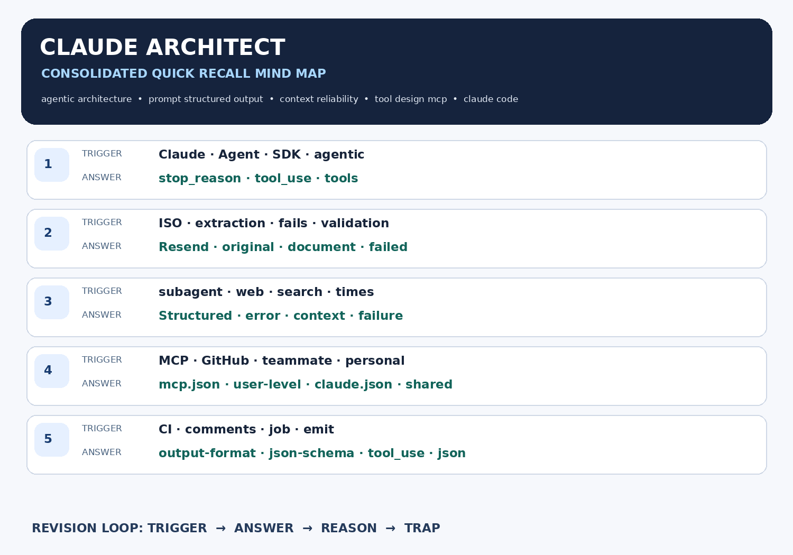
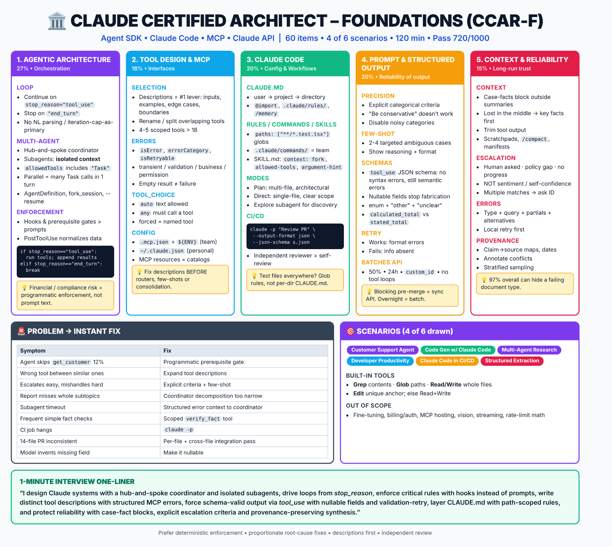
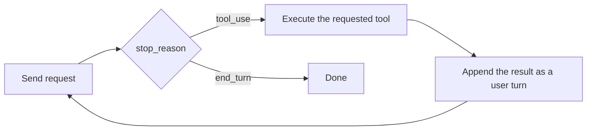
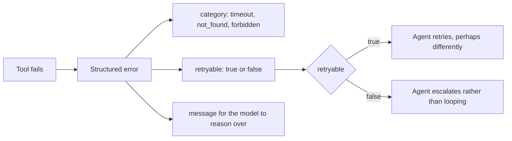

# 🏛️ Claude Certified Architect – Foundations (CCAR-F)




[Open the answer PDF](docs/claude_architect_answers.pdf)





<!-- REVISION-PRIORITIES:START -->
## Revision priorities

The objectives most worth drilling, with the practice questions that cover each. Work from the top; revisit the rest lightly.

| Objective | Key recall | Practice question IDs |
|---|---|---|
| Orchestration safeguards: every session ends resolved or escalated | Wrap the loop in orchestration code; every exit path (end_turn, iteration cap, max_tokens, tool failure, timeout, exception) ends in a resolution or a human escalation with a handoff package. The cap is a safety net, not the primary stop. | 272-276 |
| Iterative refinement workflows | Concrete input/output examples beat prose; test-first then feed specific failures; batch interacting issues in one message, fix independent ones sequentially; interview pattern for unclear requirements. | 285-289 |
| Enforce via settings/hooks vs advise in CLAUDE.md | CLAUDE.md is advisory context; settings permissions (deny rules) and hooks are deterministic. Anything that must always or never happen goes in hooks/permissions; conventions go in CLAUDE.md. | 290-293 |
| Project context: @ references vs CLAUDE.md vs inline | Reusable cross-session, team-wide → CLAUDE.md (import files with @). Specific file for this task → @ reference in the prompt. One-off detail → inline. Keep CLAUDE.md modular with @ imports or path-scoped rules. | 299-302 |
| Escalation decision criteria | Explicit human request → escalate immediately (no investigation first). Frustration alone → acknowledge and offer help, escalate if reiterated. Policy gap or no progress → escalate. Multiple matches → ask for identifiers. Sentiment and self-reported confidence are unreliable triggers. | 303-307 |
| Structured output method; tool_use + tool_choice guarantee | tool_use + JSON schema = strongest compliance (syntax, not semantics). tool_choice: auto (may reply in text) · any (must call a tool, model chooses) · {type:tool,name} (that tool) · none. Forced choice = no preamble. | 312-318 |
| tool_choice and multi-tool sequencing | Prerequisite order for consequential workflows is enforced programmatically (gate or hook), optionally forcing the first tool via tool_choice then returning to auto. Prompt order is probabilistic. | 319-321 |
| Extraction schemas: optional, nullable, enums | Required fields force fabrication → make fields optional/nullable. Enums get 'other' + detail and 'unclear'. Schemas fix syntax, not semantics. | 308-311 |
| Codebase exploration with Grep, Glob, Read | Grep = search contents (callers, error strings); Glob = match file paths; Read = open a file. Build understanding incrementally: Grep entry points → Read → follow imports; subagents for verbose discovery; scratchpad notes. | 322-324 |
| Stateless API and conversation history | Messages API is stateless: send the full relevant history every request. Keep canonical history server-side; append assistant tool_use turn then user tool_result turn; never let clients forge roles. | 325-327 |
| Tool descriptions and MCP integration | Descriptions are the selection mechanism: purpose, input formats, examples, edge cases, when to use vs similar tools. MCP: project .mcp.json with ${ENV_VAR}, personal ~/.claude.json, verify discovery with /mcp. | 328-330 |
| Session resumption and re-analysis | --resume a named session, then tell the agent exactly which files changed for targeted re-analysis; if tool results are stale, start fresh with an injected summary; fork_session to branch from a baseline. | 278-280 |
| Configuration mechanism, commands and plan mode | CLAUDE.md = always-on standards; .claude/rules + paths glob = file-type conventions; skills = on-demand workflows; hooks = deterministic; settings = access. Commands: .claude/commands (shared) vs ~/.claude/commands (personal). Plan mode for big/ambiguous/multi-approach; direct for small, clear, reversible. | 294-298 |
| Dynamic task decomposition | Open-ended work: generate subtasks adaptively (map structure, prioritise, revise as findings arrive). Fixed chains only when steps are predictable. | 281-282 |
| Structured handoff packages | Handoff = customer ID, root cause, actions taken, amounts, authorization state, recommended next action. The human has no transcript. | 277-277 |
| PreToolUse / PostToolUse hooks for business rules | PreToolUse blocks or redirects before the call (refund limits); PostToolUse transforms or checks after (normalise data, format, lint, tests). Deterministic, not model discretion. | 283-284 |

<!-- REVISION-PRIORITIES:END -->

## Consolidated Mind Map

```text
CLAUDE ARCHITECT — FOUNDATIONS
  ├─ Agentic Architecture 27%
  │     stop_reason loop · hub-and-spoke · Task + allowedTools · hooks over prompts · fork_session / --resume · tool_result per tool_use_id
  ├─ Tool Design & MCP 18%
  │     descriptions first · isError + category + retryable · scoped tools · tool_choice · .mcp.json vs ~/.claude.json · Prompt/Tool/Resource
  ├─ Claude Code 20%
  │     CLAUDE.md hierarchy · .claude/rules paths · commands & skills · plan vs direct · claude -p --json-schema
  ├─ Prompt & Structured Output 20%
  │     explicit criteria · few-shot · tool_use schema · nullable fields · validation-retry · Batches API
  ├─ Context & Reliability 15%
  │     case-facts block · escalation triggers · error propagation · provenance & conflicts · stratified sampling
  ├─ Score-report priorities (added)
  │     orchestration safeguards · escalation criteria · tool_choice · tool sequencing · enforce vs CLAUDE.md · project context · iterative refinement · nullable schemas
  ├─ CI/CD Onboarding (added)
  │     static → security → AI review → tests → human gate · risk-based approval · prompt-injection safe · independent reviewer · no self-approval
  ├─ API & SDK basics (added)
  │     AsyncAnthropic · 429 retries · cache breakpoints · temperature · eval graders · MCP client/Inspector · computer use · 4Ds
  └─ Decision loop
      ├─ Trigger: identify the scenario constraint
      ├─ Answer: recall the source-backed technical choice
      ├─ Reason: connect choice to behavior or requirement
      └─ Trap: reject a distractor that conflicts with the requirement
```

## Four-keyword recall cards

| Domain | Question trigger (max 4) | Answer recall (max 4) | Reason — why it works | Trap — what to reject |
|---|---|---|---|---|
| ★ Orchestration safeguards | session · ends · loop · cap | resolve · or · escalate · always | Every exit path (end_turn, iteration cap, max_tokens, tool failure, timeout) must end in a resolution or human escalation with a handoff package. Guarantee it in orchestration code; the cap is a safety net, not the primary stop. max_tokens = incomplete, never final. | Trap: Return the last text when the cap fires |
| ★ Escalation criteria | customer · wants · human · agent | escalate · immediately · no · investigation | Explicit human request: honour immediately. Frustration alone: acknowledge, offer help, escalate if reiterated. Policy gap or no progress: escalate. Several matches: ask for an identifier. Sentiment/self-confidence are unreliable triggers. | Trap: Try tools first, escalate only if they fail |
| ★ tool_choice | answers · text · pipeline · breaks | tool_choice · forced · tool · name | auto may reply in text; any must call some tool (model picks); {type:tool,name} forces that tool; none = no tools. Forced = no preamble. Tool use + schema fixes syntax, not semantics. | Trap: tool_choice auto or temperature 0 |
| ★ Tool sequencing | get_customer · before · refund · order | gate · hook · force · first | Prerequisite order with consequences is enforced programmatically (gate/hook); force the first tool via tool_choice once, then back to auto. Prompt order is probabilistic. | Trap: Prompt line asking Claude to call it first |
| ★ Enforce vs advise | never · edit · migrations · ignored | permissions · PreToolUse · hook · deny | CLAUDE.md is advisory context. Anything that must always/never happen goes in settings permissions or hooks (PreToolUse blocks, PostToolUse formats/lints/tests). Conventions stay in CLAUDE.md. | Trap: Make the CLAUDE.md sentence bold |
| ★ Project context | conventions · every · session · team | CLAUDE.md · @ · import · inline | Reusable cross-session → project CLAUDE.md (@ imports keep it modular). One specific file this task → @ reference in the prompt. One-off detail → inline. File-type conventions → path-scoped .claude/rules. | Trap: Paste it into every prompt |
| ★ Iterative refinement | output · inconsistent · prose · fails | examples · tests · batch · interview | 2-3 concrete input/output examples beat prose. Tests first, then feed specific failures. Interacting issues in one message; independent issues sequentially. Interview pattern for unclear requirements. | Trap: 'Make it better' or higher temperature |
| ★ Nullable schemas | required · field · invented · values | nullable · optional · other · unclear | Required fields force fabrication. Make fields nullable/optional; enums get 'other' + detail and 'unclear'; add normalisation rules and few-shot examples. Schema fixes syntax, validation checks semantics. | Trap: 'Never lie' prompt line |
| ★ Resume & explore | resume · files · changed · stale | --resume · inject · fork_session · Grep | Resume then tell the agent which files changed (targeted re-analysis); stale results → fresh session with injected summary; fork_session for divergent approaches. Explore: Grep content, Glob paths, Read files, incrementally, subagents for verbose discovery. | Trap: Resume silently or re-read everything |
| ★ Stateless API | API · history · browser · roles | stateless · resend · server-side · canonical | The Messages API keeps no state; send the relevant history each request. Keep canonical history server-side; untrusted clients must not forge roles or assistant turns. Tool loop: assistant tool_use turn then user tool_result turn. | Trap: Trust the browser's messages array |
| 1 Agentic loop | Claude · Agent · SDK · agentic | stop_reason · tool_use · tools | Continue while stop_reason is tool_use, stop on end_turn; append tool_result to history each turn. Text-block checks, phrase parsing and a primary iteration cap are anti-patterns. | Trap: The assistant message contains any text content block |
| 1 Enforcement | refund · skipped · 12% · identity | hook · prerequisite · gate · programmatic | Non-zero failure rate plus financial or compliance impact needs deterministic enforcement (hooks, gates), not a stronger prompt. | Trap: A friendlier system-prompt reminder |
| 1 Multi-agent | report · misses · topic · areas | coordinator · decomposition · too · narrow | Hub-and-spoke: the coordinator decomposes, delegates, aggregates. Subagents inherit nothing, so pass full findings; Task must be in allowedTools; parallel = several Task calls in one response. | Trap: Blame the subagents' search quality |
| 2 Tool selection | wrong · tool · similar · descriptions | expand · descriptions · boundaries · examples | Descriptions are the primary selection mechanism. Fix vague or overlapping tools first, before routers, few-shot or consolidation. | Trap: Add a routing layer first |
| 2 MCP errors | tool · fails · retry · loop | isError · category · isRetryable · message | Return structured errors so the agent can decide retry, reroute or escalate. A business-rule violation is non-retryable. Valid empty result is not an access failure. | Trap: Generic 'operation failed' string |
| 2 MCP scope & primitives | MCP · personal · shared · button | .mcp.json · ~/.claude.json · Prompt · Tool | Project .mcp.json (with ${ENV_VAR}) is shared; ~/.claude.json is personal. Primitives: Prompt = user-controlled, Tool = model-controlled, Resource = application-controlled. | Trap: Personal server committed in .mcp.json |
| 3 CLAUDE.md & rules | teammate · rules · missing · conventions | project · CLAUDE.md · rules · paths | User ~/.claude/CLAUDE.md is not shared. Project CLAUDE.md or .claude/rules/ with glob paths load conditionally and suit conventions spanning many directories. | Trap: Put team rules in the user-level file |
| 3 Plan vs direct | migration · files · approaches · stack | plan · mode · explore · subagent | Plan mode for large, ambiguous or multi-approach work; direct execution for a single-file fix with a clear trace. Explore subagent isolates verbose discovery. | Trap: Plan mode for a one-line fix |
| 3 CI usage | CI · hangs · output · parse | claude -p · output-format · json-schema | -p is non-interactive; --output-format json with --json-schema gives machine-readable output. CLAUDE_HEADLESS and --batch do not exist. | Trap: Pipe interactive session and scrape colours |
| 3 Repo config map | tool · referenced · CLAUDE.md · authorised | settings.json · .mcp.json · verify · exists | CLAUDE.md and SKILL.md only reference tools; permissions live in .claude/settings.json, MCP in .mcp.json. CI verifies referenced tools exist and are not over-permitted. Approval: L1 docs/safe skills auto, L2 new skills/agents PR review, L3 new MCP/shell/permissions security. | Trap: Tool named in CLAUDE.md means it is authorised |
| 3 CI/CD onboarding | new · agent · PR · approval | validate · scan · test · human gate | Stages: static validation → security/compliance → AI review → tests → human approval for high-risk → merge. Risk-based: docs automated; new tools/MCP security review; production permissions mandatory human approval. | Trap: Merge automatically when checks are green |
| 3 CI/CD safety | PR · comments · untrusted · reviewer | prompt · injection · least · privilege | Outsider-authored PR text is data, not instructions. Limit tools and tokens, keep secrets out of context, use an independent review instance and never self-approve. | Trap: Ask Claude to ignore malicious comments |
| 4 Explicit criteria | false · positives · reviewer · trust | explicit · criteria · few-shot · disable | Concrete categorical criteria beat 'be conservative'. Disable a noisy category, fix, then re-enable. 2-4 targeted examples fix inconsistent format. | Trap: Tell the model to only report high confidence |
| 4 Structured output | extraction · invented · totals · schema | tool_use · nullable · validation · retry | tool_use + JSON schema removes syntax errors, not semantic ones. Nullable fields stop fabrication; retry with the error helps format problems, not missing source data. | Trap: Increase max_tokens |
| 4 Batch vs sync | pre-merge · overnight · cost · SLA | Batches · 50% · 24h · custom_id | Message Batches: half price, up to 24 h, no latency SLA, no mid-request tool loops. Blocking checks use the synchronous API. | Trap: Batch API for a blocking merge check |
| 5 Context facts | long · session · amounts · lost | case-facts · block · summaries · trim | Progressive summaries lose numbers and dates. Keep a case-facts block, trim tool output, put key findings at the start. | Trap: Rely on one rolling summary |
| 5 Escalation | customer · human · sentiment · confidence | explicit · request · policy · gap | Escalate on request, policy gap or no progress. Sentiment and self-reported confidence are poor proxies. Hand off customer ID, root cause, amount and recommendation. | Trap: Escalate whenever sentiment is negative |
| 5 Provenance & review | 97% · accuracy · segment · sources | stratified · sampling · claim-source · conflicts | Overall accuracy hides weak segments, so sample by type and field. Keep claim→source mappings; annotate conflicts with both values and dates. | Trap: Pick the more recent figure silently |
| API 429 & caching | 429 · cache · hit · prefix | SDK · retries · cache_control · exact | SDKs auto-retry 429/5xx (default 2, honour retry-after). A cache breakpoint caches the prefix (tools→system→messages); dynamic data after it; up to 4 breakpoints. | Trap: Timestamp at the top of the cached prompt |
| Evals & temperature | grader · judge · temperature · tests | code · first · binary · low | Code graders first, then an LLM judge (distinct model, binary or 1-3 scale, reasoning before score), then human calibration. Low temperature for extraction/evals, 0.8-1.0 for creative. | Trap: Judge grades its own output on a 1-10 scale |
| MCP client & testing | MCP · client · test · stdio | initialize · list_tools · Inspector · stderr | Client = SDK + transport + initialize → list_tools → call_tool loop. Test with MCP Inspector or in-memory client/server; never print() to stdout on stdio servers. | Trap: Debug with print() on stdout |
| 4Ds & safe agents | delegate · describe · discern · diligence | Delegation · Description · Discernment · Diligence | Delegation decides whether AI is used, Description communicates, Discernment evaluates outputs (looping back to Description), Diligence covers transparency and accountability. Computer use and env inspection: sandbox, read-only first. | Trap: Ship AI output unreviewed and undisclosed |

## How to use this map

1. Read the trigger and identify the requirement or failure mode in the scenario.
2. Recall the answer keywords before looking at the explanation.
3. State why the answer works using the reason column.
4. Eliminate the trap because it conflicts with the scenario or source explanation.

## Source coverage

- Question bank: `questionBank_claude_architect.js`
- Questions in source bank: **331**
- Consolidated recall cards: **32**
- Recall cards are representative study aids derived from the supplied question bank, not an official exam blueprint.

---

### 📘 Interview & Exam Quick Reference (Agent SDK + Claude Code + MCP + Claude API)

**Exam facts:** 60 items · 4 scenarios drawn from a bank of 6 · 120 min · pass = scaled **720 / 1000** · $125 · valid 12 months.
The exam rewards **judgment about tradeoffs**: pick the *proportionate, root-cause* fix, and prefer **deterministic enforcement** over hopeful prompting.

**Practice simulator coverage:** expanded to 331 curated questions (211 core + 40 API/SDK/MCP recall + 21 CI/CD onboarding and repo config + 59 score-report revision) plus a refreshed 100-question priority set (`hotsQuestions`). The Hot 100 follows the official blueprint: Agentic Architecture 27, Tool Design & MCP 18, Claude Code 20, Prompt & Structured Output 20, and Context & Reliability 15. This is a preparation bank, not a representation of the live exam item count.

| # | Domain | Weight |
| - | ------ | ------ |
| 1 | Agentic Architecture & Orchestration | **27%** |
| 2 | Tool Design & MCP Integration | **18%** |
| 3 | Claude Code Configuration & Workflows | **20%** |
| 4 | Prompt Engineering & Structured Output | **20%** |
| 5 | Context Management & Reliability | **15%** |

**Scenarios (4 of 6 at random):** Customer Support Agent · Code Generation with Claude Code · Multi-Agent Research · Developer Productivity · Claude Code in CI/CD · Structured Data Extraction.

---

# 🤖 1. Agentic Architecture & Orchestration (27%)

### 🔑 Agentic loop (memorize)

```python
while True:
    resp = client.messages.create(model=M, tools=TOOLS, messages=msgs)
    msgs.append({"role": "assistant", "content": resp.content})
    if resp.stop_reason == "end_turn":      # terminate
        break
    if resp.stop_reason == "tool_use":      # continue
        results = [run(b) for b in resp.content if b.type == "tool_use"]
        msgs.append({"role": "user", "content": results})   # tool_result blocks
```

❌ **Anti-patterns:** parsing natural-language "I'm done", arbitrary iteration cap as the *primary* stop, treating "has text block" as completion.

### 🔑 Multi-agent (hub-and-spoke)

* **Coordinator** decomposes, delegates, aggregates, re-delegates gaps, routes *all* communication (observability + consistent error handling)
* **Subagents have isolated context**: they inherit nothing; put complete findings **in the prompt**
* **Task tool** spawns subagents → coordinator's `allowedTools` **must include `"Task"`**
* **Parallel subagents** = multiple `Task` calls in **one** coordinator response
* **AgentDefinition** = description + system prompt + tool restrictions
* Narrow decomposition ("creative industries" → only visual arts) is a **coordinator** root cause, not a subagent bug
* Pass **structured data** (claim, evidence, source URL, date) to preserve attribution

### 🔑 Enforcement vs guidance

| Need | Use |
| ---- | --- |
| Identity check before refund; refund cap | **Hooks / prerequisite gates** (deterministic) |
| Style, tone, soft preferences | Prompt instructions (probabilistic) |
| Normalize timestamps / status codes from many tools | **PostToolUse hook** |
| Block refund > $500 and escalate | Tool-call interception hook |

💡 **Exam Tip:** "Non-zero failure rate" in a prompt + financial/compliance consequence = **programmatic enforcement**.

### 🔑 Decomposition & sessions

* **Prompt chaining** (fixed passes) → predictable multi-aspect reviews
* **Dynamic decomposition** → open-ended investigation (map → prioritize → adapt)
* `--resume <name>` continues a session; if tool results are stale, **start fresh with an injected summary**
* `fork_session` → independent branches from a shared baseline (compare two approaches)
* Tell a resumed session **which files changed**

---

# 🧰 2. Tool Design & MCP Integration (18%)

* **Tool descriptions are the primary selection mechanism.** Fix vague/overlapping tools by expanding descriptions (inputs, examples, edge cases, boundaries) *first*, before routers, few-shots or consolidation
* Rename/split overlapping tools (`analyze_document` → `extract_data_points`, `summarize_content`, `verify_claim_against_source`)
* Watch for **keyword-sensitive system prompts** overriding good descriptions
* **Error responses:** MCP `isError` + `errorCategory` (transient / validation / business / permission) + `isRetryable` + human-readable message
* Business-rule violation → `retriable: false` + customer-friendly explanation
* **Valid empty result ≠ access failure** (never return failure as empty success)
* **Scoped tools:** 4-5 role tools beat 18; synthesis agent gets a scoped `verify_fact`, complex cases still go through the coordinator
* **`tool_choice`:** `auto` (may return text) · `any` (must call *a* tool) · forced `{"type":"tool","name":"..."}` (must call *that* tool)

### 🔑 MCP configuration

| Scope | File | Use |
| ----- | ---- | --- |
| Project (shared, versioned) | `.mcp.json` with `${GITHUB_TOKEN}` expansion | Team tooling, no committed secrets |
| User (personal) | `~/.claude.json` | Experimental servers |

* All configured servers' tools are discovered at connection and available **simultaneously**
* **MCP resources** expose catalogs (schemas, issue lists, doc trees) to cut exploratory calls
* Prefer **community MCP servers** for standard integrations (Jira); custom only for team-specific workflows
* Rich MCP tool descriptions stop the agent preferring built-in `Grep`

### 🔑 Built-in tools

| Tool | Use |
| ---- | --- |
| **Grep** | Search file **contents** (callers, error strings, imports) |
| **Glob** | Match file **paths** (`**/*.test.tsx`) |
| **Read / Write** | Whole-file operations |
| **Edit** | Targeted change via unique anchor; if non-unique → **Read + Write** |
| **Bash** | Commands |

Build understanding incrementally: Grep entry points → Read to follow imports.

---

# 💻 3. Claude Code Configuration & Workflows (20%)

### 🔑 CLAUDE.md hierarchy

* **User** `~/.claude/CLAUDE.md` – personal, **not shared** (classic "new teammate isn't getting rules" bug)
* **Project** `.claude/CLAUDE.md` or root `CLAUDE.md` – shared via git
* **Directory** – subdirectory-scoped
* `@import` keeps it modular; `.claude/rules/*.md` splits topics; `/memory` shows what's loaded

### 🔑 Path-specific rules

```yaml
---
paths: ["**/*.test.tsx"]
---
Use React Testing Library; one behavior per test.
```

Glob rules beat per-directory CLAUDE.md when conventions span **many directories** (tests next to source). Loads only when editing matching files.

### 🔑 Commands & skills

| Item | Location | Notes |
| ---- | -------- | ----- |
| Team slash command | `.claude/commands/` | Shared via version control |
| Personal command | `~/.claude/commands/` | Not shared |
| Skill | `.claude/skills/<name>/SKILL.md` | `context: fork`, `allowed-tools`, `argument-hint` |
| Personal skill variant | `~/.claude/skills/` (different name) | Doesn't affect teammates |

* **Skill** = on-demand task workflow · **CLAUDE.md** = always-on universal standards
* `context: fork` isolates verbose output from the main conversation

### 🔑 Plan mode vs direct execution

| Plan mode | Direct execution |
| --------- | ---------------- |
| Monolith→microservices, 45+ file migration, multiple valid approaches | Single-file fix with clear stack trace, add one validation |

Combine: **plan** to investigate → **execute** to implement. **Explore subagent** isolates verbose discovery.

### 🔑 Iterative refinement

* 2-3 **input/output examples** beat prose when interpretation is inconsistent
* **Test-driven iteration**: write tests, share failures
* **Interview pattern**: Claude asks questions to surface unconsidered concerns
* Interacting problems → one message; independent problems → sequential

### 🔑 CI/CD

```bash
claude -p "Review this PR" --output-format json --json-schema schema.json
```

* `-p/--print` = non-interactive (no hang). `CLAUDE_HEADLESS` and `--batch` **do not exist**
* CLAUDE.md supplies testing standards/fixtures/review criteria to CI runs
* Re-reviews: include prior findings, report only **new/unaddressed**
* **Independent review instance** > self-review (generator keeps its reasoning context)

---

# 🎯 4. Prompt Engineering & Structured Output (20%)

* **Explicit categorical criteria** > "be conservative" / "only high confidence" (these don't improve precision)
* High false-positive categories erode trust in good ones → **temporarily disable**, fix, re-enable
* **Severity levels** need concrete code examples
* **Few-shot (2-4 targeted examples)** = best fix for inconsistent format & ambiguous cases; shows *why* one action beat alternatives; generalizes judgment
* **`tool_use` + JSON schema** = most reliable structured output (kills **syntax** errors, **not semantic** errors)
* **Nullable/optional fields** when source may lack data → prevents fabricated values
* Enum + `"other"` + detail string; add `"unclear"`
* **Validation-retry:** send document + failed extraction + specific error. Works for **format/structure** problems; **useless when info is absent** from the source
* `calculated_total` vs `stated_total`, `conflict_detected`, `detected_pattern` (analyze dismissals)

### 🔑 Message Batches API

* **50% cheaper · up to 24 h · no latency SLA · `custom_id` correlation · no mid-request tool loops**
* ✅ overnight reports, weekly audits, nightly test generation
* ❌ blocking pre-merge checks → use synchronous API
* Failures: resubmit only failed `custom_id`s (chunk oversized docs); tune prompt on a **sample** first
* SLA math: 24 h batch + 4 h submit window = 28 h → fits a 30 h SLA

### 🔑 Multi-pass review

14-file PR inconsistent? → **per-file local passes + a cross-file integration pass** (attention dilution). Bigger context window ≠ better attention. Majority-vote of 3 runs suppresses real bugs.

---

# 🧠 5. Context Management & Reliability (15%)

* **Progressive summarization** loses numbers/dates/expectations → keep a **case-facts block** (amounts, dates, IDs, statuses) outside summaries
* **Lost in the middle:** key findings at the **start**, section headers for detail
* **Trim tool output** (40 order fields → the 5 you need)
* Upstream agents return **structured facts + citations**, not verbose reasoning
* **Escalate** when: customer asks for human (**immediately**) · policy gap/silent · no progress. **Not** on sentiment or self-reported confidence (poor proxies)
* Multiple customer matches → **ask for identifiers**, don't guess
* Frustrated but solvable → acknowledge, offer resolution, escalate only if they insist
* **Structured handoff:** customer ID, root cause, amount, recommended action (humans lack the transcript)
* **Error propagation:** failure type + attempted query + partial results + alternatives. Local retry of transients first. Anti-patterns: generic "unavailable", silent empty success, killing the whole workflow
* **Large codebases:** scratchpad files, subagent delegation, `/compact`, **crash-recovery manifests**
* **Human review:** 97% overall accuracy can hide weak segments → **stratified sampling** + accuracy by document type/field; field-level confidence calibrated on labeled sets
* **Provenance:** keep claim→source mappings through synthesis; **annotate conflicts** (both values + sources); require **dates** so time differences aren't "contradictions"; render financial data as tables, news as prose

---

# 🚨 Problem → Instant Fix Map

| Symptom | Fix |
| ------- | --- |
| Agent skips `get_customer` 12% of time | Programmatic prerequisite gate |
| Wrong tool chosen between similar tools | Expand tool descriptions |
| Escalates easy / handles hard cases | Explicit criteria + few-shot |
| Report misses whole topic areas | Coordinator decomposition too narrow |
| Subagent times out | Structured error context to coordinator |
| Synthesis needs frequent fact checks | Scoped `verify_fact` tool |
| CI job hangs | `claude -p` |
| Batch for blocking check? | No: sync API; batch for overnight |
| Inconsistent PR review | Per-file + integration passes |
| Test files everywhere need same rules | `.claude/rules/` with glob `paths` |
| Totals don't sum | Semantic validation (`calculated_total`) |
| Model invents missing field | Make field nullable |

---


Task statements per domain, condensed from section 6 of the guide:

**Domain 1: Agentic Architecture & Orchestration (27%)**

1.1 Design and implement agentic loops for autonomous task execution. 1.2 Orchestrate multi-agent systems with coordinator and subagent patterns. 1.3 Configure subagent invocation, context passing, and spawning. 1.4 Implement multi-step workflows with enforcement and handoff. 1.5 Apply Agent SDK hooks for tool call interception. 1.6 Design task decomposition strategies. 1.7 Manage session state, resumption, and forking.

**Domain 2: Tool Design & MCP Integration (18%)**

2.1 Design tool interfaces with clear descriptions. 2.2 Implement structured error responses for MCP tools. 2.3 Distribute tools across agents and configure tool access. 2.4 Integrate MCP servers into Claude Code and agent workflows. 2.5 Select and apply the built-in tools (Read, Write, Edit, Bash, Grep, Glob).

**Domain 3: Claude Code Configuration & Workflows (20%)**

3.1 Configure CLAUDE.md hierarchy and scoping. 3.2 Create custom slash commands and skills. 3.3 Apply path-specific rules for conditional convention loading. 3.4 Choose between plan mode and direct execution. 3.5 Apply iterative refinement techniques. 3.6 Integrate Claude Code into CI/CD pipelines.

**Domain 4: Prompt Engineering & Structured Output (20%)**

4.1 Design prompts with explicit criteria. 4.2 Apply few-shot prompting for consistency. 4.3 Enforce structured output using tool use and JSON schemas. 4.4 Implement validation, retry, and feedback loops for extraction. 4.5 Design batch processing strategies. 4.6 Design multi-instance and multi-pass review architectures.

**Domain 5: Context Management & Reliability (15%)**

5.1 Manage conversation context to preserve critical information. 5.2 Design escalation and ambiguity resolution patterns. 5.3 Implement error propagation across multi-agent systems. 5.4 Manage context in large codebase exploration. 5.5 Design human review workflows and confidence calibration. 5.6 Preserve information provenance and handle uncertainty.

## Quick notes


| Scenario | What it forces you to know |
| --- | --- |
| Support resolution agent | Agent loop design, MCP tool boundaries (get_customer, process_refund), when to escalate versus resolve, least privilege on refund-class tools |
| Claude Code for development | CLAUDE.md hierarchy, slash commands, plan mode versus direct execution, iterative refinement |
| Multi-agent research | Coordinator and subagent orchestration, context passing, provenance and citation preservation, error propagation |
| Developer productivity tooling | Built-in tool selection (Read, Write, Bash, Grep, Glob), MCP server integration, codebase-scale context management |
| Claude Code in CI/CD | Headless mode (-p, --output-format json, --json-schema), review prompts with explicit criteria, false-positive control, multi-pass review |
| Structured data extraction | tool_use with JSON schemas, validation-retry loops, optional and nullable fields, batch processing |

## Supplemental recall notes (API, SDK and MCP client basics)

Added from the AI Mode recall transcript; practice questions 211-250 cover these; questions 251-271 cover CI/CD onboarding and repo configuration (below); questions 272-330 are score-report revision drills.

| Topic | Remember |
|---|---|
| Async SDK | `Anthropic` vs `AsyncAnthropic`; Agent SDK `query()` returns an async iterator of messages |
| MCP client | MCP SDK + transport (stdio local, Streamable HTTP remote) + `initialize()` -> `list_tools()` -> tool-use loop -> `call_tool()` |
| Testing a server | MCP Inspector (`npx @modelcontextprotocol/inspector`, `mcp dev server.py`, needs Node); in-memory client/server for CI; never `print()` to stdout on stdio servers |
| Why MCP | Removes hand-built wrappers/schemas per app (M x N); server owns tool definitions, client discovers them |
| Primitives | **Prompt** = user-controlled (buttons) · **Tool** = model-controlled · **Resource** = application-controlled; `docs://documents/{doc_id}` = resource template |
| File tools | Resolve path and enforce base dir (path traversal); bytes become blobs |
| Tool function vs definition | Definition = schema Claude sees; function = your code that runs; result returns as `tool_result` |
| Message shape | `content` is a list; text + `tool_use` is normal; check `stop_reason`; keep full `response.content` in history; return one `tool_result` per `tool_use_id`; `tool_choice` any/tool skips preamble |
| Batch tool vs Batches API | Batch tool = parallel independent calls in a live loop; Message Batches API = offline, 50% cheaper, 24 h |
| Retries | SDK auto-retries 429/408/409/5xx (default 2) honouring retry-after; `max_retries` to change; then handle `RateLimitError` |
| Prompt caching | `cache_control` breakpoint caches the prefix (tools -> system -> messages); up to 4; exact prefix match; dynamic data after it; write ~1.25x, hit ~0.1x; check usage fields |
| Temperature | Low for extraction/classification/evals; 0.8-1.0 for creative; extended thinking needs 1.0 |
| Evals | Balanced 10-20 starter cases; code graders first, LLM judge (distinct model, binary/1-3 scale, reasoning first) second, human calibration |
| Computer use | Screenshot -> action -> screenshot loop; sandbox it; prompt-injection risk |
| Environment inspection | Read-only look-before-you-leap; mask secrets; bound output |
| 4Ds of AI Fluency | Delegation, Description, Discernment, Diligence (description-discernment loop) |

## CI/CD onboarding of Claude workflows and agents (quick notes)

Pattern: **automated validation with human oversight**, not manual review of everything and not autonomous self-approval.

| Stage | What runs | Tooling examples |
|---|---|---|
| 1 Static validation | YAML syntax, agent config schema, prompt structure, duplicate config | yamllint, actionlint, Python scripts |
| 2 Security & compliance | tool permissions, secret detection, MCP server checks, least privilege, untrusted-input checks | Gitleaks, OPA / Conftest |
| 3 AI-powered review | Claude reviews instructions, scope, prompt-injection risk (independent instance) | Claude Code Action, `claude -p --output-format json --json-schema` |
| 4 Automated tests | unit, integration, agent-behaviour tests (assert tool calls and schema, rubric-graded quality) | Claude Agent SDK, eval set |
| 5 Human approval | required for high-risk changes | CODEOWNERS / required reviewers |

| Change category | Approval |
|---|---|
| Documentation-only | Automated |
| Prompt improvements | Automated tests + review |
| New agent definition | Automated validation + PR review |
| New tools or MCP access | Security review |
| Production permissions | Mandatory human approval |

Always human-approved: agents with production infrastructure or deployment write access, new MCP/external connections, arbitrary shell execution, changed permission boundaries, anything exposing secrets. Green checks do not remove that requirement. "Automate 80-90% of routine validation" is a target, not a measured benchmark. Outsider-authored PR text is untrusted input (prompt injection): least-privilege tokens, scoped tools, no secrets in context, no self-approval by the authoring instance. Keep `CLAUDE.md`, `.claude/agents/` and `.github/workflows/` in version control and change them only through pull requests.

### Where tools and capabilities are defined (and validated in CI)

Mentioning a tool in `CLAUDE.md` or a skill does **not** mean it is installed, configured or authorised. CI must verify referenced tools actually exist and that access is not excessive.

| Location | Purpose | CI/CD validation |
|---|---|---|
| `CLAUDE.md` | Project instructions, tool usage guidance, rules | Validate instructions and references |
| `.claude/skills/<name>/SKILL.md` | Reusable skills and workflows (`context: fork`, `allowed-tools`, `argument-hint`) | Validate structure, frontmatter and metadata |
| `.claude/agents/` | Custom agent definitions | Validate frontmatter, configuration and tool permissions |
| `.claude/settings.json` | Tool permissions and configuration | Security and permission checks (detect excessive access) |
| `.mcp.json` | MCP server definitions (`${ENV_VAR}` for secrets) | Validate server configuration, access and no committed secrets |
| `.claude/commands/` | Custom slash commands | Validate command definitions |
| `.github/workflows/` | The validation pipeline itself (for example `claude-validation.yml`) | actionlint; path-filtered trigger on the files above |

```text
my-project/
├── CLAUDE.md
├── .mcp.json
├── .claude/
│   ├── settings.json
│   ├── agents/    (code-reviewer.md, security-reviewer.md)
│   ├── skills/    (code-review/SKILL.md, deployment/SKILL.md)
│   └── commands/  (deploy.md)
└── .github/workflows/claude-validation.yml
```

**Three approval levels**

| Level | Approval | Typical changes |
|---|---|---|
| 1 | Auto-approve | Documentation changes, safe skill updates |
| 2 | PR review | New skills, new agents, changes to tool usage |
| 3 | Security approval | New MCP servers, external integrations, shell execution, expanded permissions |

Trigger the pipeline on pull requests touching `CLAUDE.md`, `.claude/**` or `.mcp.json`. Validation differs by artifact: skills (SKILL.md structure and metadata), agents (frontmatter, tool list, permissions), MCP (server config and security), plus AI-assisted instruction review. Clarify scope first: skills, agents, MCP tools, or all three, since each needs different rules.

## The agentic loop, precisely



The details that distinguish right answers: tool results go back as part of the conversation history so the model can reason over them; loop termination needs an explicit condition beyond hoping for end_turn; hooks (for example PostToolUse) intercept tool calls for validation, logging, or blocking; subagents are spawned for delegation and context isolation, with allowedTools scoping what each may touch.

## MCP tool design rules of thumb

- A tool description is the interface contract; write it so the model can choose correctly between similar tools on the first try.
- Errors are data: return structured error responses with a category and a retryable flag, and use the isError flag rather than burying failure in prose. The model can only recover from errors it can interpret.
- Distribute tools by role: the agent that drafts replies does not need process_refund. Removing a capability entirely beats guarding it.
- Configuration lives in .mcp.json, including environment variable expansion for secrets.

## Claude Code configuration, the testable surface

- CLAUDE.md hierarchy: user level, project level, directory level; more specific wins. Path-scoped conventions go in .claude/rules/ with YAML frontmatter, loading only when matching files are touched.
- Custom commands in .claude/commands/; Skills in .claude/skills/ with SKILL.md frontmatter, where context: fork, allowed-tools, and argument-hint are the options the guide names.
- Plan mode for work you want reviewed before execution, direct execution for well-understood changes. /compact manages long sessions, --resume and fork_session manage session state.
- CI usage is non-interactive: -p or --print, --output-format json, and --json-schema to force machine-readable review output.

## Structured output patterns

- Enforce shape with tool_use plus a JSON schema rather than asking nicely for JSON. tool_choice can force the tool call.
- Schema design is judgment: required fields for what must exist, nullable or optional for what may not, enums plus an "other" with a detail string for open sets.
- The reliability loop: validate (Pydantic or equivalent), feed validation errors back, retry; measure error rates with a labeled sample rather than trusting spot checks; attach confidence and route low-confidence extractions to human review.
- Bulk work goes through the Message Batches API: half cost, 24-hour window, custom_id correlation, and no multi-turn tool calling inside a batch.

## Context and reliability

**What a failing tool should return.** The shape of an error decides whether
the agent can do anything useful with it.



A stack trace tells the agent nothing it can act on. A category and a retryable
flag let it decide, which is the difference between a loop that recovers and a
loop that spins.

- Long tasks: extract structured facts from verbose tool output as you go, keep a scratchpad file for durable state, and delegate subtasks to subagents so the main context stays clean. Beware lost-in-the-middle: critical facts belong at the edges of the window.
- Escalation is a design decision made in advance: policy gaps, explicit customer requests, and inability to progress are escalation triggers; everything else resolves autonomously with logging.
- In multi-agent systems, errors must propagate with enough context for the coordinator to decide retry, reroute, or abort; provenance (which source said what) survives handoffs only if you design for it.

## Recall list

60 questions across 4 of 6 published scenarios, 120 minutes, 720 of 1,000 to pass, $125 list (was $99 before June 30, 2026), counts toward partner tier, pre-migration failed attempts cleared, credential valid 12 months with free renewal.

---

## The six exam scenarios

> [!TIP]
> This is the largest preparation advantage available on any of the four exams: the scenarios are published in advance, and four of these six frame every question you will see. Rehearse each one until its likely questions are predictable.

Four of these six published scenarios appear on each exam sitting, selected at random. Knowing them in advance is an unusual and significant preparation advantage.

| # | Scenario | Primary domains |
| :---: | --- | --- |
| 1 | Customer support resolution agent built on the Agent SDK, with MCP tools such as get_customer, lookup_order, process_refund, and escalate_to_human, targeting 80%+ first-contact resolution | 1, 2, 5 |
| 2 | Code generation with Claude Code: slash commands, CLAUDE.md configuration, plan mode versus direct execution | 3, 5 |
| 3 | Multi-agent research system: a coordinator delegating to search, analysis, synthesis, and report subagents producing cited reports | 1, 2, 5 |
| 4 | Developer productivity tooling on the Agent SDK using the built-in tools and MCP servers for codebase exploration and automation | 2, 3, 1 |
| 5 | Claude Code in CI/CD: automated code review, test generation, and pull request feedback with low false-positive prompting | 3, 4 |
| 6 | Structured data extraction from unstructured documents with JSON schema validation and downstream integration | 4, 5 |

## Technologies named in the appendix

The guide's appendix lists what may appear on the exam. Highlights worth studying deliberately:

- **Agent SDK:** agentic loops, stop_reason handling ("tool_use" versus "end_turn"), PostToolUse hooks, subagent spawning via the Task tool, allowedTools configuration
- **MCP:** servers, tools, resources, the isError flag, tool descriptions and distribution, .mcp.json, environment variable expansion
- **Claude Code:** the CLAUDE.md hierarchy (user, project, directory), .claude/rules/ with YAML frontmatter path scoping, .claude/commands/, .claude/skills/ with SKILL.md frontmatter (context: fork, allowed-tools, argument-hint), plan mode, /memory, /compact, --resume, fork_session, the Explore subagent
- **Claude Code CLI:** -p or --print for non-interactive use, --output-format json, --json-schema for structured CI output
- **API:** tool_use with JSON schemas, tool_choice options, max_tokens, system prompts
- **Message Batches API:** 50% cost savings, up to 24-hour window, custom_id correlation, no multi-turn tool calling
- **Supplemental (added):** AsyncAnthropic, MCP client/transport/Inspector, MCP primitives (prompt/tool/resource, resource templates), tool function vs definition, 429 retry behaviour, prompt cache breakpoints, temperature, eval graders, computer use, environment inspection, 4D AI Fluency
- **CI/CD onboarding (added):** staged pipeline, yamllint, actionlint, Gitleaks, OPA/Conftest, Claude Code Action, risk-based approval, prompt injection via PR content, independent reviewer
- **Supporting concepts:** JSON Schema design (required versus optional, enums, nullable fields, "other" plus detail patterns, strict mode), Pydantic validation-retry loops, few-shot prompting, prompt chaining, token budgets and lost-in-the-middle effects, scratchpad files, session management, and confidence scoring with calibration


# 🚫 Out of Scope (don't over-study)

Fine-tuning · API auth/billing · MCP hosting/infra · Claude internals · RLHF/Constitutional AI · embeddings/vector DBs · vision · streaming/SSE internals · pricing math · cloud-provider specifics · tokenization. *Conceptual* awareness of computer use, SDK 429 retries and prompt-cache breakpoints is now covered by a few supplemental questions (see Supplemental recall notes), but they are not blueprint domains.

---

# 🏁 Final Interview One-Liner

> “I design Claude systems with a hub-and-spoke coordinator and isolated subagents, drive loops off `stop_reason`, enforce critical business rules with hooks instead of prompts, write distinctive tool descriptions with structured MCP errors, force schema-valid output via `tool_use` with nullable fields and validation-retry, configure Claude Code through a layered CLAUDE.md plus path-scoped rules, and protect reliability with case-fact blocks, explicit escalation criteria, and provenance-preserving synthesis.”

✅ Optimized for the CCAR-F exam and real-world Claude architecture discussions.


---

## Practice bank and simulator files

- `questionBank_claude_architect.js` contains 331 multiple-choice questions with stable zero-based IDs, difficulty, official blueprint category, four options, answer index, and rationale.
- `hotsQuestions` contains 100 unique zero-based indices, weighted to the five official domains and ordered by priority. Keep these as array indices; if the bank is reordered, regenerate the list.
- `claude_architect_detailed_one_pager.png` is the companion visual quick reference for the five domains, scenario patterns, and root-cause fixes.
- The exam guide states 60 live exam items, four scenarios selected from a bank of six, 120 minutes, and a scaled passing score of 720/1000. The 331-question bank is supplemental practice content.

**Preparation approach:** prioritize the Hot 100, explain why each distractor is wrong, and practice selecting the smallest deterministic fix that addresses the actual failure. Then complete all remaining questions and review scenario-based questions by domain. The current official exam guide remains authoritative if exam details change.
