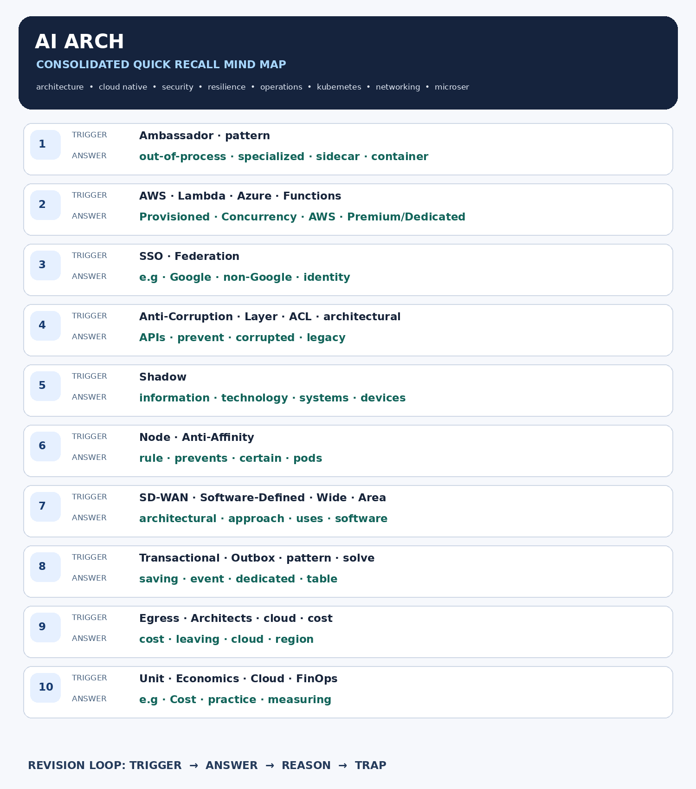

# 🤖 AI Architecture Interview & Exam Quick Reference




[Open the answer PDF](docs/AI_Arch_answers.pdf)


## Consolidated Mind Map

```text
AI ARCH
  ├─ Question domains
  │   ├─ architecture
  │   ├─ cloud native
  │   ├─ security
  │   ├─ resilience
  │   ├─ operations
  │   ├─ kubernetes
  │   ├─ networking
  │   ├─ microservices
  │   ├─ cloud cost
  │   ├─ finops
  │   ├─ ai engineering: EU · AI (cluster 1)
  │   ├─ scalability
  │   ├─ compliance
  │   ├─ governance
  │   └─ + 30 additional bank categories
  └─ Decision loop
      ├─ Trigger: identify the scenario constraint
      ├─ Answer: recall the source-backed technical choice
      ├─ Reason: connect choice to behavior or requirement
      └─ Trap: reject a distractor that conflicts with the requirement
```

## Four-keyword recall cards

| Question trigger (max 4) | Answer recall (max 4) | Reason — why it works | Trap — what to reject |
|---|---|---|---|
| Ambassador · pattern | out-of-process · specialized · sidecar · container | Similar to a sidecar, but specifically focused on network communication. The app talks to 'localhost', and the Ambassador handles the complex network calls. | Trap: A way to name your servers |
| AWS · Lambda · Azure · Functions | Provisioned · Concurrency · AWS · Premium/Dedicated | Provisioned Concurrency keeps a specified number of execution environments warm and ready to respond immediately. Azure's Premium plan provides 'Always On' instances and pre-warmed workers. | Trap: AWS S3 and Azure Blob Storage |
| SSO · Federation | e.g · Google · non-Google · identity | Federation allows a user to be authenticated by their 'Home' system (like a corporate AD) and then access 'External' systems (like AWS or Slack). | Trap: A group of people using the same password |
| Anti-Corruption · Layer · ACL · architectural | APIs · prevent · corrupted · legacy | The ACL acts as a translator. When a modern microservice talks to a 20-year-old monolith, the ACL ensures the monolith's messy domain model doesn't leak into the new service. | Trap: To automate the deletion of old logs |
| Shadow | information · technology · systems · devices | Shadow IT (like a team using their own Trello board) creates security risks because it's not monitored by the company's security team. | Trap: A way to name your servers |
| Node · Anti-Affinity | rule · prevents · certain · pods | If you have two replicas of a database, you use anti-affinity to ensure they are on different nodes, so a single node failure doesn't take down both. | Trap: A method for encrypting traffic |
| SD-WAN · Software-Defined · Wide · Area | architectural · approach · uses · software | SD-WAN allows businesses to securely connect branch offices to the cloud and each other using any combination of transport services (like MPLS, LTE, and broadband). | Trap: A very large network |
| Transactional · Outbox · pattern · solve | saving · event · dedicated · table | Since most databases and message brokers do not support distributed transactions (2PC) efficiently, the Outbox pattern uses a local DB transaction to ensure the event is saved if and only if the business data is saved. | Trap: By using a 2-phase commit (XA) across the DB and Broker |
| Egress · Architects · cloud · cost | cost · leaving · cloud · region | Most cloud providers (AWS/Azure) do not charge for 'Ingress' (data coming in), but charge per GB for 'Egress' (data going out). This can become massive for high-traffic public APIs or cross-region replication. | Trap: The cost of uploading data to the cloud |
| Unit · Economics · Cloud · FinOps | e.g · Cost · practice · measuring | Unit economics helps determine if cloud costs are scaling efficiently. If your total bill doubles but your users triple, your unit cost is actually improving. | Trap: The cost of one computer |

## How to use this map

1. Read the trigger and identify the requirement or failure mode in the scenario.
2. Recall the answer keywords before looking at the explanation.
3. State why the answer works using the reason column.
4. Eliminate the trap because it conflicts with the scenario or source explanation.

## Source coverage

- Question bank: `questionBank_AI_Arch.js`
- Questions in source bank: **571**
- Consolidated recall cards: **10**
- Recall cards are representative study aids derived from the supplied question bank, not an official exam blueprint.

---

### 📘 RAG • LLM Serving • Platform • Resilience • Security • Observability

---

# 1. GenAI Application Patterns

* **RAG**: retrieve relevant chunks → inject into the prompt → generate grounded answer (cheaper/fresher than retraining, citations possible). Pipeline: ingest → chunk → embed → index → retrieve (+rerank) → generate.
* **Vector Database**: stores embeddings for ANN search (HNSW/IVF); consider hybrid (BM25 + vector), metadata filters, index refresh.
* **LangGraph**: graph/state-machine orchestration for agents (nodes, edges, checkpoints, human-in-the-loop).
* **Guardrails**: input/output validation — PII redaction, topic/toxicity filters, schema validation, grounding checks.
* **Fine-tuning** changes behavior/style/format; **RAG** adds knowledge. Prefer prompt → RAG → fine-tune in cost order.
* **Prompt Injection**: untrusted text (user, documents, tool output) trying to override instructions → isolate untrusted content, least privilege tools, output filtering.
* **Token** = unit of cost/limit/latency; manage context size, caching, model tiering.

---

# 2. Serving & Platform

* **Model Serving**: managed endpoints vs self-hosted (vLLM/TGI); batching, streaming, autoscaling, quantization.
* **GPU**: scarce and costly → right-size, share (MIG), batch requests, scale to zero where possible.
* **LLMOps**: prompt/model versioning, eval suites, CI/CD, rollout gates, cost & quality monitoring, feedback loops.
* **Kubernetes**: orchestration; HPA/KEDA for scaling; **Karpenter** provisions right-sized nodes (incl. GPU) just-in-time and consolidates them.
* **Service Mesh** (Istio/Linkerd): mTLS, traffic shaping, retries, telemetry between services.

---

# 3. Resilience

* **Canary**: release to a small % first, auto-rollback on SLO breach (also for new model/prompt versions).
* **Multi-Region**: active-active/active-passive for availability & latency; plan data replication and failover (RTO/RPO).
* **Circuit Breaker**: stop calling a failing dependency (closed → open → half-open); pair with timeouts, retries with jitter, fallbacks (smaller model/cache).

---

# 4. Security & Governance

* **mTLS**: both sides authenticate with certificates (service-to-service).
* **Zero Trust**: never trust network location; authenticate, authorize and verify every request.
* **OIDC**: identity layer on OAuth 2.0 (ID tokens, SSO) for users and workloads.
* **Secrets Management**: vault/KMS, rotation, no secrets in prompts, images or git.
* **Data Residency**: keep data/inference in required jurisdictions (regional endpoints, region-pinned stores).
* **OWASP** Top 10 for LLM Apps: prompt injection, insecure output handling, data poisoning, model DoS, supply chain, sensitive information disclosure, excessive agency.

---

# 5. Observability & SLOs

* **Observability**: logs + metrics + traces (+ prompt/response sampling with PII controls, eval scores).
* **Latency**: time-to-first-token and total; track p50/p95/p99. **Throughput**: requests/sec, tokens/sec.
* **Distributed Tracing**: correlate gateway → retriever → model → tools with trace IDs (OpenTelemetry).

---

# 🚨 Problem → Fix

| Symptom | Fix |
| ------- | --- |
| Answers lack company knowledge | RAG |
| Hallucinated facts | Grounding + citations + guardrails |
| GPU cost spike | Batching, right-sizing, Karpenter, smaller model |
| Provider outage | Circuit breaker + fallback + multi-region |
| Bad new prompt in prod | Canary + eval gate + rollback |
| Doc contains "ignore instructions" | Isolate untrusted content, least privilege |
| Regulated data must stay in EU | Data residency controls |

> “I architect GenAI platforms with RAG on a vector store, guardrails and evals in an LLMOps pipeline, GPU-aware Kubernetes serving with canary releases and circuit breakers, zero-trust mTLS/OIDC security, and end-to-end tracing against latency and throughput SLOs.”
