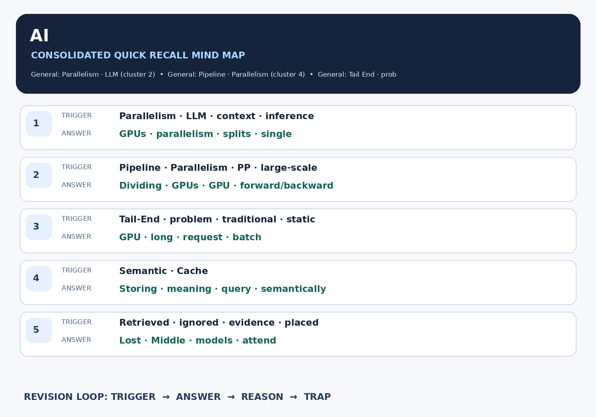

# AI



[Open the answer PDF](AI_answers.pdf)

---

## Consolidated Mind Map

```text
AI
  ├─ Question domains
  │   ├─ General: Parallelism · LLM (cluster 2)
  │   ├─ General: Pipeline · Parallelism (cluster 4)
  │   ├─ General: Tail End · problem (cluster 1)
  │   ├─ General: Semantic · Cache (cluster 3)
  │   ├─ ai engineering
  └─ Decision loop
      ├─ Trigger: identify the scenario constraint
      ├─ Answer: recall the source-backed technical choice
      ├─ Reason: connect choice to behavior or requirement
      └─ Trap: reject a distractor that conflicts with the requirement
```

## Four-keyword recall cards

| Question trigger (max 4) | Answer recall (max 4) | Reason — why it works | Trap — what to reject |
|---|---|---|---|
| Parallelism · LLM · context · inference | GPUs · parallelism · splits · single | Model parallelism (Tensor/Pipeline) is necessary when a model is too large for one GPU's VRAM. Data parallelism is used to scale throughput by serving identical model copies on separate GPUs. | Trap: Data parallelism splits the model; Model parallelism splits the users |
| Pipeline · Parallelism · PP · large-scale | Dividing · GPUs · GPU · forward/backward | PP allows models that are too large for one GPU's memory to be distributed. While it can introduce 'bubbles' (idle time), it is essential for models with hundreds of billions of parameters. | Trap: Splitting the data into different pipes |
| Tail-End · problem · traditional · static | GPU · long · request · batch | In static batching, the throughput is limited by the longest sequence. Continuous batching solves this by 'ejecting' finished requests and 'injecting' new ones mid-flight. | Trap: The GPU runs out of power at the end of the day |
| Semantic · Cache | Storing · meaning · query · semantically | Semantic caching saves money and time by not re-running the LLM for questions that have already been answered (e.g., 'What is 2+2?' vs 'Tell me 2 plus 2'). | Trap: Deleting data that doesn't make sense |
| Retrieved · ignored · evidence · placed | Lost · Middle · models · attend | Lost in the Middle: mitigate by ranking and placing key passages at the edges, trimming context or using reranking. | Trap: Catastrophic forgetting |

## How to use this map

1. Read the trigger and identify the requirement or failure mode in the scenario.
2. Recall the answer keywords before looking at the explanation.
3. State why the answer works using the reason column.
4. Eliminate the trap because it conflicts with the scenario or source explanation.

## Source coverage

- Question bank: `questionBank_AI.js`
- Questions in source bank: **391**
- Consolidated recall cards: **5**
- Recall cards are representative study aids derived from the supplied question bank, not an official exam blueprint.
