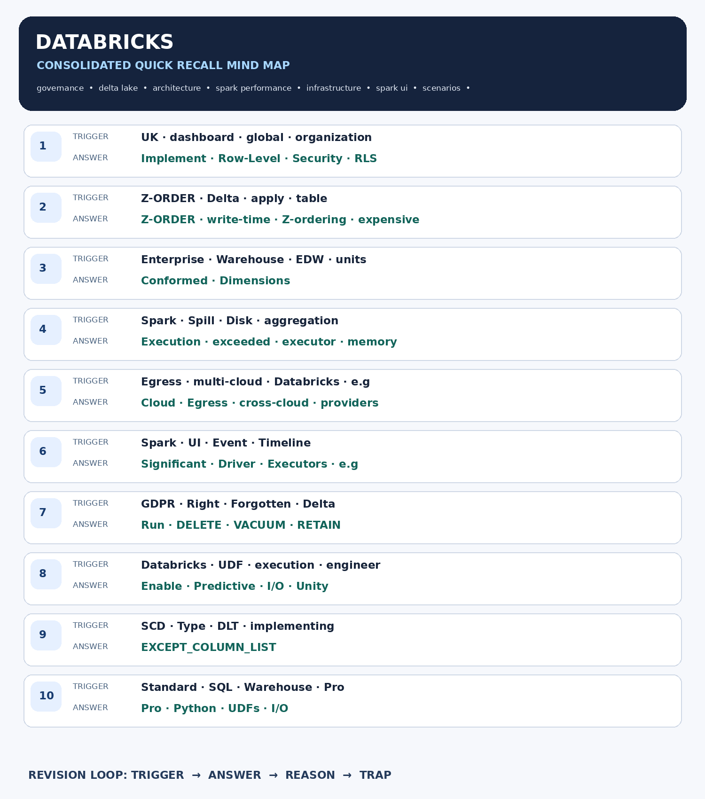

# 🚀 Databricks Medallion Architecture (Bronze → Silver → Gold)




[Open the answer PDF](docs/databricks_answers.pdf)


## Consolidated Mind Map

```text
DATABRICKS
  ├─ Question domains
  │   ├─ governance
  │   ├─ delta lake
  │   ├─ architecture
  │   ├─ spark performance
  │   ├─ infrastructure
  │   ├─ spark ui
  │   ├─ scenarios
  │   ├─ performance
  │   ├─ dlt
  │   ├─ db sql
  │   ├─ streaming
  │   ├─ idempotency
  │   ├─ ADF vs Databricks
  │   ├─ security
  │   └─ + 37 additional bank categories
  └─ Decision loop
      ├─ Trigger: identify the scenario constraint
      ├─ Answer: recall the source-backed technical choice
      ├─ Reason: connect choice to behavior or requirement
      └─ Trap: reject a distractor that conflicts with the requirement
```

## Four-keyword recall cards

| Question trigger (max 4) | Answer recall (max 4) | Reason — why it works | Trap — what to reject |
|---|---|---|---|
| UK · dashboard · global · organization | Implement · Row-Level · Security · RLS | Row-Level Security (RLS) filters data at the database level based on the user's identity. This ensures security is maintained regardless of which tool is used to access the data. | Trap: Hardcode filters into the dashboard for each user |
| Z-ORDER · Delta · apply · table | Z-ORDER · write-time · Z-ordering · expensive | Z-ORDER is a 'write-heavy' optimization. For high-frequency inserts, you should use Auto-Compaction/Optimized Writes and only run Z-ORDER during low-traffic maintenance windows. | Trap: Yes, because Z-ORDER replaces the need for partitioning |
| Enterprise · Warehouse · EDW · units | Conformed · Dimensions | Conformed dimensions (like a standard 'Date' or 'Product' dimension used by all departments) are the 'bus' of the data warehouse. They allow for 'drilling across' facts from different business processes. | Trap: Shared Staging Areas |
| Spark · Spill · Disk · aggregation | Execution · exceeded · executor · memory | Disk Spilling: when sort, join or aggregation state does not fit in executor memory, Spark writes it to disk, slowing the stage. Smaller partitions, reducing skew or larger executors reduce spilling. | Trap: The driver crashed; restart the cluster |
| Egress · multi-cloud · Databricks · e.g | Cloud · Egress · cross-cloud · providers | Data gravity is real; you should always run your Databricks clusters in the same cloud and region where your data resides to avoid massive egress bills. | Trap: Egress is faster than Ingress |
| Spark · UI · Event · Timeline | Significant · Driver · Executors · e.g | High serialization/deserialization times suggest that the 'shipped' code or the 'returned' results are too bulky for the Spark framework to handle efficiently. | Trap: The cluster has too many workers |
| GDPR · Right · Forgotten · Delta | Run · DELETE · VACUUM · RETAIN | A simple DELETE removes the row from the current version. To remove it from history/backups for legal compliance, you must VACUUM with a zero-retention period (after ensuring no active queries are running). | Trap: Run DELETE FROM table WHERE user_id = X |
| Databricks · UDF · execution · engineer | Enable · Predictive · I/O · Unity | Broadcast hints eliminate shuffles for small tables, Native Spark functions avoid Python serialization overhead (unlike UDFs), and Predictive I/O automates data skipping and file management. | Trap: Use Python UDFs for complex logic and increase cluster worker nodes to 100 |
| SCD · Type · DLT · implementing | EXCEPT_COLUMN_LIST | While not a direct keyword, in DLT SCD2 logic, you typically track changes on all columns unless specified otherwise, or use specific logic to identify the 'keys' vs 'attributes'. | Trap: TRACK HISTORY ON |
| Standard · SQL · Warehouse · Pro | Pro · Python · UDFs · I/O | Pro and Serverless warehouses include advanced features like improved performance via Predictive I/O and support for Python-based workflows. | Trap: Pro is only for PowerBI |

## How to use this map

1. Read the trigger and identify the requirement or failure mode in the scenario.
2. Recall the answer keywords before looking at the explanation.
3. State why the answer works using the reason column.
4. Eliminate the trap because it conflicts with the scenario or source explanation.

## Source coverage

- Question bank: `questionBank_databricks.js`
- Questions in source bank: **452**
- Consolidated recall cards: **10**
- Recall cards are representative study aids derived from the supplied question bank, not an official exam blueprint.

---

### 📘 Interview & Exam Quick Reference (Delta Lake + PySpark)

For interview preparation, it is best to conceptualize data pipelines using the **Medallion Architecture (Bronze → Silver → Gold)** powered by **Delta Lake**.
This approach ensures **data reliability, scalability, and performance optimization**.

---

# 🛑 0. Prerequisites: Data Source Connection

Before ingestion, configure secure access to cloud storage (e.g., AWS S3).

```python
# S3 Configuration (Databricks Secrets Recommended)
access_key = dbutils.secrets.get(scope="aws", key="access_key")
secret_key = dbutils.secrets.get(scope="aws", key="secret_key")

sc._jsc.hadoopConfiguration().set("fs.s3a.access.key", access_key)
sc._jsc.hadoopConfiguration().set("fs.s3a.secret.key", secret_key)
```

✅ **Interview Insight**

* Always mention **Secrets Management** instead of hardcoding credentials
* Alternatives: IAM Roles (preferred in production)

---

# 🥉 1. Bronze Layer: Raw Data Ingestion

### 🎯 Goal

* Ingest raw data **as-is**
* Add metadata (e.g., ingestion timestamp)
* Enable replay/debugging

### 🔑 Key Concepts

* Auto Loader (`cloudFiles`)
* Incremental ingestion
* Schema-on-read

```python
source_path = "s3a://my-bucket/raw_data/sales/"

df_bronze = (
    spark.read
    .format("cloudFiles")  # Auto Loader (Production Recommended)
    .option("cloudFiles.format", "csv")
    .option("header", "true")
    .load(source_path)
)

from pyspark.sql.functions import current_timestamp

(
    df_bronze.withColumn("ingestion_timestamp", current_timestamp())
    .write
    .format("delta")
    .mode("append")
    .saveAsTable("catalog.schema.bronze_sales")
)
```

💡 **Exam Tip**

* Auto Loader uses **checkpointing** to avoid reprocessing files
* Handles **millions of files efficiently**

---

# 🥈 2. Silver Layer: Data Cleaning & Transformation

### 🎯 Goal

* Clean, validate, and standardize data
* Establish **Source of Truth**

### 🔑 Key Concepts

* Schema enforcement
* Deduplication
* Data quality rules

```python
from pyspark.sql.types import StructType, StructField, StringType, DoubleType, IntegerType
from pyspark.sql.functions import col

silver_schema = StructType([
    StructField("order_id", IntegerType(), False),
    StructField("customer_name", StringType(), True),
    StructField("amount", DoubleType(), True),
    StructField("event_date", StringType(), True)
])

df_silver = (
    spark.read.table("catalog.schema.bronze_sales")
    .filter(col("order_id").isNotNull())       # Remove invalid data
    .dropDuplicates(["order_id"])              # Deduplicate
    .select(
        col("order_id").cast(IntegerType()),
        col("customer_name"),
        col("amount").cast(DoubleType()),
        col("event_date").cast("date")
    )
)

df_silver.write.format("delta").mode("overwrite").saveAsTable("catalog.schema.silver_sales")
```

💡 **Exam Tip**

* Mention **Schema Enforcement vs Schema Evolution**
* Use:

```python
.option("mergeSchema", "true")
```

---

# 🥇 3. Gold Layer: Aggregation & Business Logic

### 🎯 Goal

* Deliver **analytics-ready datasets**
* Optimize for BI tools (Power BI, Tableau)

### 🔑 Key Concepts

* Aggregations
* KPI generation
* Star-schema-like outputs

```python
from pyspark.sql.functions import sum, count, month

df_gold = (
    spark.read.table("catalog.schema.silver_sales")
    .groupBy(month("event_date").alias("sales_month"))
    .agg(
        sum("amount").alias("total_revenue"),
        count("order_id").alias("total_orders")
    )
)

df_gold.write.format("delta").mode("overwrite").saveAsTable("catalog.schema.gold_monthly_sales_summary")
```

💡 **Exam Tip**

* Gold layer = **Business-ready / dashboard-ready data**
* Often used by **BI tools & ML features**

---

# ⚡ Delta Lake Optimization (Must-Know)

```sql
OPTIMIZE catalog.schema.silver_sales;
VACUUM catalog.schema.silver_sales;
```

### 🔑 Concepts

* **OPTIMIZE** → File compaction (small file problem)
* **VACUUM** → Removes old data files
* **Z-ORDER** → Improves query performance via data clustering

---

# 🔥 Top 3 Interview Pro Tips

### 1️⃣ Auto Loader vs Batch

* Use **Auto Loader (`cloudFiles`)** for large-scale ingestion
* Handles **incremental processing + checkpointing**

---

### 2️⃣ Schema Evolution

* Delta Lake supports evolving schemas:

```python
.option("mergeSchema", "true")
```

---

### 3️⃣ Performance Optimization

* Always mention:

```sql
OPTIMIZE table_name;
VACUUM table_name;
```

## Additional Spark Performance Tuning Points

* **Bucketing:** While partitioning physically separates data into folders based on a column, bucketing distributes data into a fixed number of files (buckets) based on a hash of a column. This is incredibly useful for avoiding massive shuffles on frequently joined or grouped large tables.
* **Data Salting to Fix Skew:** When a specific key has way more data than others (e.g., a null value or a massive client), it causes data skew where one task takes forever. "Salting" adds a random integer to the key to split it across multiple partitions, forcing parallel processing.
* **Dynamic File Pruning (DFP):** Spark can dynamically skip reading files in a large fact table by using the filter results from a small dimension table during a join. It's like predicate pushdown, but calculated on the fly.
* **Switching to Kryo Serialization:** By default, Spark uses Java serialization, which is slow and produces large objects. Switching to Kryo serialization (`spark.serializer = org.apache.spark.serializer.KryoSerializer`) drastically reduces network transfer sizes and memory usage.
* **Garbage Collection (GC) Tuning:** Long pause times during execution are often GC overhead. Moving to the G1GC garbage collector (`-XX:+UseG1GC`) and adjusting `spark.memory.fraction` helps keep tasks running instead of waiting for the JVM to clean up after itself.
* **Delta Lake Z-Ordering:** Unlike partitioning, Z-Ordering co-locates related information in the same files based on a specific set of columns, making range queries highly performant without creating thousands of tiny files.
* **Prefer DataFrames/Datasets over RDDs**: Leverage Spark’s internal Catalyst engine and Tungsten execution engine to take advantage of advanced features like memory hierarchy exploitation, code generation, and off-heap memory management.
* **Optimize Data Partitioning**: Distribute data evenly to ensure executors handle similar amounts of work, minimizing execution bottlenecks and data skew.
* **Use `coalesce()` for Partition Reduction**: When reducing the number of partitions, use `coalesce()` to collapse partitions and minimize data movement instead of doing a full shuffle with `repartition()`.
* **Prioritize Built-In Functions Over UDFs**: Built-in functions avoid the costs of row-by-row processing, can operate on entire columns via vectorized operations, and fully interact with the Catalyst optimizer.
* **Employ UDF Optimizations**: When custom logic is required, mitigate performance costs by using Pandas UDFs for vectorized execution, SQL UDFs to execute in the JVM, or broadcast variables for lookups.
* **Implement Adaptive Query Execution (AQE)**: Benefit from on-the-fly execution plan optimizations such as dynamic join strategy switching, post-shuffle partition coalescing, and skewed task splitting.
* **Optimize Small-Table Joins with Broadcasting**: For equi-joins involving a smaller table that can fit in executor memory, use broadcast joins to bypass expensive data shuffle operations.
* **Utilize Bloom Filters for Larger Joins**: In conditions where broadcasting is not feasible, use Bloom filters to early eliminate non-matching rows and minimize the overhead of data shuffling.
 
---

# 🧠 High-Probability Interview Topics

* Delta Lake vs Data Lake vs Data Warehouse
* ACID Transactions in Data Lakes
* Medallion Architecture
* Spark Execution Model (Driver + Executors)
* Partitioning vs Z-ORDER
* Broadcast Joins
* Unity Catalog & Data Governance
* Structured Streaming vs Batch

---

# 📎 Appendix: Spark + Databricks Rapid Recall Cheat Sheet

## ⚡ 1. Core Spark Mental Model (Execution)

### 🔑 Keywords → What to Recall Instantly

* **Lazy Evaluation** → DAG built → executed only on **Action**
* **Transformation vs Action** → `map/filter` vs `count/show`
* **Narrow vs Wide Transformation**

  * Narrow → No shuffle (`map`)
  * Wide → Shuffle (`join`, `groupBy`)
* **Shuffle = Bottleneck** → Network + Disk I/O + Serialization

---

### ⚙️ Engine Internals (Buzzwords Interviewers Love)

* **Catalyst Optimizer** → Logical → Physical plan optimization
* **Tungsten Engine** → Memory + CPU optimization (off-heap, codegen)
* **AQE (Adaptive Query Execution)** → Runtime optimization

---

### 🧠 Cluster Model

* **Driver** → Orchestrates
* **Executor** → Runs tasks
* **Slots/Cores** → Parallelism unit
* **Cluster Manager** → YARN / Kubernetes

---

## 🚨 2. Performance Pain Points → Instant Fix Mapping

### 🔥 High-Signal Table (Memorize This)

| Problem              | Trigger Words                | Solution Keywords                   |
| -------------------- | ---------------------------- | ----------------------------------- |
| Slow job after join  | Shuffle, Wide transformation | Broadcast Join / AQE                |
| One task very slow   | Data Skew                    | Salting / Skew Join Hint            |
| Too many small files | लाखs files / slow reads      | Compaction / OPTIMIZE               |
| OOM / spilling       | Spill to disk                | Increase partitions / memory tuning |
| Uneven task time     | Skewed partitions            | Repartition / Salting               |
| Slow filtering       | Full scan                    | Predicate Pushdown / Data Skipping  |

---

## 🎯 3. Scenario-Based Recall (Interview Gold)

### 🧩 Scenario → Answer Pattern

**"Huge table + small table join?"**
→ **Broadcast Hash Join** (avoid shuffle)

**"Job slow due to one key?"**
→ **Data Skew → Salting**

**"Too many small files?"**
→ **OPTIMIZE (Compaction)**

**"Query scanning too much data?"**
→ **Z-Order / Liquid Clustering / Predicate Pushdown**

**"Late-arriving streaming data?"**
→ **Watermarking**

**"Need to recover deleted data?"**
→ **Delta Time Travel**

---

## 🏗️ 4. Partitioning & Data Layout

### 🔑 Quick Recall

* `repartition()` → Full shuffle (increase/decrease)
* `coalesce()` → Reduce partitions (no shuffle)
* **Partitioning** → Folder-based pruning
* **Z-ORDER** → Multi-column clustering
* **Liquid Clustering** → Dynamic replacement for partitioning

---

## 🧊 5. Delta Lake Essentials (Lakehouse Core)

### 🔑 Must-Say Keywords

* **ACID Transactions**
* **_delta_log (Transaction Log)**
* **Parquet + Metadata Layer**

---

### ⚙️ Features → Why They Matter

| Feature            | Recall             |
| ------------------ | ------------------ |
| Schema Enforcement | Prevent bad data   |
| Schema Evolution   | Flexible pipelines |
| Time Travel        | Debug + recovery   |
| Vacuum             | Storage cleanup    |

---

## ⚡ 6. Advanced Databricks Optimization

* **Photon Engine** → C++ vectorized execution (faster than JVM)
* **Liquid Clustering** → Handles high-cardinality keys automatically
* **Data Skipping** → Reads fewer files using stats
* **Auto Optimize** → Handles small file problem automatically

---

## 🌊 7. Streaming & Data Consistency

### 🔑 Keywords

* **Structured Streaming**
* **Checkpointing** → Fault tolerance
* **Watermarking** → Late data handling
* **Exactly-once Processing**

---

## 📉 8. Data Drift & ML Awareness

* **Feature Drift** → Input distribution changes
* **Concept Drift** → Target relationship changes
* **Schema Drift** → Columns change
* **MLflow** → Experiment tracking + monitoring

---

## 🧠 9. One-Line Mental Models (Super Useful)

* **"Shuffle = expensive → avoid it"**
* **"Skew = uneven work → fix distribution"**
* **"Small files = slow I/O → compact"**
* **"Delta = Data Lake + ACID"**
* **"Broadcast = avoid shuffle"**

---

## 🚀 10. Ultra-Condensed Interview Answer Template

If stuck, say:

> “I’d first check for shuffle-heavy operations and data skew, optimize joins using broadcast where possible, ensure proper partitioning or clustering (Z-Order or Liquid), and address small file issues with compaction using OPTIMIZE.”

---

## 🎯 Bonus: Keyword Chain (Memory Trick)

**Execution Flow:**

```
Lazy Eval → DAG → Catalyst → Tungsten → Shuffle → AQE optimize
```

**Optimization Flow:**

```
Skew → Salting
Small files → Compaction
Slow joins → Broadcast
Slow scans → Z-Order / Liquid
```
---

# 📌 Summary (1-Minute Revision)

| Layer  | Purpose                 | Key Actions          |
| ------ | ----------------------- | -------------------- |
| Bronze | Raw ingestion           | Append + metadata    |
| Silver | Clean & validated       | Filter, dedupe, cast |
| Gold   | Business-ready insights | Aggregation          |

---

# 🚀 Final Interview One-Liner

> “Design Databricks pipelines using the Medallion Architecture on Delta Lake, leveraging Auto Loader for ingestion, enforcing schema in Silver, and optimizing Gold tables with OPTIMIZE, VACUUM, and Z-ORDER for high-performance analytics.”

---

✅ This README is optimized for:

* Databricks pySpark Interview prep
* Real-world architecture discussions

---
