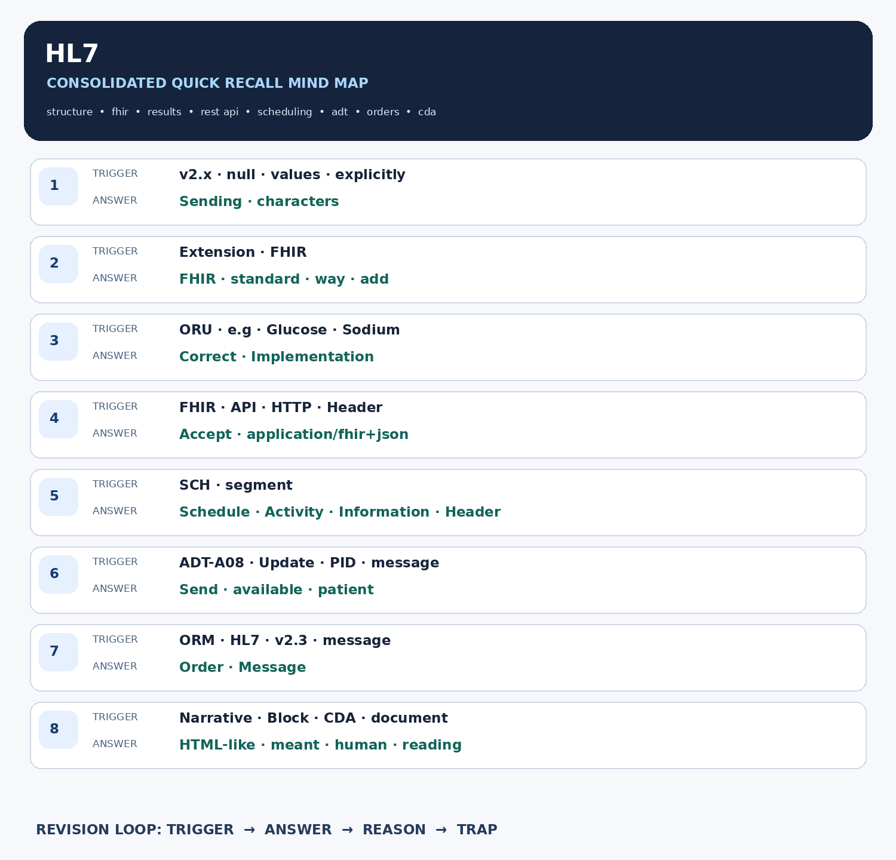

# 🏥 HL7 v2 & FHIR Interview & Exam Quick Reference



[Open the answer PDF](HL7_answers.pdf)


## Consolidated Mind Map

```text
HL7
  ├─ Question domains
  │   ├─ structure
  │   ├─ fhir
  │   ├─ results
  │   ├─ rest api
  │   ├─ scheduling
  │   ├─ adt
  │   ├─ orders
  │   ├─ cda
  │   ├─ billing
  │   ├─ performance
  │   ├─ ack
  │   ├─ troubleshooting
  │   ├─ scenarios
  │   ├─ insurance
  │   └─ + 4 additional bank categories
  └─ Decision loop
      ├─ Trigger: identify the scenario constraint
      ├─ Answer: recall the source-backed technical choice
      ├─ Reason: connect choice to behavior or requirement
      └─ Trap: reject a distractor that conflicts with the requirement
```

## Four-keyword recall cards

| Question trigger (max 4) | Answer recall (max 4) | Reason — why it works | Trap — what to reject |
|---|---|---|---|
| v2.x · null · values · explicitly | Sending · characters | Two double quotes ("") is the 'delete' indicator in HL7, meaning 'clear this field'. An empty pipe (//) means 'no change/ignore'. | Trap: Sending a zero |
| Extension · FHIR | FHIR · standard · way · add | FHIR follows the 80/20 rule; 20% of data needs extensions, and the standard provides a strictly defined way to add them. | Trap: A larger hard drive |
| ORU · e.g · Glucose · Sodium | Correct · Implementation | Usually, if they belong to the same order (e.g., a Basic Metabolic Panel), they are grouped under one OBR with three OBXs. | Trap: None |
| FHIR · API · HTTP · Header | Accept · application/fhir+json | The 'Accept' header tells the server which content type the client is prepared to handle. FHIR uses 'application/fhir+json'. | Trap: Format: json |
| SCH · segment | Schedule · Activity · Information · Header | The SCH segment contains the high-level details of the appointment, such as the Placer/Filler ID and the overall status. | Trap: Security Check Header |
| ADT-A08 · Update · PID · message | Send · available · patient | While technically possible to send partials, standard practice is to send the full current state of the patient record. | Trap: Only the patient ID |
| ORM · HL7 · v2.3 · message | Order · Message | ORM is the general Order Message used in older HL7 versions to request tests, procedures, or supplies. | Trap: Order Response Management |
| Narrative · Block · CDA · document | HTML-like · meant · human · reading | The narrative block ensures that a human can always read the document even if the receiving system can't parse the discrete data. | Trap: The document's title |

## How to use this map

1. Read the trigger and identify the requirement or failure mode in the scenario.
2. Recall the answer keywords before looking at the explanation.
3. State why the answer works using the reason column.
4. Eliminate the trap because it conflicts with the scenario or source explanation.

## Source coverage

- Question bank: `questionBank_HL7.js`
- Questions in source bank: **260**
- Consolidated recall cards: **8**
- Recall cards are representative study aids derived from the supplied question bank, not an official exam blueprint.

---

### 📘 Messages • Segments • MLLP • FHIR • Terminology • Interfaces • Compliance

---

# 1. HL7 v2 Messaging

* Pipe-delimited text; **Segment** = line (3-letter id), fields `|`, components `^`, repetitions `~`, escape `\`, subcomponents `&`.
* **MSH** (message header: sending/receiving app & facility, timestamp, **message type** e.g. `ADT^A01`, control ID, version). 
* Key segments: **PID** (patient identification), **PV1** (visit), **OBR** (order/observation request), **OBX** (observation result: value type, identifier, value, units, status), **ORC**, **NK1**, **AL1**, **DG1**.
* **Message types:** **ADT** (admit/discharge/transfer, patient demographics), **ORM** (orders), **ORU** (observation results — labs/radiology), **SIU** (scheduling), plus MDM, DFT, VXU.
* **Trigger events:** **A01** admit, A02 transfer, A03 discharge, A04 register, A08 update patient info.
* **Z-segment**: custom, site-specific segment (starts with Z) — non-standard; receivers that don't know it should ignore it.
* **Acknowledgment**: `ACK` with **MSA** — `AA` accept, `AE` error, `AR` reject (original mode); `CA/CE/CR` commit-level (enhanced mode).
* **MLLP** (Minimal Lower Layer Protocol): framing over TCP — start `0x0B`, end `0x1C 0x0D`. No encryption by itself → use VPN/TLS tunnel.

```
MSH|^~\&|REG|HOSP|EHR|HOSP|20261124101500||ADT^A01|MSG0001|P|2.5
PID|1||12345^^^HOSP^MR||DOE^JANE||19800101|F
PV1|1|I|ICU^101^A
```

---

# 2. FHIR (Fast Healthcare Interoperability Resources)

* **Resource**-based, RESTful (`GET /Patient/123`, `POST`, `PUT`, search params), JSON/XML.
* Core resources: **Patient**, **Observation** (vitals/labs), **Encounter** (visit), Condition, MedicationRequest, DiagnosticReport.
* **Bundle**: container of resources — `searchset`, `transaction` (atomic), `batch`, `document`, `collection`.
* **Profile**: constraints/extensions on a base resource (e.g., US Core) for a specific use case.
* **SMART on FHIR**: OAuth 2.0 / OIDC app launch framework (scopes like `patient/Observation.read`, EHR launch & standalone launch).
* **REST** semantics: status codes (201 created, 404, 410, 422 validation), `_include`, `_revinclude`, paging.
* **CDA**: XML clinical document standard (C-CDA: discharge summaries, care summaries) — document-centric vs FHIR's resource-centric.

---

# 3. Terminology

* **LOINC**: lab tests & clinical observations (e.g., glucose measurement codes).
* **SNOMED CT**: clinical findings, procedures, body structures (diagnoses/problems).
* Also ICD-10 (diagnosis billing), CPT (procedures), RxNorm (drugs), UCUM (units).
* **Terminology** services map local codes → standard codes so data is semantically interoperable.

---

# 4. Integration & Compliance

* **Interface Engine** (e.g., **Mirth** Connect/NextGen Connect, Rhapsody, Cloverleaf): receive, parse, filter, transform, route, queue/retry, log. Typical channel: Source (MLLP listener) → Filter → Transformer (HL7 ↔ JSON/FHIR) → Destination(s).
* **OAuth** 2.0 secures FHIR APIs (access tokens, scopes, refresh).
* **HIPAA**: Privacy Rule (minimum necessary), Security Rule (access control, audit logs, encryption in transit/at rest), Breach Notification; PHI must be protected; **BAA** with vendors.
* Idempotency & ordering: use message control ID (MSH-10) to detect duplicates; process ADT in order.

---

# 🚨 Problem → Fix

| Symptom | Fix |
| ------- | --- |
| Lab result arrives | `ORU^R01` with OBR/OBX |
| Patient admitted | `ADT^A01` |
| Receiver rejects unknown segment | Z-segment handling / ignore unknown |
| Sender never gets confirmation | ACK handling (`MSA-1`), retry on AE/AR |
| Legacy v2 → modern API | Interface engine transform HL7 v2 → FHIR |
| Lab codes differ per site | Map to LOINC via terminology service |
| Third-party app needs EHR data | SMART on FHIR + OAuth scopes |

> “I move clinical data with HL7 v2 over MLLP through an interface engine like Mirth, translate it to FHIR resources and bundles, normalize with LOINC and SNOMED, secure APIs with SMART on FHIR/OAuth, and satisfy HIPAA with minimum-necessary access, encryption and audit logging.”
