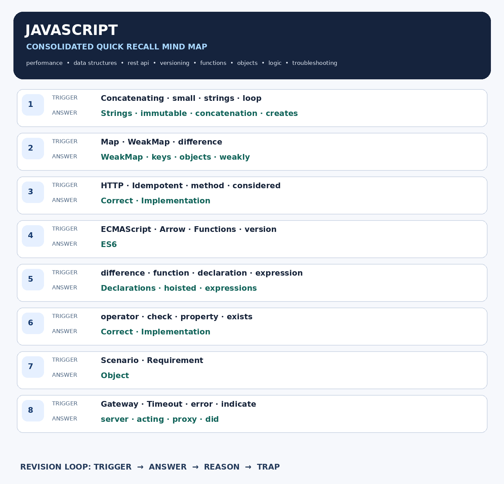

# 🟨 JavaScript Interview & Exam Quick Reference




[Open the answer PDF](docs/JavaScript_answers.pdf)


## Consolidated Mind Map

```text
JAVASCRIPT
  ├─ Question domains
  │   ├─ performance
  │   ├─ data structures
  │   ├─ rest api
  │   ├─ versioning
  │   ├─ functions
  │   ├─ objects
  │   ├─ logic
  │   ├─ troubleshooting
  │   ├─ axios
  │   ├─ async
  │   ├─ security
  │   ├─ scenarios
  │   ├─ scalability
  │   ├─ cdn
  │   └─ + 8 additional bank categories
  └─ Decision loop
      ├─ Trigger: identify the scenario constraint
      ├─ Answer: recall the source-backed technical choice
      ├─ Reason: connect choice to behavior or requirement
      └─ Trap: reject a distractor that conflicts with the requirement
```

## Four-keyword recall cards

| Question trigger (max 4) | Answer recall (max 4) | Reason — why it works | Trap — what to reject |
|---|---|---|---|
| Concatenating · small · strings · loop | Strings · immutable · concatenation · creates | Modern engines optimize this, but for massive operations, using an array and .join('') is often safer. | Trap: Strings are limited to 100 characters |
| Map · WeakMap · difference | WeakMap · keys · objects · weakly | WeakMap keys must be objects. If there are no other references to the key object, it can be garbage collected even if it is in the WeakMap. | Trap: WeakMaps are faster for iteration |
| HTTP · Idempotent · method · considered | Correct · Implementation | GET, PUT, and DELETE are idempotent, meaning multiple identical requests should have the same effect as a single request. POST is not. | Trap: CONNECT |
| ECMAScript · Arrow · Functions · version | ES6 | ES6, also known as ES2015, was a major update that introduced modern syntax like block-scoped variables and arrow functions. | Trap: ES2017 |
| difference · function · declaration · expression | Declarations · hoisted · expressions | Function declarations are available throughout the scope, while expressions only exist after the line they are defined. | Trap: Declarations cannot have arguments |
| operator · check · property · exists | Correct · Implementation | The 'in' operator returns true if the specified property is in the specified object or its prototype chain. | Trap: exists |
| Scenario · Requirement | Object | Array is coerced to empty string, Object is coerced to string '[object Object]'. Sum is the concatenated string. | Trap: undefined |
| Gateway · Timeout · error · indicate | server · acting · proxy · did | This often happens in microservice architectures when a load balancer/gateway waits too long for a service. | Trap: The page does not exist |

## How to use this map

1. Read the trigger and identify the requirement or failure mode in the scenario.
2. Recall the answer keywords before looking at the explanation.
3. State why the answer works using the reason column.
4. Eliminate the trap because it conflicts with the scenario or source explanation.

## Source coverage

- Question bank: `questionBank_JavaScript.js`
- Questions in source bank: **261**
- Consolidated recall cards: **8**
- Recall cards are representative study aids derived from the supplied question bank, not an official exam blueprint.

---

### 📘 Language Core • Async • Functional Patterns • Browser & API Concepts

---

# 1. Language Core

* **Closure**: a function remembering its lexical scope after the outer function returns (private state, factories, callbacks).
* **Hoisting**: declarations are processed before execution. `var` hoists as `undefined`; function declarations hoist fully. **Temporal Dead Zone**: `let`/`const` exist but are inaccessible before their declaration (ReferenceError).
* **`this`** is decided by *how* a function is called: method call → object; plain call → `undefined` (strict) / global; `new` → new object; `call/apply/bind` → explicit; **arrow functions** inherit `this` lexically.
* **Prototype** chain: objects delegate property lookup to their prototype; `class` is syntax over prototypes.
* **Strict Mode** (`'use strict'`, automatic in modules/classes): no implicit globals, errors on silent failures.
* **Proxy** intercepts operations (get/set/has) — validation, reactivity. **Generator** (`function*`, `yield`) pauses/resumes; basis of lazy iterators.
* **Destructuring** & **Spread**: `const {a, ...rest} = obj`, `[...arr]`, `{...obj}` (shallow).
* **ES6** & **Module**s: `let/const`, arrow functions, template literals, classes, `import/export` (static, live bindings).
* **Map / Set**: keyed collection with any key type / unique values; O(1) average lookups.

```js
for (var i = 0; i < 3; i++) setTimeout(() => console.log(i)); // 3 3 3
for (let i = 0; i < 3; i++) setTimeout(() => console.log(i)); // 0 1 2
```

---

# 2. Async

* **Event Loop**: call stack → Web APIs → task (macrotask) queue; **microtasks** (Promise reactions) run before the next macrotask.
* **Callback** → **Promise** (pending/fulfilled/rejected) → **async/await**. `await` in a loop is sequential; use `Promise.all` for parallel.
* **Fetch**: returns a promise that **rejects only on network failure** — check `response.ok` for 4xx/5xx; `response.json()` is itself async.

---

# 3. Functional & Performance Patterns

* **Currying**: `f(a, b, c)` → `f(a)(b)(c)`; partial application.
* **Memoization**: cache results by arguments for pure functions.
* **Debounce**: run after calls stop for N ms (search-as-you-type). **Throttle**: run at most once per N ms (scroll/resize).
* **Shallow Copy** (`{...o}`, `Object.assign`) copies top level only; deep copy → `structuredClone`. **Immutable** updates (`map`, spread, `Object.freeze` is shallow) make change detection and debugging simpler.
* **Event Delegation**: one listener on a parent using bubbling and `event.target`; works for dynamic children.
* **LocalStorage**: synchronous, string-only, ~5MB, per-origin, no expiry; never store secrets/tokens susceptible to XSS (vs `sessionStorage`, cookies `HttpOnly`).

---

# 4. API Concepts

* **REST**: stateless, resource URLs, verbs, status codes. **Versioning** (`/v1`, header) so clients don't break.
* **CORS**: server opt-in via `Access-Control-Allow-*`; preflight `OPTIONS` for non-simple requests.

---

# 🚨 Quick Traps

| Trap | Answer |
| ---- | ------ |
| `typeof null` | `"object"` |
| `0.1 + 0.2 === 0.3` | `false` (floating point) |
| `[] + {}` / `==` coercion | Use `===` |
| `var` in loop with timeout | Closure over shared variable → use `let` |
| `async` function return | Always a Promise |
| `fetch` 404 | Does not reject |

> “I reason about JavaScript through scope, `this` binding and the event loop; I use closures, immutability and Promise.all deliberately, and control event frequency with debounce and throttle.”
