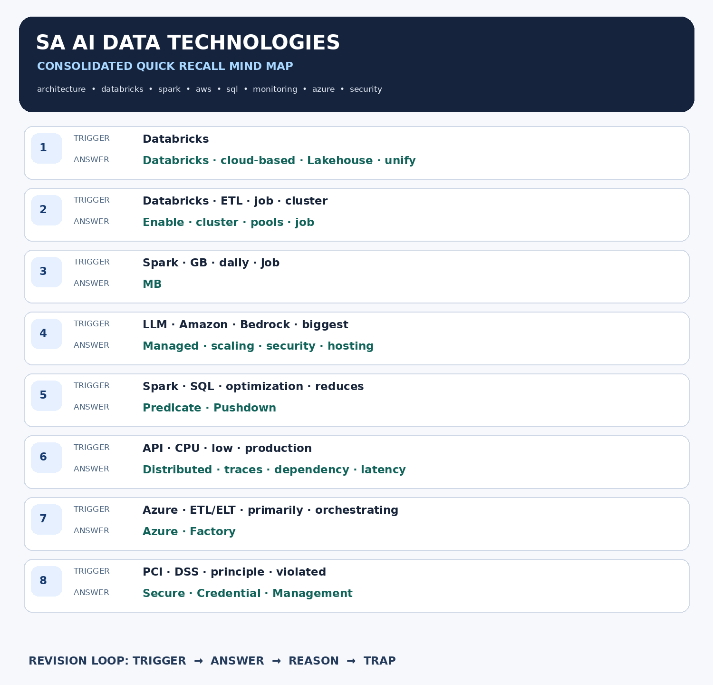

# 🚀 Senior Architect Interview & System Design README




[Open the answer PDF](docs/SA_AI_Data_Technologies_answers.pdf)


## Consolidated Mind Map

```text
SA AI DATA TECHNOLOGIES
  ├─ Question domains
  │   ├─ architecture
  │   ├─ databricks
  │   ├─ spark
  │   ├─ aws
  │   ├─ sql
  │   ├─ monitoring
  │   ├─ azure
  │   ├─ security
  │   ├─ rag
  │   ├─ python
  │   ├─ data modelling
  │   ├─ ai
  │   ├─ agentic ai
  │   ├─ vector db
  │   └─ + 44 additional bank categories
  └─ Decision loop
      ├─ Trigger: identify the scenario constraint
      ├─ Answer: recall the source-backed technical choice
      ├─ Reason: connect choice to behavior or requirement
      └─ Trap: reject a distractor that conflicts with the requirement
```

## Four-keyword recall cards

| Question trigger (max 4) | Answer recall (max 4) | Reason — why it works | Trap — what to reject |
|---|---|---|---|
| Databricks | Databricks · cloud-based · Lakehouse · unify | A Databricks solution is primarily used to unify an organization's data engineering, data science, machine learning, and business intelligence workloads onto a single cloud-based data lakehouse platform, thereby eliminating data silos and enabling teams to collaboratively build, scale, and govern everything from traditional analytics to advanced artificial i | Trap: Support analytics and reporting |
| Databricks · ETL · job · cluster | Enable · cluster · pools · job | Cluster Pools keep pre-warmed VM instances available, significantly reducing cluster startup time while retaining the cost benefits of ephemeral job clusters. | Trap: Use an always-on all-purpose cluster |
| Spark · GB · daily · job | MB | Spark generally performs best when partitions are around 128-256 MB, balancing parallelism and scheduling overhead. | Trap: 5 MB |
| LLM · Amazon · Bedrock · biggest | Managed · scaling · security · hosting | Bedrock eliminates infrastructure management while providing secure managed AI services. | Trap: Unlimited GPU |
| Spark · SQL · optimization · reduces | Predicate · Pushdown | Predicate pushdown filters data at the source, minimizing data transfer. | Trap: SELECT * |
| API · CPU · low · production | Distributed · traces · dependency · latency | Distributed tracing often reveals downstream dependency bottlenecks that are not visible from CPU metrics alone. | Trap: Restart the database |
| Azure · ETL/ELT · primarily · orchestrating | Azure · Factory | Azure Data Factory (ADF) is Microsoft's managed data integration and orchestration service. | Trap: Azure DevOps |
| PCI · DSS · principle · violated | Secure · Credential · Management | Credentials should be stored in secure secret management solutions such as Key Vault or AWS Secrets Manager. | Trap: Encryption |

## How to use this map

1. Read the trigger and identify the requirement or failure mode in the scenario.
2. Recall the answer keywords before looking at the explanation.
3. State why the answer works using the reason column.
4. Eliminate the trap because it conflicts with the scenario or source explanation.

## Source coverage

- Question bank: `questionBank_SA_AI_Data_Technologies.js`
- Questions in source bank: **240**
- Consolidated recall cards: **8**
- Recall cards are representative study aids derived from the supplied question bank, not an official exam blueprint.

---

### 📘 Quick Reference (System Design + Microservices + Cloud + Reliability)

This is your **mental model + buzzword map** to handle:

* System design rounds
* Architecture deep-dives
* Trade-off discussions


---

# 🧠 0. Architect Mental Model (Golden Flow)

```id="a1x9pl"
Client → Gateway → Service → DB / Cache / Queue
             ↓
     Observability + Security + Resilience (cross-cutting)
```

💡 **Interview Insight**

Always think in:

* **Trade-offs (latency vs consistency)**
* **Failure scenarios (what breaks?)**
* **Scalability path (how it grows?)**

---

# ⚡ 1. The “Illities” (ALWAYS MENTION)

## 🔑 Reliability

```id="r9k2sl"
Health Checks → Self-healing → MTTR ↓ → SLA/SLO/SLI
```

💡 Say:

* Liveness vs Readiness probes
* Fast recovery > preventing all failures

---

## 🔑 Scalability & Throughput

```id="s3k9dl"
Horizontal > Vertical
Throughput ↑ | Latency ↓
```

**Key weapons:**

* Load Balancer
* Caching (Redis)
* Read Replicas
* Async queues

---

## 🔑 Resilience

```id="t8k1sd"
Failure → Retry → Circuit Breaker → Fallback
```

Patterns:

* Circuit Breaker
* Bulkhead
* Retry (Exponential Backoff)

---

## 🔑 Maintainability

* Modular architecture
* Clean code
* Auditability + compliance (GDPR, SOC2)

---

# 🧩 2. Microservices & Distributed Patterns

## 🔥 Saga Pattern (Distributed Transactions)

```id="k2x8pl"
Order → Payment → Inventory → Failure → Compensate
```

💡 Clues:

* No global lock
* Eventual consistency
* Compensating actions

---

## 🔥 Outbox Pattern (CRITICAL)

```id="o9s2kd"
DB Transaction → Save Event → Outbox Table → Relay → Kafka
```

💡 Say:

* Avoid **double write problem**
* Guarantees **at-least-once delivery**

---

## 🔑 Quick Recall

| Pattern | Use                    |
| ------- | ---------------------- |
| Saga    | Multi-service workflow |
| Outbox  | Reliable messaging     |
| 2PC     | Avoid (slow, blocking) |

---

## ⚡ CQRS

```id="c7k3sl"
Write Model ≠ Read Model
```

💡 Benefits:

* Scalability
* Optimized queries

---

# 🗄️ 3. Database & Data Strategy

## 🔑 Consistency Models

```id="d4k8sl"
ACID → strong consistency
BASE → eventual consistency
```

---

## ⚖️ CAP Theorem

```id="p2k9sl"
Consistency | Availability | Partition tolerance
```

💡 Say:

* In distributed systems → choose AP or CP

---

## 🔥 Scaling DB

* Sharding (horizontal partitioning)
* Read replicas
* Caching layer

---

## 📊 Warehousing Clues

* Star schema
* Snowflake schema
* SCD-2 (history tracking)

---

# 🔐 4. Security & Identity

## 🔑 Authentication

```id="a7k2sl"
JWT → stateless
OAuth2 → delegated access
OIDC → identity layer
```

---

## 🔑 Authorization

* RBAC → roles
* ABAC → attributes
* Least privilege

---

## 🎯 What to Say

* Token expiration + refresh
* Secure storage
* Prevent:

  * XSS
  * CSRF

---

# ☁️ 5. Cloud & DevOps

## 🔑 Deployment Strategies

```id="d8k2sl"
Blue/Green → switch traffic
Canary → partial rollout
Rolling → gradual replace
```

---

## 🔑 Infrastructure

* Docker (containers)
* Kubernetes (orchestration)
* IaC (Terraform)

---

## 🎯 Key Concepts

* Stateless services
* Immutable infrastructure
* Backward compatibility

---

# 📡 6. Observability (VERY HIGH SIGNAL)

## 🔑 Three Pillars

```id="o3k9sl"
Logs | Metrics | Traces
```

---

## 🔥 Tools (mention generically)

* Distributed tracing
* Centralized logging
* Monitoring dashboards

---

## 🎯 What to Say

* Correlation IDs
* Structured logging (JSON)
* Alerting based on SLO

---

# ⚡ 7. Performance & Traffic Handling

## 🔑 Scaling Patterns

| Problem           | Solution           |
| ----------------- | ------------------ |
| Traffic spike     | Auto-scaling (HPA) |
| Too many requests | Rate limiting      |
| System overload   | Load shedding      |
| Slow downstream   | Circuit breaker    |

---

## 🔥 Backpressure

```id="b2k7sl"
Producer > Consumer → Queue → throttle
```

---

# 🧠 8. Concurrency & Synchronization

## 🔑 Core Issues

* Race conditions
* Deadlocks

---

## 🔧 Tools

* Mutex / locks
* Semaphores
* Thread pools

---

# 🧩 9. High-Probability Scenarios

## 🚀 Scenario → Answer Pattern

---

### ❓ “Traffic spike?”

```id="x1k9sl"
HPA → Load Balancer → Cache → Read Replicas → Queue
```

---

### ❓ “Distributed transaction fails?”

```id="y2k8sl"
Saga → Compensating Transactions → Idempotency
```

---

### ❓ “Zero downtime deployment?”

```id="z3k7sl"
Blue/Green → Health checks → Backward compatibility
```

---

### ❓ “Service keeps failing?”

```id="q4k6sl"
Circuit Breaker → Retry → Fallback
```

---

### ❓ “Data inconsistency?”

```id="w5k5sl"
Outbox → Event-driven → Eventual consistency
```

---

# 📎 Appendix: Rapid Recall Cheat Sheet

## ⚡ System Design

```id="s9k2sl"
Latency ↓ | Throughput ↑
Horizontal scaling > vertical
Cache everything possible
```

---

## ⚡ Microservices

```id="m8k2sl"
Saga → distributed consistency
Outbox → reliable messaging
CQRS → read/write separation
```

---

## ⚡ Database

```id="d7k2sl"
ACID → strong consistency
BASE → eventual consistency
Sharding → scale
```

---

## ⚡ DevOps

```id="v6k2sl"
Docker → container
K8s → orchestration
IaC → reproducibility
```

---

## ⚡ Observability

```id="o5k2sl"
Logs → debugging
Metrics → monitoring
Traces → request flow
```

---

# 🎯 Final Interview One-Liner

> “I design distributed systems by balancing consistency and availability, using patterns like Saga for distributed transactions and Outbox for reliable messaging, ensuring resilience with circuit breakers and retries, scaling via horizontal partitioning and caching, and maintaining observability through logs, metrics, and tracing.”

---
