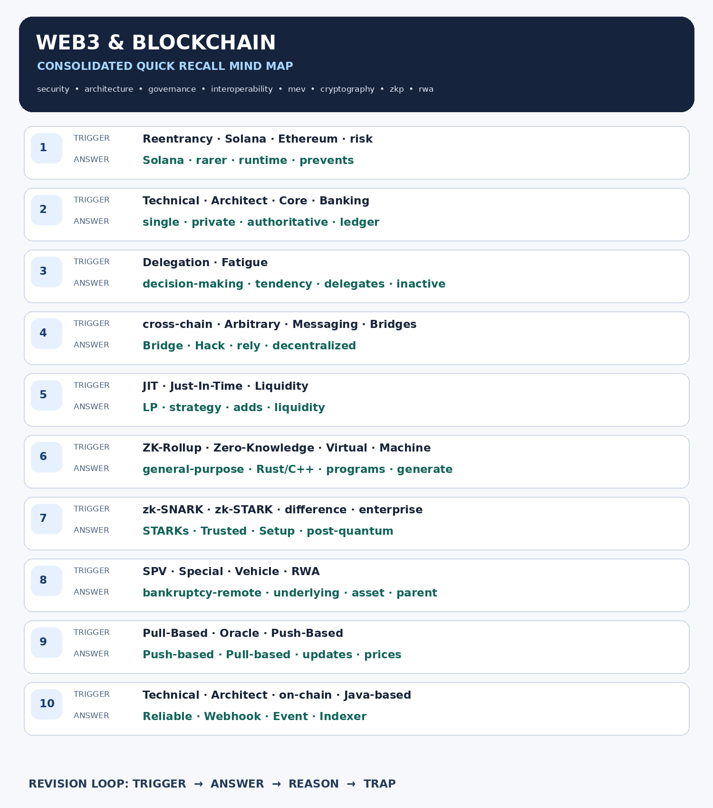

# Technical Architect’s Guide: Web2 to Web3 Transition




[Open the answer PDF](docs/web3Blockchain_answers.pdf)


## Consolidated Mind Map

```text
WEB3 & BLOCKCHAIN
  ├─ Question domains
  │   ├─ security
  │   ├─ architecture
  │   ├─ governance
  │   ├─ interoperability
  │   ├─ mev
  │   ├─ cryptography
  │   ├─ zkp
  │   ├─ rwa
  │   ├─ oracles
  │   ├─ integration
  │   ├─ fintech
  │   ├─ compliance
  │   ├─ alt vm
  │   ├─ tooling
  │   └─ + 39 additional bank categories
  └─ Decision loop
      ├─ Trigger: identify the scenario constraint
      ├─ Answer: recall the source-backed technical choice
      ├─ Reason: connect choice to behavior or requirement
      └─ Trap: reject a distractor that conflicts with the requirement
```

## Four-keyword recall cards

| Question trigger (max 4) | Answer recall (max 4) | Reason — why it works | Trap — what to reject |
|---|---|---|---|
| Reentrancy · Solana · Ethereum · risk | Solana · rarer · runtime · prevents | Solana's architecture prevents a program from calling itself in a way that allows typical Solidity-style reentrancy, though logic errors can still occur. | Trap: Solana is immune to reentrancy |
| Technical · Architect · Core · Banking | single · private · authoritative · ledger | Web3 replaces the central authority (bank's DB) with a shared state machine where every state transition is verified by consensus and linked via hashes. | Trap: From ACID-compliant relational databases to eventually consistent NoSQL clusters |
| Delegation · Fatigue | decision-making · tendency · delegates · inactive | Fatigue is a major hurdle for 'Liquid Democracy,' necessitating better governance tooling and incentive structures for delegates. | Trap: When a voter changes their delegate too often |
| cross-chain · Arbitrary · Messaging · Bridges | Bridge · Hack · rely · decentralized | Lock-and-mint bridges are notorious single points of failure. AMBs use varied security models (like decentralized validation or ZK proofs) to move state, not just tokens, across chains. | Trap: They eliminate the need for gas on the destination chain |
| JIT · Just-In-Time · Liquidity | LP · strategy · adds · liquidity | JIT liquidity can actually benefit the trader by providing better execution, even if it 'snatches' fees from passive LPs. | Trap: Liquidity that arrives late |
| ZK-Rollup · Zero-Knowledge · Virtual · Machine | general-purpose · Rust/C++ · programs · generate | zkVMs like RISC Zero or SP1 allow developers to write logic in standard languages and prove the execution, bridging the gap between Web2 developers and ZK-powered privacy/scaling. | Trap: To store user data off-chain |
| zk-SNARK · zk-STARK · difference · enterprise | STARKs · Trusted · Setup · post-quantum | Architects prefer STARKs for long-term security as they don't rely on a 'toxic waste' ceremony and are resistant to future quantum computing attacks. | Trap: STARKs require a centralized server |
| SPV · Special · Vehicle · RWA | bankruptcy-remote · underlying · asset · parent | An SPV is a legal entity created to isolate financial risk. If the issuer goes bust, the asset inside the SPV remains protected for the token holders. | Trap: To provide liquidity on Uniswap |
| Pull-Based · Oracle · Push-Based | Push-based · Pull-based · updates · prices | Pull-based oracles (like Pyth or Chainlink Low Latency) save gas because they don't update on-chain unless someone actually needs the price. | Trap: Pull-based is for Bitcoin; Push-based is for Ethereum |
| Technical · Architect · on-chain · Java-based | Reliable · Webhook · Event · Indexer | Direct RPC polling is unreliable. Architects use indexers to capture events, then push to Kafka/RabbitMQ to ensure the Web2 database eventually matches the Web3 state. | Trap: Hardcoding the transaction IDs in the Java source |

## How to use this map

1. Read the trigger and identify the requirement or failure mode in the scenario.
2. Recall the answer keywords before looking at the explanation.
3. State why the answer works using the reason column.
4. Eliminate the trap because it conflicts with the scenario or source explanation.

## Source coverage

- Question bank: `questionBank_web3Blockchain.js`
- Questions in source bank: **354**
- Consolidated recall cards: **10**
- Recall cards are representative study aids derived from the supplied question bank, not an official exam blueprint.

---

This documentation serves as a strategic bridge for Technical Architects moving from traditional enterprise environments (Fintech, Core Banking) to Decentralized Finance (DeFi) and Blockchain ecosystems.

---

## 1. The Architect’s Lexicon (Buzzwords Defined)

### Core Infrastructure & Banking

- **Core Banking Transformation**  
  The process of migrating legacy centralized ledgers to Distributed Ledger Technology (DLT) to achieve real-time settlement and transparency.

- **Blockchain**  
  A distributed, append-only state machine secured by cryptography and consensus.

- **Interoperability**  
  The ability of different blockchain networks to exchange data and value (e.g., Polkadot, Cosmos, LayerZero).

- **Cross-Chain**  
  Technologies enabling transactions to span multiple independent blockchains.

- **Hybrid Integration**  
  Architecture combining Web2 backends (Node.js/Python) with Web3 smart contracts to balance performance and decentralization.

---

### Cryptographic Primitives

- **Asymmetric Encryption**  
  Use of public/private key pairs (RSA/ECDSA) where:
  - Public key = identity
  - Private key = authorization

- **Merkle Trees**  
  Binary hash tree used to efficiently verify that a specific transaction exists within a block without downloading the entire chain.

- **ZK Proofs (ZKP)**  
  Cryptographic methods where one party proves a statement is true without revealing underlying data.

- **zkVMs**  
  Virtual machines executing general-purpose code (e.g., Rust) while generating zero-knowledge proofs of correctness.

---

### Standards & Tokens

- **EIP Standards**  
  Ethereum Improvement Proposals defining protocol/application standards.

- **ERC-20**  
  Fungible token standard (e.g., stablecoins like USDC).

- **ERC-721**  
  Non-fungible token (NFT) standard.

- **ERC-1155**  
  Multi-token standard supporting both fungible and non-fungible assets.

- **ERC-4337 (Account Abstraction)**  
  Enables smart contract wallets with:
  - Social recovery  
  - Gas sponsorship  
  - Transaction batching  

---

### Security & Tooling

- **Security First Approach**  
  Code is immutable like hardware → requires audits, formal verification, and fuzzing.

- **Slither**  
  Static analysis for Solidity.

- **Mythril**  
  Symbolic execution-based EVM bytecode analyzer.

- **Echidna**  
  Property-based fuzz testing tool.

- **Hardhat / Foundry / Truffle**  
  Development frameworks (Foundry preferred for speed and Solidity-native testing).

- **Ethers.js / Web3.js / Viem**  
  JavaScript/TypeScript libraries for blockchain interaction.

---

## 2. Software Development Lifecycle (Web3 SDLC)

> In Web3, bugs = potential total capital loss  
> Mindset shift: **"Fail Fast" → "Verify Always"**

### Phases

1. **Requirement Mapping**
   - Define tokenomics
   - Incentive alignment

2. **Architecture Design**
   - On-chain vs Off-chain decisions
   - Hybrid patterns

3. **Development**
   - Smart contracts (Solidity/Rust)
   - Local unit testing

4. **Security Fuzzing**
   - Stress test invariants using tools like Echidna

5. **External Audit**
   - Third-party security validation

6. **Deployment (Proxy Pattern)**
   - UUPS or Transparent proxies for upgradeability

7. **Indexing & Monitoring**
   - The Graph (querying)
   - Forta (threat detection)

---

## 3. The Token Lifecycle

| Stage              | Action                | Technical Context |
|-------------------|---------------------|------------------|
| 1. Minting        | Creation of supply  | `_mint()` function |
| 2. Distribution   | Initial allocation  | Airdrops, ICOs, Liquidity Mining |
| 3. Utility/Escrow | Token usage         | Staking, governance locking (veTokens) |
| 4. Transfer       | Peer-to-peer        | Updates `balanceOf` mapping |
| 5. Burning        | Supply reduction    | Send to `0x0` address |

---

## 4. Web2 vs. Web3: Architect’s Cheat Sheet

| Web2 Component        | Web3 Equivalent              | Architect’s Insight |
|----------------------|-----------------------------|---------------------|
| Database (SQL/NoSQL) | Blockchain / Ledger         | Writes cost gas; reads are slower |
| OAuth / JWT          | Wallets (MetaMask/EIP-4337) | Identity = public key |
| API Gateway          | Oracles (Chainlink)         | External data bridge |
| S3 / Blob Storage    | IPFS / Filecoin             | Store hashes on-chain |
| CloudWatch / ELK     | The Graph                   | Use indexing layers |
| Server/Compute       | Smart Contracts (EVM)       | Deterministic, immutable |
| Microservices        | App-Chains / L2s            | Scale via rollups |
| Unit Testing         | Formal Verification         | Mathematical guarantees |

---

## 5. Technical Architect Interview Preparation

### System Design Scenario

**Q:** How would you integrate a legacy Core Banking system with an Ethereum-based stablecoin for cross-border settlement?

**Key Points:**

- **Bridge Architecture**
  - Lock-and-mint or burn-and-mint mechanisms

- **Security**
  - Multisig (e.g., Gnosis Safe)
  - Time-locks for upgrades

- **Reconciliation**
  - Middleware (Node.js/Java)
  - Listen to blockchain events via Web3.js/Web3j
  - Sync with internal SQL ledger

- **Compliance**
  - zk-SNARKs for privacy-preserving KYC verification

---

### Security Question

**Q:** What is a Reentrancy attack and how do you prevent it?

**Answer:**

- Occurs when:
  - External call is made before state update
- Risks:
  - Funds can be drained repeatedly

**Prevention:**
- Checks-Effects-Interactions pattern
- Use `ReentrancyGuard` (OpenZeppelin)

---

### Strategy Question

**Q:** Why choose a ZK-Rollup over a sidechain?

**Answer:**

- **ZK-Rollups**
  - Inherit L1 (Ethereum) security
  - Use cryptographic proofs

- **Sidechains**
  - Independent consensus
  - Potentially weaker security

**Conclusion:**  
ZK-Rollups provide stronger security guarantees with better scalability trade-offs.

---

## Final Thoughts

Transitioning from Web2 to Web3 requires:
- A mindset shift toward **immutability and trust minimization**
- Strong emphasis on **security and verification**
- Understanding **token economics and decentralized governance**

Architects who embrace these paradigms will be well-positioned to design the next generation of financial infrastructure.

---
```
