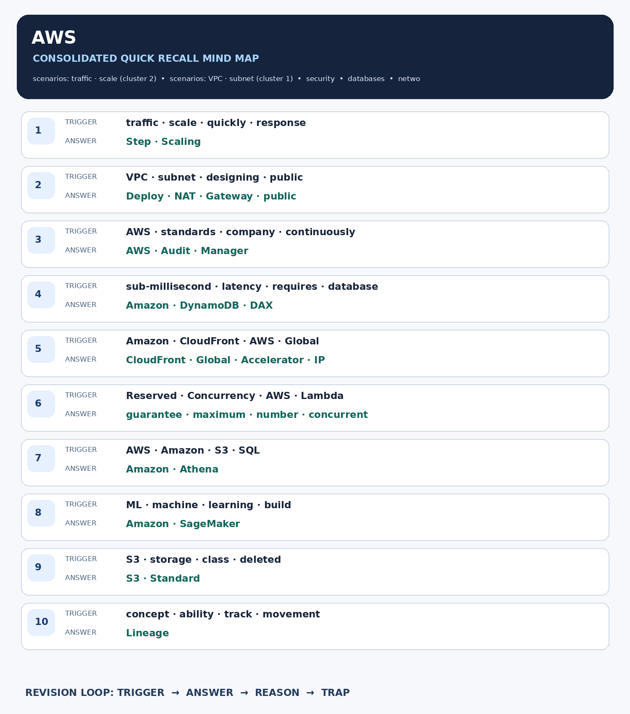

# 🚀 AWS Senior Architect & DevOps README



[Open the answer PDF](AWS_answers.pdf)


---

## Consolidated Mind Map

```text
AWS
  ├─ Question domains
  │   ├─ scenarios: traffic · scale (cluster 2)
  │   ├─ scenarios: VPC · subnet (cluster 1)
  │   ├─ security
  │   ├─ databases
  │   ├─ networking
  │   ├─ compute
  │   ├─ analytics
  │   ├─ ai ml
  │   ├─ storage
  │   ├─ governance
  │   ├─ integration
  │   ├─ well architected
  │   ├─ management
  │   ├─ iam
  │   └─ + 18 additional bank categories
  └─ Decision loop
      ├─ Trigger: identify the scenario constraint
      ├─ Answer: recall the source-backed technical choice
      ├─ Reason: connect choice to behavior or requirement
      └─ Trap: reject a distractor that conflicts with the requirement
```

## Four-keyword recall cards

| Question trigger (max 4) | Answer recall (max 4) | Reason — why it works | Trap — what to reject |
|---|---|---|---|
| traffic · scale · quickly · response | Step · Scaling | Step scaling allows you to define multiple 'steps' or adjustments based on the size of the metric breach (e.g., add 1 instance at 60%, add 3 at 80%). | Trap: Manual Scaling |
| VPC · subnet · designing · public | Deploy · NAT · Gateway · public | A NAT Gateway must reside in a public subnet (with a route to the IGW) to allow private instances to reach the internet without being exposed to inbound connections. | Trap: Deploy a NAT Gateway in the private subnet |
| AWS · standards · company · continuously | AWS · Audit · Manager | Audit Manager helps you continuously audit your AWS usage to simplify how you assess risk and compliance with regulations and industry standards. | Trap: AWS Artifact |
| sub-millisecond · latency · requires · database | Amazon · DynamoDB · DAX | DynamoDB is built for massive scale, and DAX (DynamoDB Accelerator) provides in-memory caching for microsecond latency. | Trap: Amazon Redshift |
| Amazon · CloudFront · AWS · Global | CloudFront · Global · Accelerator · IP | CloudFront is a CDN for web content (HTTP/S). Global Accelerator uses the AWS network to improve performance for TCP/UDP traffic using Anycast IPs. | Trap: CloudFront uses Anycast IPs; Global Accelerator does not |
| Reserved · Concurrency · AWS · Lambda | guarantee · maximum · number · concurrent | Reserved concurrency ensures that a function always has capacity and also acts as a ceiling to prevent run-away costs. | Trap: To save money on long-running tasks |
| AWS · Amazon · S3 · SQL | Amazon · Athena | Athena allows you to query S3 data directly (CSV, JSON, Parquet) using Presto/Trino without loading it into a database. | Trap: Amazon Redshift |
| ML · machine · learning · build | Amazon · SageMaker | SageMaker is a fully managed service that provides every developer and data scientist with the ability to build, train, and deploy ML models quickly. | Trap: Amazon Rekognition |
| S3 · storage · class · deleted | S3 · Standard | S3 Standard has no minimum storage duration. Other classes (like IA or Glacier) charge a minimum of 30, 90, or 180 days even if deleted early. | Trap: S3 Standard-IA |
| concept · ability · track · movement | Lineage | Data Lineage provides visibility into the data's lifecycle, which is critical for compliance, auditing, and troubleshooting in complex pipelines. | Trap: Data Partitioning |

## How to use this map

1. Read the trigger and identify the requirement or failure mode in the scenario.
2. Recall the answer keywords before looking at the explanation.
3. State why the answer works using the reason column.
4. Eliminate the trap because it conflicts with the scenario or source explanation.

## Source coverage

- Question bank: `questionBank_AWS.js`
- Questions in source bank: **466**
- Consolidated recall cards: **10**
- Recall cards are representative study aids derived from the supplied question bank, not an official exam blueprint.

---

### 📘 Quick Reference (The Resource Hierarchy)

```text
AWS Organizations (SCPs) 
  ↳ Account (Billing/Blast Radius/Policy) 
    ↳ VPC (Network) → Subnets (Public/Private)
      ↳ IAM Role (Identity) → Security Group (Stateful Firewall)
        ↳ Instance / Pod / Lambda
```

---

# 🧠 0. AWS Mental Model (The Cloud Fabric)

* **Shared Responsibility:** AWS secures the "Cloud" (Hardware); You secure what's "In" the cloud (IAM, Data, Config).
* **Decoupling is King:** Use SQS/SNS/EventBridge to ensure the failure of one microservice doesn't cascade.
* **Identity as the Perimeter:** Use IAM Roles for services (EC2/Lambda) instead of long-lived User keys to eliminate credential leakage.
* **Infrastructure as Code (IaC):** Standardize deployments using **Terraform, CDK, or Bicep** to prevent configuration drift.

---

# ⚙️ 1. Infrastructure & Networking

### 🔑 Connectivity & Routing
* **VPC (Virtual Private Cloud):** Use **Public Subnets** for Load Balancers (IGW attached) and **Private Subnets** for App/DB tiers.
* **Transit Gateway:** The central hub for connecting thousands of VPCs and on-prem networks; replaces complex VPC Peering meshes.
* **Direct Connect:** Dedicated physical link for low-latency, high-bandwidth hybrid (from on-prem to AWS) cloud requirements.
* **VPC Endpoints (PrivateLink):** Keeps traffic to S3, DynamoDB, or Kinesis on the private AWS backbone, bypassing the public internet.

### 🔑 Governance (Common Schema)
* **Tagging Schema:** `{Project}-{Env}-{Region}-{Service}-{Instance}`.
* **Mandatory Tags:** `Owner`, `CostCenter`, `Environment`, `DataClassification`.
* **SCPs (Service Control Policies):** Enforce guardrails at the Organization level (e.g., "Disable all regions except us-east-1").

---

# 🔐 2. Identity & Security (The Perimeter)
###
* **IAM Roles**: Use roles for EC2/Lambda instead of IAM Users to avoid long-lived credentials.
* **Service Control Policies (SCPs)**: Set the maximum permissions for accounts within an AWS Organization.
* **KMS (Key Management Service)**: Centralized encryption key management.
### 🔑 Advanced Identity
* **EKS Pod Identity:** The modern successor to IRSA; allows pods to assume IAM roles without complex OIDC mapping.
* **Least Privilege:** Always scope IAM policies to specific resources and conditions (e.g., Source IP or MFA).
* **KMS (Key Management):** Use **KMS Grants** instead of bulky Key Policies for high-volume service scaling (EBS/S3).

---

# ⚡ 3. Kubernetes & Compute (EKS/Lambda Focus)
### 🔑 EKS Architecture (Containerization)
* **Data Plane:** Choose **Fargate** for serverless pods or **Managed Node Groups** for custom EC2 requirements.
* **Networking:** Use **AWS VPC CNI** so pods get native VPC IPs, allowing Security Groups to be applied directly to pods.
* **Policies:** Use **Kyverno** or **OPA/Gatekeeper** to enforce "No Root" or "Resource Limits".
* **ECS vs EKS:** Use ECS for AWS-native simplicity; use EKS for standard K8s portability.

### 🔑 Serverless Integration
* **Lambda:** Event-driven serverless compute. Use **Provisioned Concurrency** to eliminate "Cold Start" spikes.
* **Event-Driven Flow:** **SQS** (Queueing/Buffering), **SNS** (Pub/Sub fan-out), and **EventBridge** (Schema-aware event bus) for decoupling microservices.

---

# 💰 4. Database & Cost Optimization

* **Aurora Serverless v2:** Best for unpredictable workloads; scales instantly without dropping connections.
* **Instance Scheduler:** Use EventBridge + Lambda to stop non-prod RDS/EC2 during off-hours.
* **S3 Lifecycle:** Automatically transition logs: `Standard → IA → Glacier Deep Archive`.
* **S3 Select:** Filter CSV/JSON data *inside* S3 to reduce egress costs and compute load.

---

# 🚨 5. Failure Scenarios & Troubleshooting

### 🔥 1. EKS Pods Stuck in "Pending"
* **Symptom:** `kubectl describe` shows "FailedScheduling" or "No available IPs."
* **Root Cause:** VPC CNI exhausted IPs in the subnet.
* **Fix:** Use **Custom Networking** for VPC CNI to assign a secondary CIDR block for pods.

### 🔥 2. Connection Timeouts to EC2
* **Symptom:** App cannot reach the instance despite it being "Running."
* **Root Cause:** **Security Group** (Stateful/Missing Inbound) or **NACL** (Stateless/Missing Outbound Ephemeral ports) configuration.
* **Fix:** Audit the Security Group ingress and NACL egress rules.

### 🔥 3. ELK Stack / Observability Lag
* **Symptom:** Logs appear in Kibana 15+ minutes late.
* **Root Cause:** Ingestion bottleneck or JVM memory pressure on OpenSearch.
* **Fix:** Use **Amazon MSK (Kafka)** as a buffer; scale OpenSearch "Warm" nodes.

### 🔥 4. S3 403 "Access Denied" (PrivateLink)
* **Symptom:** IAM role is correct, but access fails from within the VPC.
* **Root Cause:** VPC Endpoint Policy is overly restrictive.
* **Fix:** Check the hierarchy: `IAM Role → Bucket Policy → VPC Endpoint Policy`.

### 🔥 5. Lambda Timeout 
* **Symptom:** Downstream DB is slow or VPC ENI creation overhead.
* **Fix:** Optimize DB queries or use RDS Proxy.
---

# 📊 6. Observability & Health

* **CloudWatch Logs Insights:** Use SQL-like queries to analyze terabytes of logs without ELK overhead.
* **AWS X-Ray:** Distributed tracing to find bottlenecks in microservice call chains.
* **Cost Spikes:** Enforce tagging and use **AWS Budgets** with SNS alerts at 80% threshold.

---
#### **Failure Debugging**
```markdown
- Regional Outage → Implement Multi-Region Failover (Traffic Manager / Route 53)
- Cost Spikes → Use Cost Management/Budgets + Tagging enforcement
- Security Breach → Rotate keys, check CloudTrail/Activity Logs, isolate resources
```
---
### 💻 Code Snippet: The "Least Privilege" Standard

```json
{
  "Version": "2012-10-17",
  "Statement": [
    {
      "Effect": "Allow",
      "Action": ["s3:GetObject"],
      "Resource": "arn:aws:s3:::my-secure-bucket/*",
      "Condition": { 
        "IpAddress": { "aws:SourceIp": "203.0.113.0/24" } 
      }
    }
  ]
}
```

---

# 📎 Appendix: Rapid Recall Cheat Sheet

| Service | Best For... | Senior Insight |
| :--- | :--- | :--- |
| **Route 53** | DNS & Failover | Use **Alias Records** (over CNAME) for better performance and root domain support. |
| **AWS MSK** | Managed Kafka | Set `auto.create.topics.enable=false` to prevent rogue resource creation. |
| **EventBridge** | Event Bus | Use for cross-account event routing to decouple business units. |
| **KMS** | Encryption | Rotate keys annually and use **KMS Multi-Region keys** for DR scenarios. |

### 📎 Clipboard Sections (Quick Preparation)

#### **AWS Buzzwords**
```markdown
- IAM Roles → Temporal security for services (No hardcoded keys)
- VPC Peering / Transit Gateway → Multi-VPC networking
- S3 Select → Querying CSV/JSON inside S3 without downloading files
- Aurora Serverless → Auto-scaling SQL database
- CloudFormation / CDK → AWS native Infrastructure as Code (IaC)
```
---

# 🎯 Final Architect One-Liner
> "I build resilient AWS environments by enforcing **Least Privilege IAM**, utilizing **Transit Gateway** for scalable networking, and optimizing costs through **S3 Lifecycle** and **Spot/Serverless** patterns, while ensuring deep observability via **ELK, X-Ray, and CloudWatch**."
