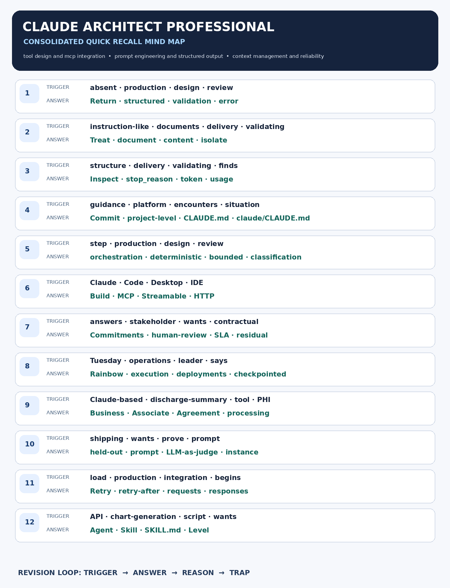
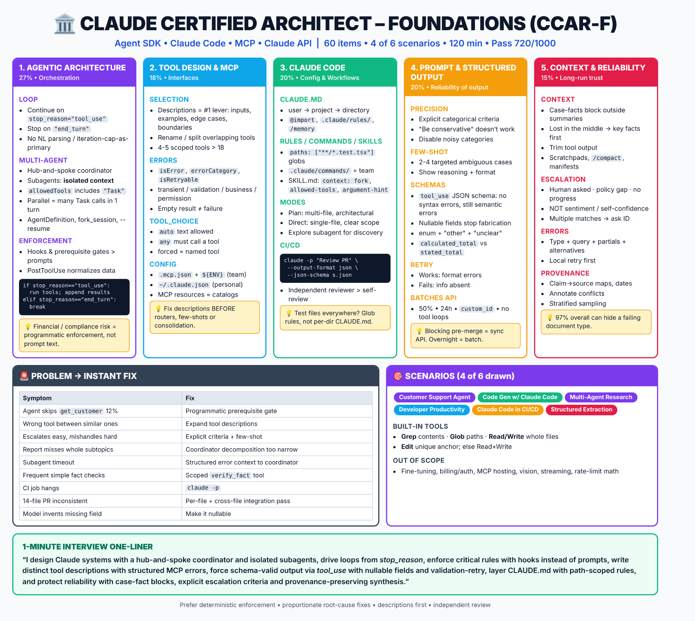
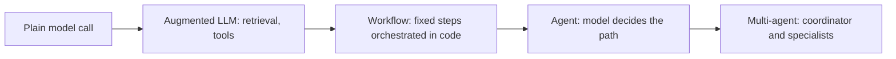
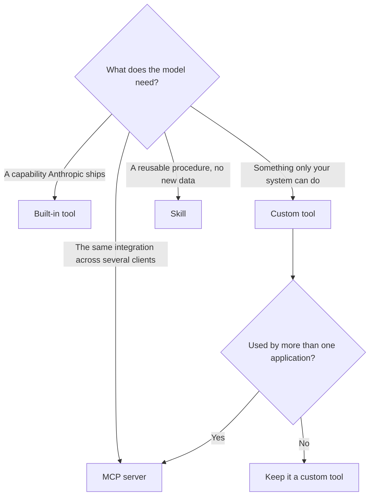

# Claude Certified Architect — Professional (CCAR-P)




[Open the answer PDF](docs/claude_architect_professional_answers.pdf)





<!-- REVISION-PRIORITIES:START -->
## Revision priorities

The objectives most worth drilling, with the practice questions (173–212) that cover each. Work from the top; revisit the rest lightly.

| Objective | Key recall | Practice question IDs |
|---|---|---|
| Orchestration safeguards: every session ends resolved or escalated | One orchestration layer owns every exit path (end_turn, cap, max_tokens, tool failure/timeout, refusal, exception) and a watchdog catches dead sessions. Never execute a truncated tool_use. | 173-177 |
| Iterative refinement workflows | Concrete input/output examples; tests first, then specific failures; batch interacting issues, fix independent ones sequentially. | 178-180 |
| Enforce via settings/hooks vs advise in CLAUDE.md | CLAUDE.md is advisory; deny rules, hooks and managed settings are deterministic; PostToolUse for formatting/tests after every edit. | 181-184 |
| Project context: @ references vs CLAUDE.md vs inline | Cross-session team context → project CLAUDE.md (+ @imports, path-scoped rules); this-task file → @ reference; one-off → inline. | 185-187 |
| Escalation decision criteria | Explicit request → immediate; frustration alone → acknowledge and offer help; policy gap/no progress → escalate; multiple matches → ask identifier; sentiment/confidence unreliable. | 188-192 |
| Structured output via tool use; tool_choice and sequencing | auto / any / named tool / none; forced calls guarantee shape not meaning; thinking allows only auto/none; gate prerequisite tools in code. | 193-197 |
| Extraction schemas: optional, nullable, enums | Required fields force fabrication; use nullable/optional, 'other' + detail, 'unclear'; normalise formats with few-shot examples. | 198-200 |
| Codebase exploration with Grep, Glob, Read | Grep contents, Glob paths, Read files; search first, read incrementally. | 201-202 |
| Stateless API and conversation history | Resend history every request; keep canonical history server-side. | 203-204 |
| Tool descriptions and MCP integration | Descriptions drive selection; shared MCP in .mcp.json with ${ENV_VAR}; typed errors. | 205-206, 211 |
| Session resumption, plan mode, decomposition | Name changed files after --resume; persist and inject findings; plan mode for broad/uncertain work; adaptive subtasks for open-ended work. | 207-210 |
| Structured handoff packages | Customer ID, root cause, actions, amounts, authorisation state, next action. | 212 |

<!-- REVISION-PRIORITIES:END -->

## Consolidated Mind Map

```text
CLAUDE ARCHITECT PROFESSIONAL
  ├─ Question domains
  │   ├─ tool design and mcp integration
  │   ├─ prompt engineering and structured output
  │   ├─ context management and reliability
  │   ├─ claude code configuration and workflows
  │   ├─ agentic architecture and orchestration
  │   ├─ integration
  │   ├─ stakeholder communication and lifecycle management
  │   ├─ solution design and architecture
  │   ├─ governance safety and risk management
  │   ├─ evaluation testing and optimization
  │   ├─ developer productivity and operational management
  │   ├─ claude models prompting and context
  ├─ Score-report priorities (added)
  │     safeguards · escalation · tool_choice · sequencing · enforce vs advise · project context · refinement · nullable schemas
  └─ Decision loop
      ├─ Trigger: identify the scenario constraint
      ├─ Answer: recall the source-backed technical choice
      ├─ Reason: connect choice to behavior or requirement
      └─ Trap: reject a distractor that conflicts with the requirement
```

## Four-keyword recall cards

| Question trigger (max 4) | Answer recall (max 4) | Reason — why it works | Trap — what to reject |
|---|---|---|---|
| ★ session · cap · timeout · crash | orchestrator · finalise · resolve · escalate | Every exit path (end_turn, iteration cap, max_tokens, tool failure/timeout, refusal, exception, process death) maps to a resolution or a human escalation in orchestration code, with a watchdog for sessions that die silently. | Trap: a prompt line asking the model to escalate, or just raising the cap. |
| ★ max_tokens · tool_use · cut-off · refund | never · execute · retry · escalate | A truncated tool_use block has unreliable arguments. Treat the turn as incomplete: no side effects, retry with a larger limit or escalate. | Trap: execute whatever parsed, or present the truncated text as the answer. |
| ★ wants · human · frustrated · policy | request · immediately · gap · identifier | Explicit human request: escalate at once. Frustration alone: acknowledge, offer resolution, escalate if repeated. Policy gap or no progress: escalate. Multiple matches: ask for an identifier. Sentiment and self-reported confidence are weak triggers. | Trap: investigate first, pick results[0], or escalate on a sentiment score. |
| ★ never · edit · ignored · audit | deny · permissions · PreToolUse · managed | CLAUDE.md is advisory context. Must-never and must-always rules go in settings permissions (deny) or hooks; org-wide rules in managed settings, which lower scopes cannot override. Formatting or tests after every edit: PostToolUse. | Trap: shout the rule louder in CLAUDE.md, a Skill or a user-level file. |
| ★ team · every-session · one-off · file | CLAUDE.md · @import · @file · inline | Reusable team-wide, cross-session context: project CLAUDE.md, split with @ imports and path-scoped .claude/rules. One specific file for this task: @ reference. A one-off detail: inline. | Trap: pasting guidance each session or one 900-line CLAUDE.md. |
| ★ inconsistent · prose · interacting · failures | examples · tests-first · batch · evaluate | Two or three concrete input/output examples beat prose; write tests first and feed specific failures; interacting issues go in one message and are evaluated together, independent ones sequentially. | Trap: more adjectives, one failure at a time for coupled bugs, or eyeballing. |
| ★ text · instead · tool · parser | tool_choice · forced · name · any | auto may answer in prose; any must call some tool (model picks); {type:tool,name} forces that tool; none disables tools. Forcing guarantees the call and its shape, not the correctness of values. | Trap: 'always call the tool' in the prompt, or temperature 0. |
| ★ thinking · forced · tool · error | auto · none · only · validate | With extended thinking, tool_choice is limited to auto or none. Pick structured-output-by-forcing or thinking, or use auto with a schema tool and validate. | Trap: assuming both features combine silently. |
| ★ lookup · before · refund · guessed-ID | gate · session-state · verified · code | Consequential prerequisite order is enforced in the tool executor or a hook (reject until a verified result exists); optionally force the first tool, then return to auto. | Trap: numbering tools in the prompt or renaming them. |
| ★ required · invented · missing · unreadable | nullable · optional · other · unclear | Required fields force fabrication. Make absent-able fields nullable/optional, give enums 'other' + detail and 'unclear', add normalisation rules and varied few-shot examples. Valid JSON is not correct JSON: validate semantics and retry with the error. | Trap: 'don't make things up' on a required field. |
| ★ forgets · history · resume · changed-files | stateless · resend · server-side · re-analyse | The Messages API keeps no state: resend relevant history, held canonically server-side. After --resume, name the changed files for targeted re-analysis; persist findings and inject them rather than repeating work; fork_session to branch. | Trap: trusting model memory or client-held history. |
| ★ callers · confused-tools · errors · handoff | Grep · descriptions · isError · package | Grep searches content, Glob matches paths, Read opens files; explore incrementally. Fix confused tools with fuller descriptions first. MCP errors: category, retryable, message, next action. Handoff: customer ID, root cause, actions, amounts, authorisation, next step. | Trap: reading every file, adding a router, or returning 'failed'. |
| absent · production · design · review | Return · structured · validation · error | Return a structured validation error that identifies the missing field and is not marked retryable. This is preferred because it addresses the stated requirement with explicit controls and predictable behavior. | Trap: Solve the symptom locally without defining ownership, boundaries or recovery behavior |
| instruction-like · documents · delivery · validating | Treat · document · content · isolate | Treat document content as data, isolate it with delimiters and enforce sensitive actions outside the model. This is preferred because it addresses the stated requirement with explicit controls and predictable behavior. | Trap: Increase model capacity and assume the architectural risk is resolved |
| structure · delivery · validating · finds | Inspect · stop_reason · token · usage | Inspect stop_reason and token usage; increase output budget or continue safely when truncation is confirmed. This is preferred because it addresses the stated requirement with explicit controls and predictable behavior. | Trap: Increase model capacity and assume the architectural risk is resolved |
| guidance · platform · encounters · situation | Commit · project-level · CLAUDE.md · claude/CLAUDE.md | Commit project-level CLAUDE.md or .claude/CLAUDE.md and keep personal guidance separate. This is preferred because it addresses the stated requirement with explicit controls and predictable behavior. | Trap: Make the entire design autonomous and remove deterministic application controls |
| step · production · design · review | orchestration · deterministic · bounded · classification | Keep orchestration deterministic and use the model only for the bounded classification with validated output. This is preferred because it addresses the stated requirement with explicit controls and predictable behavior. | Trap: Increase model capacity and assume the architectural risk is resolved |
| Claude · Code · Desktop · IDE | Build · MCP · Streamable · HTTP | Four different hosts needing the same capability with one place to manage it is exactly what MCP standardizes — discovery, primitives, and a single security boundary, with Streamable HTTP for remote multi- client access and OAuth for token acquisition. A duplicates the surface four times. | Trap: Define the tools separately in each of the four applications. |
| answers · stakeholder · wants · contractual | Commitments · human-review · SLA · residual | Probabilistic systems can carry meaningful commitments on availability, latency, and accuracy over a defined distribution with a defined measurement method, provided exclusions and the escalation path for failures are explicit. A invents a number without defining the distribution or the measurement, which is the same trap in a more precise-sounding form. | Trap: A commitment to 99.9% accuracy, which is close enough to be defensible. |
| Tuesday · operations · leader · says | Rainbow · execution · deployments · checkpointed | Stateful long-running agents need traffic shifted gradually with both versions live (rainbow) so in-flight sessions survive, and checkpoints with resumption so a late failure does not discard the run. B addresses cost, not statefulness. | Trap: Prompt caching and batch processing. |
| Claude-based · discharge-summary · tool · PHI | Business · Associate · Agreement · processing | HIPAA requires the BAA before processing, audit controls over PHI access and use, and — because output influences clinical records — human validation before the output becomes consequential. C confuses capability with compliance. | Trap: Selecting the largest available model to maximize accuracy. |
| shipping · wants · prove · prompt | held-out · prompt · LLM-as-judge · instance | Validity requires held-out data, a defined and independent grading method, and guardrails so a quality gain does not silently trade away latency or cost. C is a misconception — early effect sizes are large enough that ~20 well-chosen cases discriminate, and scale is invested when gains shrink. | Trap: Reporting the mean judge score on the cases that were used to iterate. |
| load · production · integration · begins | Retry · retry-after · requests · responses | The first triage question is retriable versus terminal. 429 is transient rate limiting and calls for jittered, capped backoff honoring retry-after . | Trap: Retry both with exponential backoff and jitter. |
| API · chart-generation · script · wants | Agent · Skill · SKILL.md · Level | Skills are filesystem-based, workspace-shared on the API, and use progressive disclosure — the brand reference costs nothing until read, and the script's body never enters context, only its output. A pays for 40 pages on every request. | Trap: Append the brand reference and script source to the system prompt on every request. |

## How to use this map

1. Read the trigger and identify the requirement or failure mode in the scenario.
2. Recall the answer keywords before looking at the explanation.
3. State why the answer works using the reason column.
4. Eliminate the trap because it conflicts with the scenario or source explanation.

## Source coverage

- Question bank: `questionBank_claude_architect_professional.js`
- Questions in source bank: **228**
- Consolidated recall cards: **24**
- Recall cards are representative study aids derived from the supplied question bank, not an official exam blueprint.

---

This professional practice guide extends the simulator's **Claude Certified Architect – Foundations** guide. The image above intentionally reuses the foundation reference graphic; the professional assessment is a separate, deeper 212-question practice bank.

## Practice exam format
- **228 professional-level practice MCQs** in the simulator bank.
- Questions emphasize architecture decisions, trade-offs, failure modes, operational controls and scenario-based judgment.
- This is a preparation resource, not an official Anthropic exam or a claim about live exam item count, scoring, price or blueprint.

## Domain coverage (aligned to the attached CCAR-P study guide)
1. Solution Design & Architecture — 17%.
2. Claude Models, Prompting & Context — 13%.
3. Integration — 19%.
4. Evaluation, Testing & Optimization — 16%.
5. Governance, Safety & Risk Management — 14%.
6. Stakeholder Communication & Lifecycle Management — 14%.
7. Developer Productivity & Operational Management — 7%.

## Quick Notes 
Most design questions reduce to picking the cheapest reliable structure:



Move right only when the left rung demonstrably cannot meet the requirement. An exam answer that adds agents, capabilities, or model size without a stated need is usually the wrong one; the sample rationales consistently reward removing what is unnecessary.

## Integration (19%), the heaviest domain

**Choosing what to build with.** The heaviest domain on the paper, and the
decision it keeps testing is which mechanism fits, not how to wire one up.



Capability bloat is the failure mode on the other side: every tool you add makes
every other tool slightly harder to choose correctly.

- **Least privilege is the reflex**: strip tools and permissions a role does not need, entirely. Logging and confirmation prompts are compensating controls, not substitutes for removal.
- **RAG design**: chunking should follow document structure, indexing and retrieval should match the data shape and query pattern, and hybrid retrieval exists for a reason. The classic failure: confident wrong answers after a document refresh point at retrieval and indexing, not the model.
- **Protocol selection**: MCP for reusable model-facing capabilities, direct API or CLI integration for fixed pipelines, agent-to-agent when autonomous systems must interoperate. Progressive discovery of tools beats loading a monolithic context when the tool surface is large.
- **Observability at scale** is designed in: traces of tool calls and decisions, not just final outputs, or production failures cannot be isolated to a layer.

## Evaluation (16%)

- Metrics span accuracy, latency, cost, safety, and security; pick them per use case and set them before building.
- Evaluation datasets need coverage of edge cases and mixed methodology: exact checks where truth is crisp, rubric or model-graded where it is not, human review where stakes demand it.
- A/B tests justify changes; regression suites keep model or prompt updates honest. Diagnosis order for degradation: data and retrieval first, then prompts, then model mismatch.

## Models, prompting, and context (13%)

- Model selection is a cost-latency-quality tradeoff argued from the task, not brand preference.
- The caching answer generalizes: static content first, dynamic last, cache the prefix; it cuts latency and cost simultaneously and appears in the official samples.
- Prompt reuse at enterprise scale means modular prompts, versioning, and Skills, so behavior changes are reviewable events rather than silent drift.

## Governance and safety (14%)

- Layer guardrails: input validation, output filtering, scoped permissions, human-in-the-loop for consequential actions. One layer is a single point of failure.
- Human-in-the-loop goes where errors are costly or irreversible; confidence-based routing keeps it affordable.
- Regulatory mapping in one line each: GDPR governs personal data of EU persons (minimization, purpose, erasure), HIPAA governs US health information, FedRAMP governs US federal cloud deployments. Know which applies to a scenario and what it forces in the design.
- Ethics is scored concretely: bias testing, fairness across user groups, transparency about AI involvement.

## Stakeholders and lifecycle (14%), the underrated domain

- Structured discovery before design: business problem, constraints, success measures, then architecture.
- Decisions get documented with their tradeoffs (an architecture decision record is the natural form), expectations get managed with explicit SLAs, and handoff includes implementation guidance, not just diagrams.
- Lifecycle thinking continues past deployment: monitoring, feedback loops, and iteration are part of the design, and the exam treats communication about all of this as a technical skill.

## Developer productivity (7%)

- Team-level Claude tooling: shared Claude Code configuration, standardized prompts and Skills, and AI-assisted debugging workflows. Small domain; do not overspend on it.

## Recall list

63 questions, 120 minutes, 720 of 1,000 to pass, $175 list, counts toward partner tier, no prerequisite (Architect Foundations is recommended order only), credential valid 12 months with free renewal, retake waits of 14, 30, then 90 days.

---

The original 150 simulator questions are retained. The 22 scenario questions from the attached study guide's seven domain sample-question sections have been added as questions 151–172. Multi-select items preserve their multiple correct answers and are rendered as checkbox questions.

## Professional exam approach
- Identify the requirement and the failure mode before selecting a solution.
- Prefer deterministic enforcement for permissions, destructive actions and business invariants.
- Keep agent autonomy bounded by explicit tools, budgets, deadlines, state and terminal conditions.
- Distinguish valid empty results from transport, authorization and business failures.
- Evaluate changes using representative scenarios and measurable quality, safety, latency and cost.

## Added study-guide questions
The 22 sample questions in the attached study guide have been added verbatim to the practice bank as questions 151–172, distributed across all seven blueprint domains. Seven are multiple-response questions; the exam interface presents checkboxes and scores the complete answer set.

## Revision questions
Questions 173–212 were added as targeted revision drills (see the Revision priorities table). They use the same schema as the rest of the bank.

## Additional scenario questions
Questions 213–228 are extra scenario questions on topics the earlier bank covered thinly: coordinator state ownership, external scratchpads, LLM-judge bias, deployment surface, circuit breakers, context management for long runs, model version pinning, MCP token passthrough and supply-chain risk, canary releases, PII-safe logging and citations. They are original practice questions, not live exam items.

## Simulator
Select **Claude Certified Architect – Professional** from the portal. The bank uses the simulator question schema, including an answer-index array for multi-select items and is loaded by `exam.html` through `js/questionBank_claude_architect_professional.js`.

## Relationship to Foundations
Use `claude_architect_readme.md` for the foundation-level reference notes. This professional guide builds on the same core concepts and reuses the foundation PNG rather than duplicating image assets.
