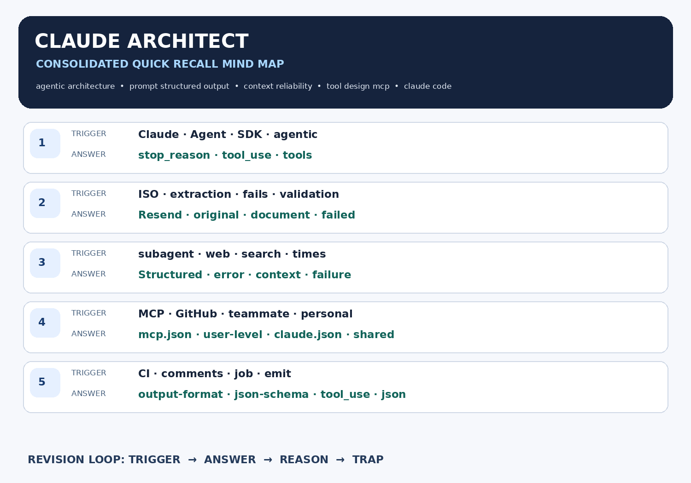
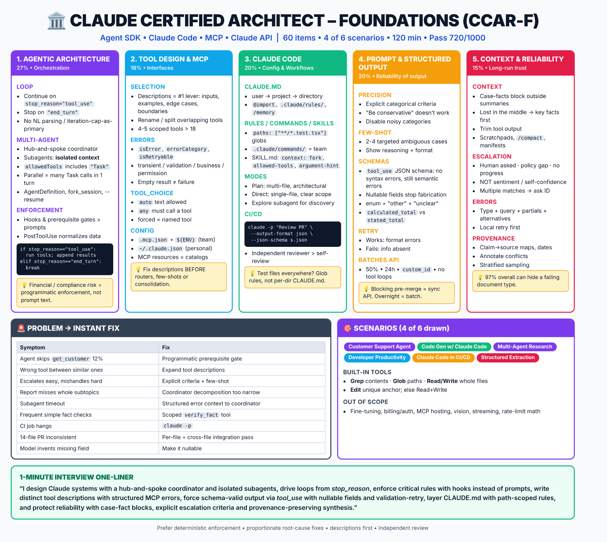

# 🏛️ Claude Certified Architect – Foundations (CCAR-F)




[Open the answer PDF](docs/claude_architect_answers.pdf)





## Consolidated Mind Map

```text
CLAUDE ARCHITECT
  ├─ Question domains
  │   ├─ agentic architecture
  │   ├─ prompt structured output
  │   ├─ context reliability
  │   ├─ tool design mcp
  │   ├─ claude code
  └─ Decision loop
      ├─ Trigger: identify the scenario constraint
      ├─ Answer: recall the source-backed technical choice
      ├─ Reason: connect choice to behavior or requirement
      └─ Trap: reject a distractor that conflicts with the requirement
```

## Four-keyword recall cards

| Question trigger (max 4) | Answer recall (max 4) | Reason — why it works | Trap — what to reject |
|---|---|---|---|
| Claude · Agent · SDK · agentic | stop_reason · tool_use · tools | The documented control flow is: continue while stop_reason is "tool_use", terminate when it is "end_turn". Parsing natural-language phrases, relying on arbitrary caps as the primary stop, or checking for text blocks are listed anti-patterns. | Trap: The assistant message contains any text content block |
| ISO · extraction · fails · validation | Resend · original · document · failed | Retry with Feedback: appending the specific validation error guides the model to correct format or structural mistakes, but it cannot fix information absent from the source. | Trap: Increase max_tokens |
| subagent · web · search · times | Structured · error · context · failure | Error Propagation: structured context enables intelligent coordinator recovery. Generic statuses hide information; swallowing errors or aborting the whole workflow are both anti-patterns. | Trap: "search unavailable" |
| MCP · GitHub · teammate · personal | mcp.json · user-level · claude.json · shared | ~/.claude.json: user-scoped configuration for personal or experimental MCP servers. Project-scoped .mcp.json is version-controlled for shared tooling, using ${ENV_VAR} expansion for tokens. | Trap: The shared server in ~/.claude.json and the personal one in .mcp.json |
| CI · comments · job · emit | output-format · json-schema · tool_use · json | --json-schema: constrains CI output to a defined structure. A tool_use Schema in API-based extraction gives the same syntactic guarantee, though semantic checks remain your job. | Trap: Parsing the terminal colors |

## How to use this map

1. Read the trigger and identify the requirement or failure mode in the scenario.
2. Recall the answer keywords before looking at the explanation.
3. State why the answer works using the reason column.
4. Eliminate the trap because it conflicts with the scenario or source explanation.

## Source coverage

- Question bank: `questionBank_claude_architect.js`
- Questions in source bank: **211**
- Consolidated recall cards: **5**
- Recall cards are representative study aids derived from the supplied question bank, not an official exam blueprint.

---

### 📘 Interview & Exam Quick Reference (Agent SDK + Claude Code + MCP + Claude API)

**Exam facts:** 60 items · 4 scenarios drawn from a bank of 6 · 120 min · pass = scaled **720 / 1000** · $125 · valid 12 months.
The exam rewards **judgment about tradeoffs**: pick the *proportionate, root-cause* fix, and prefer **deterministic enforcement** over hopeful prompting.

**Practice simulator coverage:** expanded to 150 curated questions plus a refreshed 100-question priority set (`hotsQuestions`). The Hot 100 follows the official blueprint: Agentic Architecture 27, Tool Design & MCP 18, Claude Code 20, Prompt & Structured Output 20, and Context & Reliability 15. This is a preparation bank, not a representation of the live exam item count.

| # | Domain | Weight |
| - | ------ | ------ |
| 1 | Agentic Architecture & Orchestration | **27%** |
| 2 | Tool Design & MCP Integration | **18%** |
| 3 | Claude Code Configuration & Workflows | **20%** |
| 4 | Prompt Engineering & Structured Output | **20%** |
| 5 | Context Management & Reliability | **15%** |

**Scenarios (4 of 6 at random):** Customer Support Agent · Code Generation with Claude Code · Multi-Agent Research · Developer Productivity · Claude Code in CI/CD · Structured Data Extraction.

---

# 🤖 1. Agentic Architecture & Orchestration (27%)

### 🔑 Agentic loop (memorize)

```python
while True:
    resp = client.messages.create(model=M, tools=TOOLS, messages=msgs)
    msgs.append({"role": "assistant", "content": resp.content})
    if resp.stop_reason == "end_turn":      # terminate
        break
    if resp.stop_reason == "tool_use":      # continue
        results = [run(b) for b in resp.content if b.type == "tool_use"]
        msgs.append({"role": "user", "content": results})   # tool_result blocks
```

❌ **Anti-patterns:** parsing natural-language "I'm done", arbitrary iteration cap as the *primary* stop, treating "has text block" as completion.

### 🔑 Multi-agent (hub-and-spoke)

* **Coordinator** decomposes, delegates, aggregates, re-delegates gaps, routes *all* communication (observability + consistent error handling)
* **Subagents have isolated context**: they inherit nothing; put complete findings **in the prompt**
* **Task tool** spawns subagents → coordinator's `allowedTools` **must include `"Task"`**
* **Parallel subagents** = multiple `Task` calls in **one** coordinator response
* **AgentDefinition** = description + system prompt + tool restrictions
* Narrow decomposition ("creative industries" → only visual arts) is a **coordinator** root cause, not a subagent bug
* Pass **structured data** (claim, evidence, source URL, date) to preserve attribution

### 🔑 Enforcement vs guidance

| Need | Use |
| ---- | --- |
| Identity check before refund; refund cap | **Hooks / prerequisite gates** (deterministic) |
| Style, tone, soft preferences | Prompt instructions (probabilistic) |
| Normalize timestamps / status codes from many tools | **PostToolUse hook** |
| Block refund > $500 and escalate | Tool-call interception hook |

💡 **Exam Tip:** "Non-zero failure rate" in a prompt + financial/compliance consequence = **programmatic enforcement**.

### 🔑 Decomposition & sessions

* **Prompt chaining** (fixed passes) → predictable multi-aspect reviews
* **Dynamic decomposition** → open-ended investigation (map → prioritize → adapt)
* `--resume <name>` continues a session; if tool results are stale, **start fresh with an injected summary**
* `fork_session` → independent branches from a shared baseline (compare two approaches)
* Tell a resumed session **which files changed**

---

# 🧰 2. Tool Design & MCP Integration (18%)

* **Tool descriptions are the primary selection mechanism.** Fix vague/overlapping tools by expanding descriptions (inputs, examples, edge cases, boundaries) *first*, before routers, few-shots or consolidation
* Rename/split overlapping tools (`analyze_document` → `extract_data_points`, `summarize_content`, `verify_claim_against_source`)
* Watch for **keyword-sensitive system prompts** overriding good descriptions
* **Error responses:** MCP `isError` + `errorCategory` (transient / validation / business / permission) + `isRetryable` + human-readable message
* Business-rule violation → `retriable: false` + customer-friendly explanation
* **Valid empty result ≠ access failure** (never return failure as empty success)
* **Scoped tools:** 4-5 role tools beat 18; synthesis agent gets a scoped `verify_fact`, complex cases still go through the coordinator
* **`tool_choice`:** `auto` (may return text) · `any` (must call *a* tool) · forced `{"type":"tool","name":"..."}` (must call *that* tool)

### 🔑 MCP configuration

| Scope | File | Use |
| ----- | ---- | --- |
| Project (shared, versioned) | `.mcp.json` with `${GITHUB_TOKEN}` expansion | Team tooling, no committed secrets |
| User (personal) | `~/.claude.json` | Experimental servers |

* All configured servers' tools are discovered at connection and available **simultaneously**
* **MCP resources** expose catalogs (schemas, issue lists, doc trees) to cut exploratory calls
* Prefer **community MCP servers** for standard integrations (Jira); custom only for team-specific workflows
* Rich MCP tool descriptions stop the agent preferring built-in `Grep`

### 🔑 Built-in tools

| Tool | Use |
| ---- | --- |
| **Grep** | Search file **contents** (callers, error strings, imports) |
| **Glob** | Match file **paths** (`**/*.test.tsx`) |
| **Read / Write** | Whole-file operations |
| **Edit** | Targeted change via unique anchor; if non-unique → **Read + Write** |
| **Bash** | Commands |

Build understanding incrementally: Grep entry points → Read to follow imports.

---

# 💻 3. Claude Code Configuration & Workflows (20%)

### 🔑 CLAUDE.md hierarchy

* **User** `~/.claude/CLAUDE.md` – personal, **not shared** (classic "new teammate isn't getting rules" bug)
* **Project** `.claude/CLAUDE.md` or root `CLAUDE.md` – shared via git
* **Directory** – subdirectory-scoped
* `@import` keeps it modular; `.claude/rules/*.md` splits topics; `/memory` shows what's loaded

### 🔑 Path-specific rules

```yaml
---
paths: ["**/*.test.tsx"]
---
Use React Testing Library; one behavior per test.
```

Glob rules beat per-directory CLAUDE.md when conventions span **many directories** (tests next to source). Loads only when editing matching files.

### 🔑 Commands & skills

| Item | Location | Notes |
| ---- | -------- | ----- |
| Team slash command | `.claude/commands/` | Shared via version control |
| Personal command | `~/.claude/commands/` | Not shared |
| Skill | `.claude/skills/<name>/SKILL.md` | `context: fork`, `allowed-tools`, `argument-hint` |
| Personal skill variant | `~/.claude/skills/` (different name) | Doesn't affect teammates |

* **Skill** = on-demand task workflow · **CLAUDE.md** = always-on universal standards
* `context: fork` isolates verbose output from the main conversation

### 🔑 Plan mode vs direct execution

| Plan mode | Direct execution |
| --------- | ---------------- |
| Monolith→microservices, 45+ file migration, multiple valid approaches | Single-file fix with clear stack trace, add one validation |

Combine: **plan** to investigate → **execute** to implement. **Explore subagent** isolates verbose discovery.

### 🔑 Iterative refinement

* 2-3 **input/output examples** beat prose when interpretation is inconsistent
* **Test-driven iteration**: write tests, share failures
* **Interview pattern**: Claude asks questions to surface unconsidered concerns
* Interacting problems → one message; independent problems → sequential

### 🔑 CI/CD

```bash
claude -p "Review this PR" --output-format json --json-schema schema.json
```

* `-p/--print` = non-interactive (no hang). `CLAUDE_HEADLESS` and `--batch` **do not exist**
* CLAUDE.md supplies testing standards/fixtures/review criteria to CI runs
* Re-reviews: include prior findings, report only **new/unaddressed**
* **Independent review instance** > self-review (generator keeps its reasoning context)

---

# 🎯 4. Prompt Engineering & Structured Output (20%)

* **Explicit categorical criteria** > "be conservative" / "only high confidence" (these don't improve precision)
* High false-positive categories erode trust in good ones → **temporarily disable**, fix, re-enable
* **Severity levels** need concrete code examples
* **Few-shot (2-4 targeted examples)** = best fix for inconsistent format & ambiguous cases; shows *why* one action beat alternatives; generalizes judgment
* **`tool_use` + JSON schema** = most reliable structured output (kills **syntax** errors, **not semantic** errors)
* **Nullable/optional fields** when source may lack data → prevents fabricated values
* Enum + `"other"` + detail string; add `"unclear"`
* **Validation-retry:** send document + failed extraction + specific error. Works for **format/structure** problems; **useless when info is absent** from the source
* `calculated_total` vs `stated_total`, `conflict_detected`, `detected_pattern` (analyze dismissals)

### 🔑 Message Batches API

* **50% cheaper · up to 24 h · no latency SLA · `custom_id` correlation · no mid-request tool loops**
* ✅ overnight reports, weekly audits, nightly test generation
* ❌ blocking pre-merge checks → use synchronous API
* Failures: resubmit only failed `custom_id`s (chunk oversized docs); tune prompt on a **sample** first
* SLA math: 24 h batch + 4 h submit window = 28 h → fits a 30 h SLA

### 🔑 Multi-pass review

14-file PR inconsistent? → **per-file local passes + a cross-file integration pass** (attention dilution). Bigger context window ≠ better attention. Majority-vote of 3 runs suppresses real bugs.

---

# 🧠 5. Context Management & Reliability (15%)

* **Progressive summarization** loses numbers/dates/expectations → keep a **case-facts block** (amounts, dates, IDs, statuses) outside summaries
* **Lost in the middle:** key findings at the **start**, section headers for detail
* **Trim tool output** (40 order fields → the 5 you need)
* Upstream agents return **structured facts + citations**, not verbose reasoning
* **Escalate** when: customer asks for human (**immediately**) · policy gap/silent · no progress. **Not** on sentiment or self-reported confidence (poor proxies)
* Multiple customer matches → **ask for identifiers**, don't guess
* Frustrated but solvable → acknowledge, offer resolution, escalate only if they insist
* **Structured handoff:** customer ID, root cause, amount, recommended action (humans lack the transcript)
* **Error propagation:** failure type + attempted query + partial results + alternatives. Local retry of transients first. Anti-patterns: generic "unavailable", silent empty success, killing the whole workflow
* **Large codebases:** scratchpad files, subagent delegation, `/compact`, **crash-recovery manifests**
* **Human review:** 97% overall accuracy can hide weak segments → **stratified sampling** + accuracy by document type/field; field-level confidence calibrated on labeled sets
* **Provenance:** keep claim→source mappings through synthesis; **annotate conflicts** (both values + sources); require **dates** so time differences aren't "contradictions"; render financial data as tables, news as prose

---

# 🚨 Problem → Instant Fix Map

| Symptom | Fix |
| ------- | --- |
| Agent skips `get_customer` 12% of time | Programmatic prerequisite gate |
| Wrong tool chosen between similar tools | Expand tool descriptions |
| Escalates easy / handles hard cases | Explicit criteria + few-shot |
| Report misses whole topic areas | Coordinator decomposition too narrow |
| Subagent times out | Structured error context to coordinator |
| Synthesis needs frequent fact checks | Scoped `verify_fact` tool |
| CI job hangs | `claude -p` |
| Batch for blocking check? | No: sync API; batch for overnight |
| Inconsistent PR review | Per-file + integration passes |
| Test files everywhere need same rules | `.claude/rules/` with glob `paths` |
| Totals don't sum | Semantic validation (`calculated_total`) |
| Model invents missing field | Make field nullable |

---

# 🚫 Out of Scope (don't over-study)

Fine-tuning · API auth/billing · MCP hosting/infra · Claude internals · RLHF/Constitutional AI · embeddings/vector DBs · computer use · vision · streaming/SSE · rate limits & pricing math · cloud-provider specifics · prompt caching internals · tokenization.

---

# 🏁 Final Interview One-Liner

> “I design Claude systems with a hub-and-spoke coordinator and isolated subagents, drive loops off `stop_reason`, enforce critical business rules with hooks instead of prompts, write distinctive tool descriptions with structured MCP errors, force schema-valid output via `tool_use` with nullable fields and validation-retry, configure Claude Code through a layered CLAUDE.md plus path-scoped rules, and protect reliability with case-fact blocks, explicit escalation criteria, and provenance-preserving synthesis.”

✅ Optimized for the CCAR-F exam and real-world Claude architecture discussions.


---

## Practice bank and simulator files

- `questionBank_claude_architect.js` contains 150 multiple-choice questions with stable zero-based IDs, difficulty, official blueprint category, four options, answer index, and rationale.
- `hotsQuestions` contains 100 unique zero-based indices, weighted to the five official domains and ordered by priority. Keep these as array indices; if the bank is reordered, regenerate the list.
- `claude_architect_detailed_one_pager.png` is the companion visual quick reference for the five domains, scenario patterns, and root-cause fixes.
- The exam guide states 60 live exam items, four scenarios selected from a bank of six, 120 minutes, and a scaled passing score of 720/1000. The 150-question bank is supplemental practice content.

**Preparation approach:** prioritize the Hot 100, explain why each distractor is wrong, and practice selecting the smallest deterministic fix that addresses the actual failure. Then complete all remaining questions and review scenario-based questions by domain. The current official exam guide remains authoritative if exam details change.
