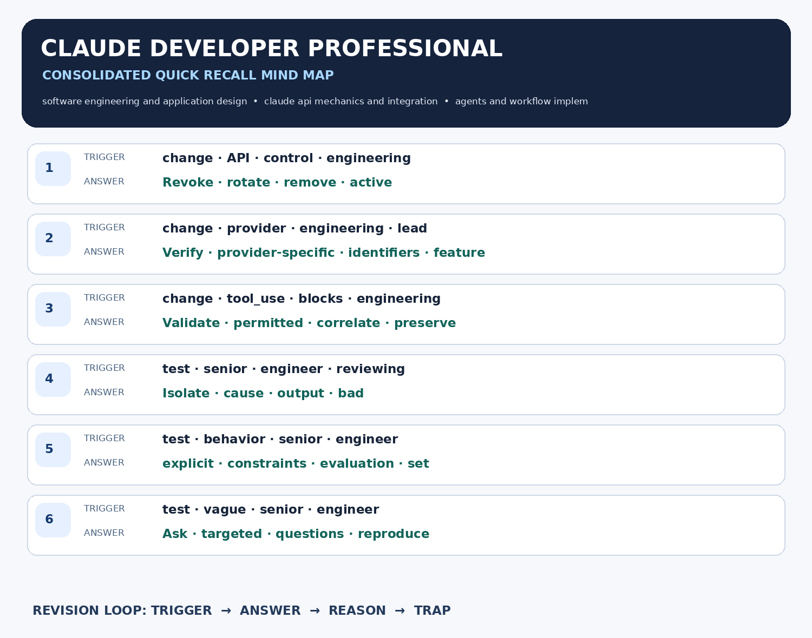

# Claude Certified Developer — Professional (CCDV-P)




[Open the answer PDF](docs/claude_developer_professional_answers.pdf)


<!-- REVISION-PRIORITIES:START -->
## Revision priorities

The objectives most worth drilling, with the practice questions (151–188) that cover each. Work from the top; revisit the rest lightly.

| Objective | Key recall | Practice question IDs |
|---|---|---|
| Orchestration safeguards: every session ends resolved or escalated | Bounded loop + deadline, try/finally around tools, one finalise(); correct stop_reason handling; never execute a cut-off tool_use. | 151-155 |
| Iterative refinement workflows | Example pairs; tests first; group related failures, fix once, re-run whole eval set. | 156-158 |
| Enforce via settings/hooks vs advise in CLAUDE.md | Deny rules and hooks are deterministic (PreToolUse exit 2 blocks); CLAUDE.md advisory; PostToolUse formatter. | 159-162 |
| Project context: @ references vs CLAUDE.md vs inline | Project CLAUDE.md + @imports for shared; rules paths for file types; @ file for this task. | 163-165 |
| Escalation decision criteria | Escalate on explicit request, policy gap, repeated failure; ask identifier for multiple matches; no sentiment/confidence triggers. | 166-169 |
| Structured output via tool use; tool_choice and sequencing | {type:tool,name} forces a tool; any forces some tool; no forcing with extended thinking; executor guard for prerequisites; validate semantics. | 170-174 |
| Extraction schemas: optional, nullable, enums | Nullable/optional fields, 'other'+detail, 'unclear', normalisation + varied few-shot. | 175-177 |
| Stateless API, exploration, descriptions, MCP, resume | Resend history (server-side); Grep→Read; description contrast; .mcp.json with ${ENV_VAR}; re-analyse changed files; plan mode; adaptive decomposition. | 178-187 |
| Structured handoff packages | ID, root cause, actions, amounts, authorisation state, next action. | 188 |

<!-- REVISION-PRIORITIES:END -->

## Consolidated Mind Map

```text
CLAUDE DEVELOPER PROFESSIONAL
  ├─ Question domains
  │   ├─ software engineering and application design
  │   ├─ claude api mechanics and integration
  │   ├─ agents and workflow implementation
  │   ├─ security, safety and evaluation
  │   ├─ prompt, context and output handling
  │   ├─ claude code engineering workflows
  ├─ Score-report priorities (added)
  │     safeguards · escalation · tool_choice · sequencing · enforce vs advise · project context · refinement · nullable schemas
  └─ Decision loop
      ├─ Trigger: identify the scenario constraint
      ├─ Answer: recall the source-backed technical choice
      ├─ Reason: connect choice to behavior or requirement
      └─ Trap: reject a distractor that conflicts with the requirement
```

## Four-keyword recall cards

| Question trigger (max 4) | Answer recall (max 4) | Reason — why it works | Trap — what to reject |
|---|---|---|---|
| ★ while-True · hang · crash · half-processed | bounded · try/finally · finalise · escalate | Bound the loop (iteration cap + deadline), wrap tool execution in try/finally, and call one finalise() that always records resolved or escalated; add a watchdog for dead processes. | Trap: prompt says 'stop after 10 steps', or swallow exceptions and continue. |
| ★ stop_reason · max_tokens · refusal · parse | tool_use · end_turn · incomplete · retry | tool_use: execute and continue; end_turn: done; max_tokens: incomplete, never execute a cut-off tool_use; refusal: surface or escalate. Always answer each tool_use_id with a tool_result (is_error + structured detail on failure). | Trap: json.loads the partial input, or search the text for 'done'. |
| ★ wants · person · multiple-matches · policy-gap | escalate · identifier · explicit · triggers | Implement escalation on explicit request (immediate), policy gaps and repeated failures. Ambiguous lookup: ask for an identifier, never results[0]. Do not trigger on sentiment or self-reported confidence. | Trap: one more lookup first, or a sentiment threshold. |
| ★ never · read-.env · formatter · every-edit | permissions · deny · PostToolUse · exit-2 | CLAUDE.md is advisory. Enforce with settings deny rules and hooks: PreToolUse blocks with exit code 2 and a stderr reason, PostToolUse runs formatter/tests after every edit. | Trap: repeat the rule in CLAUDE.md or exit 0 with a warning. |
| ★ shared · every-session · one-off · bloated | CLAUDE.md · @import · rules-paths · @file | Project CLAUDE.md (committed) for team conventions with @ imports; path-scoped .claude/rules for file-type specifics; @ file reference for this task only. | Trap: user-level file, pasted text, or a 1,100-line file. |
| ★ edge-cases · fail · prose · related-failures | examples · tests-first · group · rerun-all | Add input/output example pairs, drive iteration with tests, fix a shared root cause once and re-run the whole eval set for regressions. | Trap: special-case patches per failure or switching models blindly. |
| ★ prose · instead · of · tool_use | tool_choice · type · tool · name | tool_choice={"type":"tool","name":...} forces a named tool; "any" forces some tool; "auto" can answer in text. Forced tool choice is not allowed with extended thinking (auto/none only). | Trap: retry until a tool_use appears, or regex the prose. |
| ★ lookup · before · refund · guard | executor · guard · state · reject | Enforce prerequisite tool order in the executor: reject issue_refund unless a verified lookup result is in session state. | Trap: tool order in the list or a comment in the description. |
| ★ valid-JSON · wrong · total · required-field | nullable · validate · retry · other/unclear | Schemas give shape, not meaning: add semantic validation (sum checks) and retry with the exact error. Nullable/optional fields stop fabrication; enums get 'other' + detail and 'unclear'. | Trap: accept valid JSON, or add a plausibility regex. |
| ★ forgets · history · forged-roles · resume | stateless · server-side · changed-files · persist | Resend history every call, authoritative on the server (roles and tool_result built server-side). On resume, name changed files; persist structured findings and inject them. | Trap: browser-held history or trusting model memory. |
| ★ explore · descriptions · MCP · handoff | Grep · contrast · ${ENV_VAR} · package | Grep then Read incrementally; fix tool confusion with purpose/format/examples/contrast in descriptions; shared MCP in committed .mcp.json with ${ENV_VAR}; typed errors; handoff carries ID, root cause, actions, amounts, authorisation, next step. | Trap: read every file, add a classifier router, hard-code the token. |
| change · API · control · engineering | Revoke · rotate · remove · active | Revoke and rotate it, remove it from active history where possible, and move secrets to managed configuration. This is preferred because it addresses the stated requirement with explicit controls and predictable behavior. | Trap: Rely on a prompt-only instruction and leave enforcement or validation to the model |
| change · provider · engineering · lead | Verify · provider-specific · identifiers · feature | Verify provider-specific model identifiers, feature support, limits, authentication and operational behavior. This is preferred because it addresses the stated requirement with explicit controls and predictable behavior. | Trap: Rely on a prompt-only instruction and leave enforcement or validation to the model |
| change · tool_use · blocks · engineering | Validate · permitted · correlate · preserve | Validate and execute each permitted call, correlate each result and preserve the protocol sequence. This is preferred because it addresses the stated requirement with explicit controls and predictable behavior. | Trap: Skip instrumentation and accept the result if the response appears plausible |
| test · senior · engineer · reviewing | Isolate · cause · output · bad | Isolate whether the cause is model output, bad tool data, incorrect parameters, truncation or orchestration. This is preferred because it addresses the stated requirement with explicit controls and predictable behavior. | Trap: Rely on a prompt-only instruction and leave enforcement or validation to the model |
| test · behavior · senior · engineer | explicit · constraints · evaluation · set | Use examples, explicit constraints and an evaluation set that covers representative edge cases. This is preferred because it addresses the stated requirement with explicit controls and predictable behavior. | Trap: Rely on a prompt-only instruction and leave enforcement or validation to the model |
| test · vague · senior · engineer | Ask · targeted · questions · reproduce | Ask targeted questions, reproduce, inspect traces and isolate the smallest failing layer. This is preferred because it addresses the stated requirement with explicit controls and predictable behavior. | Trap: Retry or repeat the operation without classifying the failure or checking side effects |

## How to use this map

1. Read the trigger and identify the requirement or failure mode in the scenario.
2. Recall the answer keywords before looking at the explanation.
3. State why the answer works using the reason column.
4. Eliminate the trap because it conflicts with the scenario or source explanation.

## Source coverage

- Question bank: `questionBank_claude_developer_professional.js`
- Questions in source bank: **203**
- Consolidated recall cards: **17**
- Recall cards are representative study aids derived from the supplied question bank, not an official exam blueprint.

---

This professional practice guide extends the simulator's **Claude Certified Developer – Foundations** guide. The image above intentionally reuses the foundation reference graphic; the professional assessment is a separate, deeper 150-question practice bank.

## Practice exam format
- **203 professional-level practice MCQs** in the simulator bank.
- Questions emphasize API integration, production software engineering, agent-loop implementation, Claude Code workflows, context/output handling, security and evaluation.
- This is a preparation resource, not an official Anthropic exam or a claim about live exam item count, scoring, price or blueprint.

## Domain coverage
1. Claude API mechanics and integration — stateless Messages API, streaming, multimodal input, batching, truncation, provider integration and request lifecycle.
2. Software engineering and application design — retries, idempotency, validation, concurrency, secrets, auditability, contracts and deployment.
3. Agents and workflow implementation — stop reasons, tool protocol, approval, state, bounded loops, subagents and recovery.
4. Claude Code engineering workflows — project guidance, headless CI, Plan mode, Skills, path-specific rules, review and safe execution.
5. Prompt, context and output handling — structured output, untrusted content, context pruning, evidence, caching and unknown values.
6. Security, safety and evaluation — injection defense, server-side authorization, data minimization, least privilege, regression evals and trace diagnosis.

## Professional exam approach
- Treat model output as untrusted input until validated.
- Keep authorization, transaction rules and side-effect controls in application code.
- Classify failures before retrying; use bounded backoff for transient failures and idempotency for writes.
- Inspect stop reasons, tool-use correlation, truncation and usage metadata.
- Test realistic edge cases and operational failure paths, not only happy-path prompts.

## Revision questions
Questions 151–188 were added as targeted revision drills (see the Revision priorities table). They use the same schema as the rest of the bank.

## Additional scenario questions
Questions 189–203 are extra scenario questions on topics the earlier bank covered thinly: coordinator state ownership, external scratchpads, LLM-judge bias, deployment surface, circuit breakers, context management for long runs, model version pinning, MCP token passthrough and supply-chain risk, canary releases, PII-safe logging and citations. They are original practice questions, not live exam items.

## Simulator
Select **Claude Certified Developer – Professional** from the portal. The bank uses the existing simulator question schema and is loaded by `exam.html` through `js/questionBank_claude_developer_professional.js`.

## Relationship to Foundations
Use `claude_developer_readme.md` for the foundation-level reference notes. This professional guide builds on the same core concepts and reuses the foundation PNG rather than duplicating image assets.
