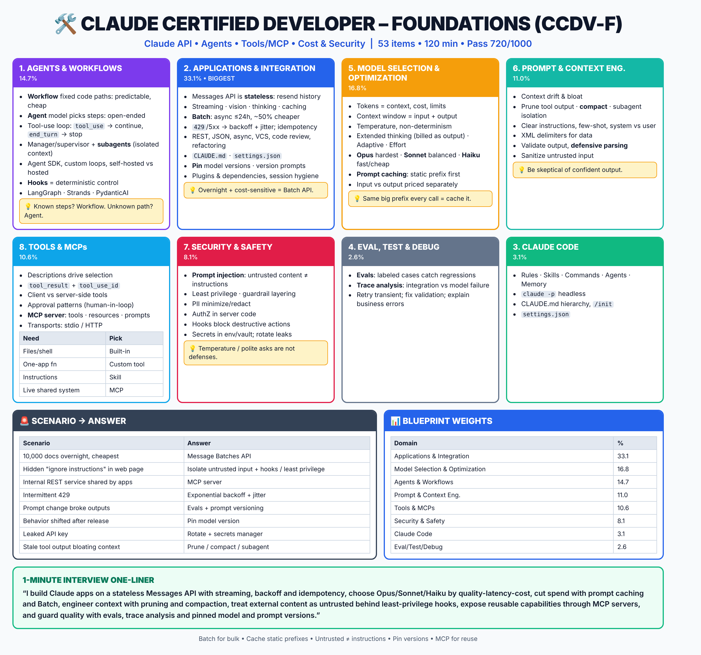

# Claude Certified Developer — Professional (CCDV-P)

This professional practice guide extends the simulator's **Claude Certified Developer – Foundations** guide. The image above intentionally reuses the foundation reference graphic; the professional assessment is a separate, deeper 150-question practice bank.

## Practice exam format
- **150 professional-level practice MCQs** in the simulator bank.
- Questions emphasize API integration, production software engineering, agent-loop implementation, Claude Code workflows, context/output handling, security and evaluation.
- This is a preparation resource, not an official Anthropic exam or a claim about live exam item count, scoring, price or blueprint.

## Domain coverage
1. Claude API mechanics and integration — stateless Messages API, streaming, multimodal input, batching, truncation, provider integration and request lifecycle.
2. Software engineering and application design — retries, idempotency, validation, concurrency, secrets, auditability, contracts and deployment.
3. Agents and workflow implementation — stop reasons, tool protocol, approval, state, bounded loops, subagents and recovery.
4. Claude Code engineering workflows — project guidance, headless CI, Plan mode, Skills, path-specific rules, review and safe execution.
5. Prompt, context and output handling — structured output, untrusted content, context pruning, evidence, caching and unknown values.
6. Security, safety and evaluation — injection defense, server-side authorization, data minimization, least privilege, regression evals and trace diagnosis.

## Professional exam approach
- Treat model output as untrusted input until validated.
- Keep authorization, transaction rules and side-effect controls in application code.
- Classify failures before retrying; use bounded backoff for transient failures and idempotency for writes.
- Inspect stop reasons, tool-use correlation, truncation and usage metadata.
- Test realistic edge cases and operational failure paths, not only happy-path prompts.

## Simulator
Select **Claude Certified Developer – Professional** from the portal. The bank uses the existing simulator question schema and is loaded by `exam.html` through `js/questionBank_claude_developer_professional.js`.

## Relationship to Foundations
Use `claude_developer_readme.md` for the foundation-level reference notes. This professional guide builds on the same core concepts and reuses the foundation PNG rather than duplicating image assets.
