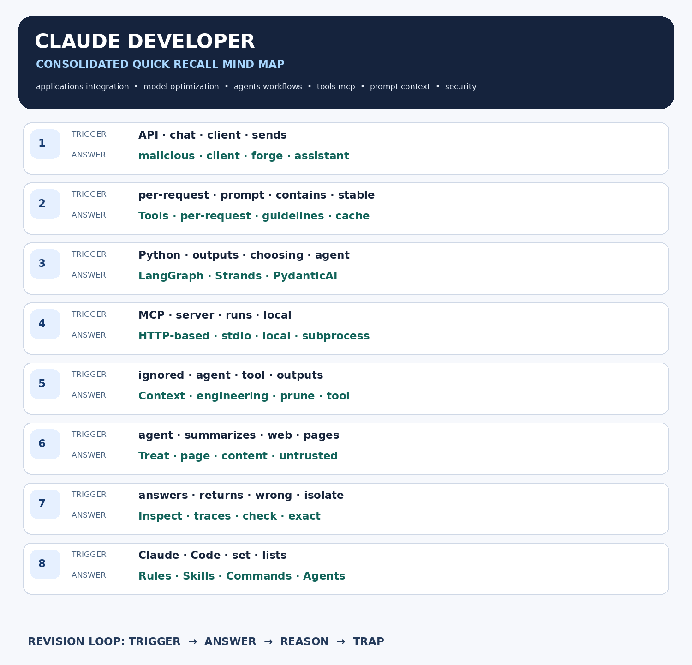
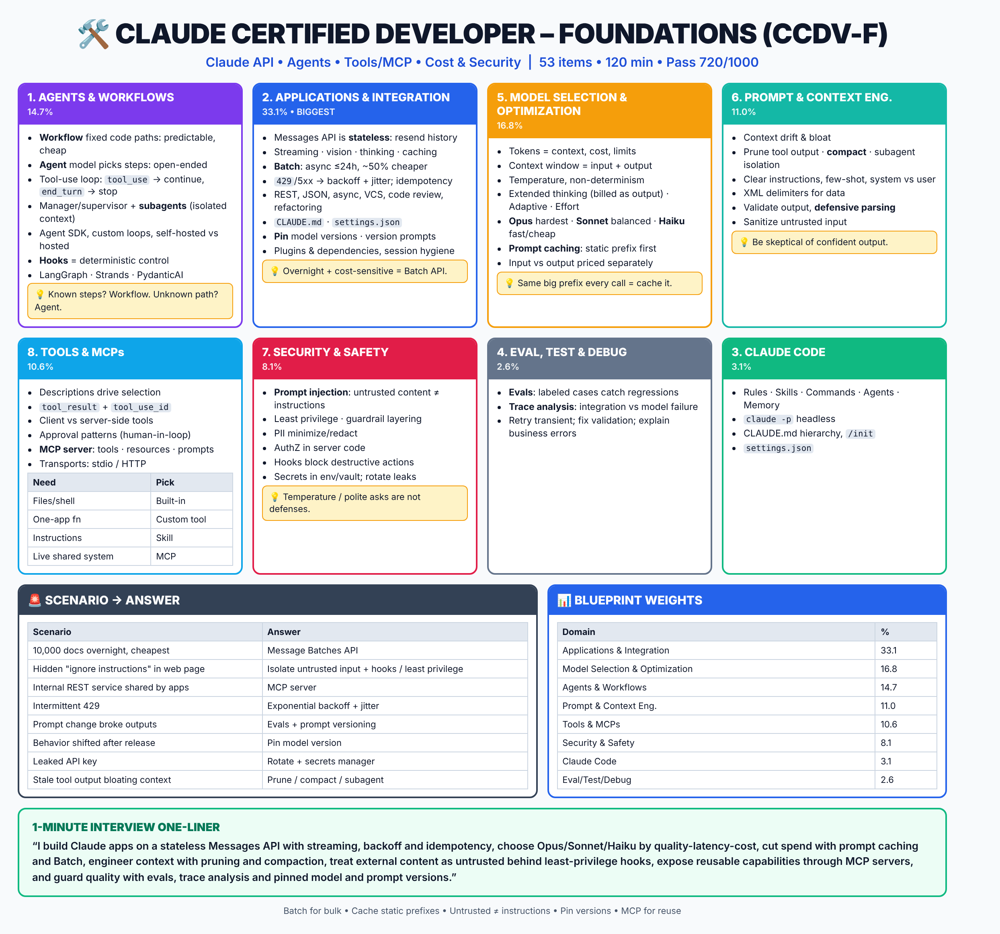
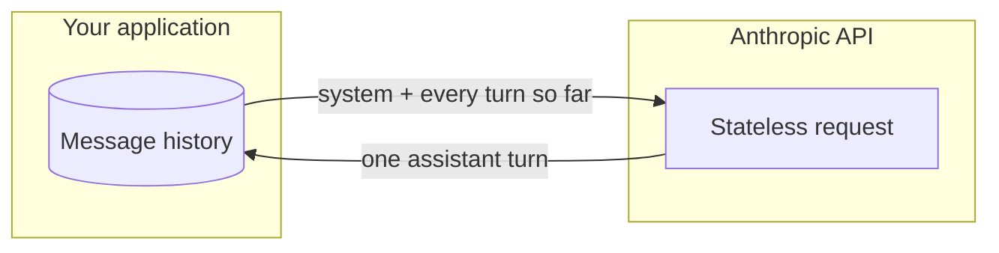
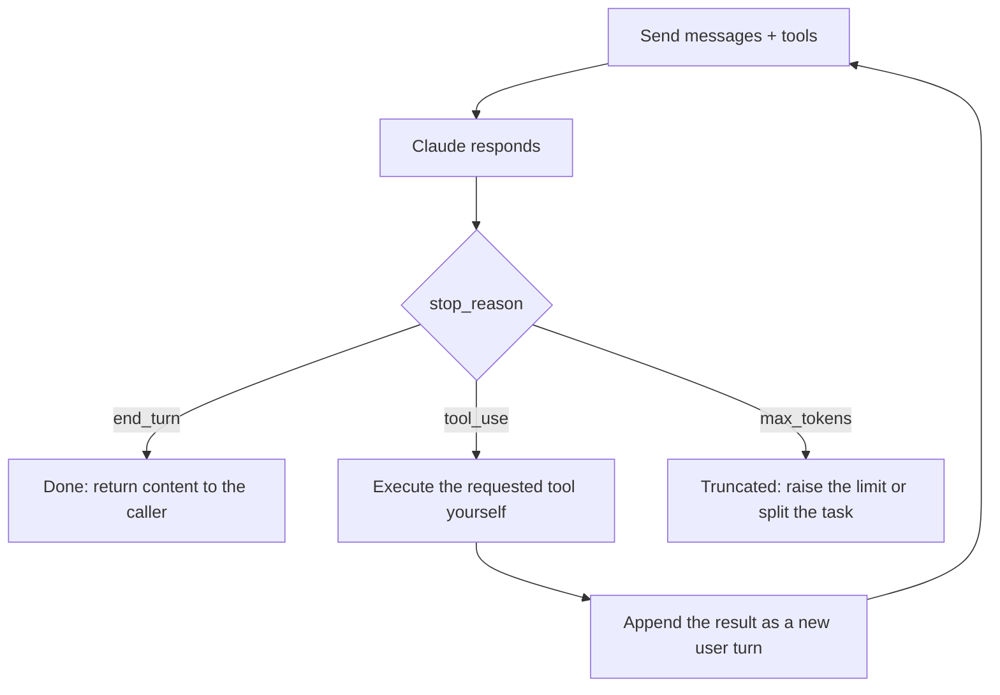
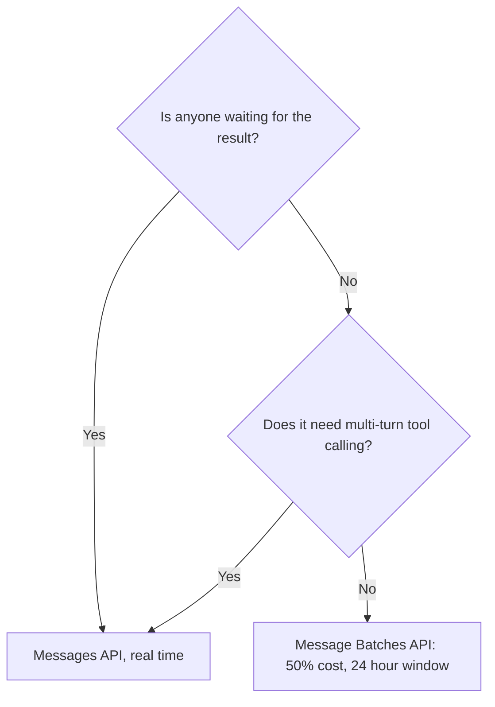
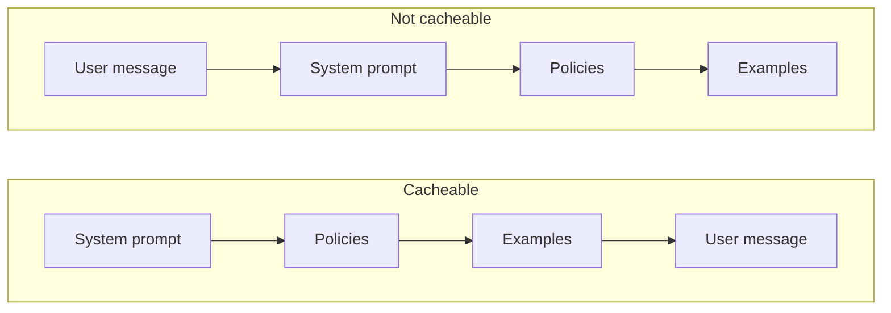

# 🛠️ Claude Certified Developer – Foundations (CCDV-F)




[Open the answer PDF](docs/claude_developer_answers.pdf)





## Consolidated Mind Map

```text
CLAUDE DEVELOPER
  ├─ Question domains
  │   ├─ applications integration
  │   ├─ model optimization
  │   ├─ agents workflows
  │   ├─ tools mcp
  │   ├─ prompt context
  │   ├─ security safety
  │   ├─ eval debugging
  │   ├─ claude code
  └─ Decision loop
      ├─ Trigger: identify the scenario constraint
      ├─ Answer: recall the source-backed technical choice
      ├─ Reason: connect choice to behavior or requirement
      └─ Trap: reject a distractor that conflicts with the requirement
```

## Quick Tips
1. **stop_reason drives the loop.** `tool_use` means execute the tool, append the result, call again. `end_turn` means done.
2. **Batches for latency-tolerant volume.** 50% of the cost, 24-hour window, `custom_id` correlation, no multi-turn tool calling inside a batch.
3. **Cache the stable prefix.** Static system prompt and policy first, variable content last, caching on. Cuts latency and cost together.
4. **Enforce structure, then validate, then retry with the error.** Tool use plus JSON schema. Never trust the model to emit valid JSON because you asked firmly.
5. **Known path, workflow. Unknown path, agent.** Autonomy earns its complexity only when the model must choose the route.
6. **Subagents isolate context.** Delegation keeps verbose intermediate work out of the parent window.
7. **Pin model versions in production.** Upgrades then become evaluated changes rather than overnight surprises.
8. **Injection is defeated structurally.** Separate untrusted content from instructions and deny it access to consequential tools. Not by asking the model to ignore it, not by a bigger model.
9. **Least privilege on tools.** A capability the agent does not hold cannot be misused. Removal beats confirmation dialogs and logging.
10. **MCP server for reuse across applications.** Custom tool for one app, Skill for instructions, built-ins for file and shell basics.
11. **Tool descriptions are the selection mechanism.** Overlapping, vague descriptions cause wrong tool choices. Differentiate or consolidate.
12. **Context hygiene beats a bigger window.** Prune tool output, compact history, isolate subtasks. A larger window delays the same failure at higher cost.
13. **Few-shot fixes format and edge cases.** More instructions do not.
14. **Traces localize the fault.** Correct reasoning over wrong documents is a retrieval defect, not a model defect.

## Decisions the exam keeps testing

| Requirement | Answer |
| --- | --- |
| Cheap bulk work, results tomorrow | Message Batches API |
| Same long preamble every call | Reorder for a stable prefix, enable caching |
| Output must be machine-parseable | Tool use with JSON schema plus validation retry |
| Capability shared by several apps | MCP server |
| Agent must never do X | Do not give it the tool |
| Fixed five-step process | Workflow, model used inside it |
| Long session degrading | Prune, compact, delegate |

## Working the clock

53 items in 120 minutes is a comfortable pace, slightly over two minutes each. My approach:

- **First pass, about 65 minutes.** Answer what you know. Code-shaped questions read slowly; do not let one long snippet eat five minutes. Flag and move.
- **Second pass, about 35 minutes.** Work the flags. API mechanics questions in particular tend to resolve once you have seen several: the exam is internally consistent about what it considers good practice.
- **Last 20 minutes.** Re-read every multiple-response item and confirm the number of selections.

## Reading a question the way it is written

Each scenario states a constraint: cost, latency, reliability, security, or maintainability. Identify it in the first sentence, then eliminate. The pattern across almost every item is the same: the correct option changes the structure of the system, and the distractors adjust a parameter, add a bigger model, or ask the model nicely.

Specifically, be suspicious of any option containing "increase max_tokens", "raise temperature", "use a larger model", or "add an instruction to the prompt" when the problem is correctness, cost, format, or security. Those are the exam's standard wrong answers.

## The morning of

- Run the system test again on the exam machine, even if it passed last week
- Close everything on the shutdown list before check-in, including the Claude desktop app
- ID ready, room clear, desk clear, second monitor unplugged
- Check-in takes longer than you expect; start early
- 135 minutes of seat time; eat first

## If you blank

Skip and keep moving. One hard item costs one mark; stalling costs several. On this exam in particular, later items often jog the concept you needed for an earlier one.

## Exam day logistics

- ID name must match your registration exactly
- Closed book. No notes, no documentation, no translation tools
- Answer everything; unanswered scores zero
- Multiple response items say how many to pick
- Roughly 2 minutes per item; flag and return rather than stalling

## Traps

- The most capable model is rarely the right answer to a cost or latency question
- Temperature is almost never the fix for a correctness, format, or security problem
- Try or catch that silently swallows failures is never the sturdy pattern
- Prompt wording is not a security control, and confirmation dialogs are not least privilege

## Four-keyword recall cards

| Question trigger (max 4) | Answer recall (max 4) | Reason — why it works | Trap — what to reject |
|---|---|---|---|
| API · chat · client · sends | malicious · client · forge · assistant | Because the Messages API is stateless you resend history, but untrusted clients must not be allowed to define roles or inject fabricated assistant turns. Keep canonical history server-side. | Trap: The history will always be too long to send |
| per-request · prompt · contains · stable | Tools · per-request · guidelines · cache | Cache Breakpoint: stable prefix before volatile content. System vs User placement also matters, since system content is typically stable while user content varies. | Trap: Question first |
| Python · outputs · choosing · agent | LangGraph · Strands · PydanticAI | LangGraph: graph-based, stateful orchestration. Strands: a model-driven agent SDK. | Trap: Terraform, Ansible and Chef |
| MCP · server · runs · local | HTTP-based · stdio · local · subprocess | stdio vs HTTP: stdio launches a local process; HTTP serves remote, multi-client servers. MCP Resources expose readable data such as catalogs, while tools perform actions. | Trap: stdio for remote |
| ignored · agent · tool · outputs | Context · engineering · prune · tool | Context Engineering: curate what enters the window. Context Drift: stale or bloated content degrades behavior. | Trap: Add more tools |
| agent · summarizes · web · pages | Treat · page · content · untrusted | Prompt Injection: untrusted content must never be able to command the agent. Jailbreak Defense: filter inputs and outputs and layer controls rather than trusting one. | Trap: Politely ask the model to ignore malicious text |
| answers · returns · wrong · isolate | Inspect · traces · check · exact | Trace analysis separates integration bugs (bad prompt assembly, truncated tool output, parsing errors) from genuine model failures. | Trap: Swap to a larger model first |
| Claude · Code · set · lists | Rules · Skills · Commands · Agents | Claude Code is customized through CLAUDE.md, settings.json, rules, skills, slash commands and subagents, with memory persisting useful context. | Trap: Browser cookies and local storage |

## How to use this map

1. Read the trigger and identify the requirement or failure mode in the scenario.
2. Recall the answer keywords before looking at the explanation.
3. State why the answer works using the reason column.
4. Eliminate the trap because it conflicts with the scenario or source explanation.

## Source coverage

- Question bank: `questionBank_claude_developer.js`
- Questions in source bank: **195**
- Consolidated recall cards: **8**
- Recall cards are representative study aids derived from the supplied question bank, not an official exam blueprint.

---

### 📘 Interview & Exam Quick Reference (Claude API + Agents + Tools/MCP + Cost + Security)

**Exam facts:** 53 items · 120 min · pass = scaled **720 / 1000** · $125 · valid 12 months · for engineers with 1-5 yrs SWE and 6+ months Claude experience.
Breadth exam: **API mechanics and engineering fundamentals carry a third of the score.**

**Practice simulator coverage:** 195 curated questions plus a refreshed 100-question priority set (`hotsQuestions`). The Hot 100 is weighted to the official domain blueprint: Applications & Integration 33, Model Selection 17, Agents & Workflows 15, Prompt & Context 11, Tools & MCP 10, Security & Safety 8, Claude Code 3, and Eval/Debugging 3. This is a preparation bank, not a representation of the live exam item count.

| # | Domain | Weight |
| - | ------ | ------ |
| 1 | Agents and Workflows | 14.7% |
| 2 | **Applications and Integration** | **33.1%** |
| 3 | Claude Code | 3.1% |
| 4 | Eval, Testing, and Debugging | 2.6% |
| 5 | Model Selection and Optimization | 16.8% |
| 6 | Prompt and Context Engineering | 11.0% |
| 7 | Security and Safety | 8.1% |
| 8 | Tools and MCPs | 10.6% |

---

# 🤖 1. Agents and Workflows (14.7%)

* **Workflow** = LLM calls through predefined code paths (predictable, cheaper, faster). **Agent** = model decides steps/tools in a loop (open-ended tasks)
* **Tool-use loop:** continue on `stop_reason == "tool_use"`, stop on `"end_turn"`
* **Manager/supervisor** delegates to **subagents** → isolated context, focused tools
* **Claude Agent SDK** = Claude's harness (loop, tools, hooks, subagents); custom loops also valid; managed deployments self-hosted vs Anthropic-hosted
* **Hooks** = deterministic control points (block destructive actions, enforce policy)
* Frameworks: **LangGraph, Strands, PydanticAI** (abstractions for multi-step agents)
* Patterns: tool-use loop · subagents · memory · context-window management

💡 **Exam Tip:** Pick workflow when steps are known; agent when the path can't be predicted.

---

# 🔌 2. Applications and Integration (33.1%)

### 🔑 Claude API mechanics (6.8%)

* **Messages API is stateless** → resend full history every call
* **Streaming** → lower perceived latency
* **Vision / multi-format input**, **thinking**, **caching**, third-party vendors (Bedrock / Vertex etc.)
* **Batch API:** async, ≤24 h, ~**50% cheaper**; for non-urgent bulk. Realtime for user-facing / blocking
* `max_tokens` truncation → check `stop_reason`

```python
resp = client.messages.create(model="claude-sonnet-5-5", max_tokens=1024,
        system="You are a support assistant.",
        messages=[{"role": "user", "content": "Summarize this ticket..."}])
```

### 🔑 Software engineering foundations (7.4%)

* REST + JSON, **async/concurrency**, version control, SDLC integration, code review, refactoring
* **429 / 5xx** → retry with **exponential backoff + jitter**; honor `retry-after`
* **Idempotency** keys for retries that cause side effects
* 4xx validation errors → fix the request, **don't** retry blindly

### 🔑 Application design (8.6%)

* Instructions are interpreted differently across Claude Code, Desktop, claude.ai, API, SDKs
* Content boundaries, schema design, **session hygiene** (don't carry stale/irrelevant context), plugin management

### 🔑 Configuration management (4.1%)

* **CLAUDE.md** (project context) · **settings.json** (permissions, hooks, model) · **pin model versions** · **version prompts** · track plugin dependencies
* Why pin? Model releases can cause **breaking behavior changes**

### 🔑 Requirements & lifecycle (6.2%)

Translate business → functional/infrastructure requirements; plan, deploy, operate, maintain.

---

# 🧑‍💻 3. Claude Code (3.1%)

* Components: **Rules, Skills, Commands, Agents, Agent Memory**
* `claude -p` = **headless** for scripts/CI · streaming mode · auto-mode · session management
* CLAUDE.md hierarchy (user / project / directory) · `/init` to initialize a repo · `settings.json`

---

# 🧪 4. Eval, Testing, and Debugging (2.6%)

* **Evals** = labeled cases that catch regressions when prompts/models change
* **Trace analysis:** is it the **integration layer** (bad tool result, wrong params, truncation) or the **model output**? Isolate first
* Recovery: **retry transient** (timeouts, 429, 5xx), **fix validation** errors, surface business errors

---

# ⚙️ 5. Model Selection and Optimization (16.8%)

### 🔑 LLM fundamentals

* **Token** = unit of context, cost, limits · **context window** covers input + output
* **Temperature** → sampling variability; outputs are **non-deterministic**
* **Extended thinking** (reasoning tokens **billed as output**) · **Adaptive thinking** (model scales its own reasoning) · **Effort levels** trade quality vs cost/speed
* Prompting: zero-shot → single-shot → **few-shot**

### 🔑 Model tradeoffs

| Tier | Use |
| ---- | --- |
| **Opus** | Hardest reasoning / agentic work (highest cost) |
| **Sonnet** | Balanced default |
| **Haiku** | High-volume, low-latency, cheap |

Choose by **quality / latency / cost**; check breaking changes between releases.

### 🔑 Cost & tokens

* Input and output priced **separately** (output costs more)
* **Prompt caching:** put **static content first**, mark cache breakpoint; cached prefix reads are cheaper
* Track token usage, model cost per request/feature; Batch API for 50% off

---

# 🧠 6. Prompt and Context Engineering (11.0%)

* **Context engineering** = control what enters the window; prevent **drift & bloat**
* Techniques: **tool output pruning**, **compaction** (summarize older turns), **subagent isolation**
* **Prompt engineering:** clear instructions, few-shot, **system vs user placement**, output constraints, iterative refinement
* **XML delimiters** separate data from instructions
* **Output handling:** structured output, **validate responses**, **defensive parsing**, be **skeptical of confident output**
* **Input sanitization:** constrain/validate untrusted fields

---

# 🔒 7. Security and Safety (8.1%)

* **Prompt injection:** treat retrieved/user content as **untrusted**, keep separate from trusted instructions, use **hooks/guardrails** so injected text can't trigger sensitive actions. (Temperature, polite requests, bigger model ≠ defenses)
* **Least privilege:** minimal tools, scopes, data
* **Guardrail layering:** multiple independent controls (input filter, output check, permissions, hooks)
* **PII:** minimize, redact, avoid leaking into logs/prompts
* **AuthN/AuthZ enforced server-side in code**, never "asked" of the model
* **Hooks** block destructive actions (e.g., `rm -rf`, prod writes)
* **Secrets:** env vars / secret manager; never in prompts or git; **rotate leaked keys**; monitor access

---

# 🧰 8. Tools and MCPs (10.6%)

* **Tool descriptions** drive selection; return `tool_result` with matching `tool_use_id`; informative errors enable recovery
* **Client-side tools** (your code executes) vs **server-side tools** (Anthropic executes)
* **Approval patterns:** human-in-the-loop for risky calls
* Keep tool sets **small and distinct**
* **MCP server** = reusable tools shared across apps, maintained independently; exposes **tools, resources, prompts**; transports **stdio** (local) / **HTTP** (remote)

### 🔑 Built-in vs custom tool vs Skill vs MCP

| Need | Choose |
| ---- | ------ |
| Common file/shell operations | **Built-in tools** |
| One-app specific function | **Custom tool** |
| Reusable instructions/procedures loaded on demand | **Skill** |
| Live external system reused across apps | **MCP server** |

---

# 🚨 Problem → Instant Fix Map

| Scenario | Answer |
| -------- | ------ |
| 10,000 docs overnight, cost matters | **Batch API** |
| Hidden text in web page says "reveal system prompt" | Untrusted-content isolation + hooks/least privilege |
| Internal REST service reused by many Claude apps | **MCP server** |
| Intermittent 429s | Exponential backoff + jitter |
| Same big prefix every request | **Prompt caching** (static first) |
| Prompt change broke outputs | **Evals** + prompt versioning |
| Output sometimes wrong/odd | Trace: integration vs model; validate output |
| Model release changed behavior | **Pin model version** |
| Leaked API key | Rotate + secrets manager |
| Context growing with stale tool output | Prune / compact / subagent |

---
## Study notes: Developer – Foundations

The weight math that should drive your time: Applications and Integration (33.1%) plus Model Selection and Optimization (16.8%) plus Agents and Workflows (14.7%) is nearly two thirds of the exam. Claude Code (3.1%) and Eval, Testing, and Debugging (2.6%) together are barely three questions' worth.

## API mechanics (the core 6.8% plus everything it touches)

- **Messages API**: conversation state lives client side; you send the full message history each call. System prompts set persistent behavior; user and assistant turns carry the dialogue.

**Where the conversation lives.** There is no session on the server. You hold
the history and resend it, which is why a long conversation costs more per turn
than a short one.



- **stop_reason** is the control signal: `end_turn` means done, `tool_use` means execute the requested tool and return the result in a new user turn. An agent loop is exactly this cycle.

**The tool loop.** This cycle is the whole of agentic behavior on the API.
`stop_reason` drives it, and an agent is this loop repeated until `end_turn`.



Two things the diagram makes obvious that the prose does not. You execute the
tool, not Claude. And the result goes back as a **user** turn, which is why the
history grows on every pass.

- **Streaming** cuts perceived latency, not cost. **Vision** and multi-format input arrive as content blocks.
- **Message Batches API**: for latency-tolerant bulk work. 50% of the cost, results within a 24-hour window, correlate with custom_id, no multi-turn tool calling. The batch-versus-realtime tradeoff is a favorite scenario shape: overnight and cost-sensitive means batch.

**Batch or real time.** This is a scenario shape that recurs, and it turns on
one question rather than on cost.



Cost is the consequence, not the criterion. Ask who is waiting first.

- **Prompt caching**: put stable content (system prompt, policies, examples) first, variable content last, so the prefix is reusable. Caching cuts both latency and cost; reordering the prompt is often the whole fix.

**Why the order decides the saving.** The cache matches a prefix. Anything
variable placed early breaks the match for everything after it, so the same
content in the wrong order caches nothing.



In the second arrangement the prefix changes on every request, so nothing after
it can be reused. Reordering is often the entire optimization.

## Model selection and cost (16.8%)

- Haiku for high-volume simple work, Sonnet as the default, Opus when reasoning depth pays for itself. Extended and adaptive thinking and effort levels trade latency for quality on hard problems.
- Tokens are the unit of everything: budget them, track usage, and know that context windows bound the conversation plus the response.
- Model releases can change behavior. Pin model versions in production and treat upgrades as changes requiring evaluation, not drop-ins.

## Agents and workflows (14.7%)

- **Workflow versus agent**: if the steps are known in advance, orchestrate a workflow; reserve an autonomous agent loop for tasks where the model must decide the path. The cheapest reliable structure wins.
- Manager and supervisor hierarchies delegate to subagents; subagents also isolate context so a long investigation does not pollute the main thread.
- Hooks give deterministic control at loop boundaries, which is how you enforce guardrails an LLM cannot be trusted to self-enforce.
- Know what the Claude Agent SDK gives you versus a hand-rolled loop versus frameworks such as LangGraph, Strands, or PydanticAI: the tradeoff is control against convention.

## Tools, Skills, and MCP (10.6%)

The decision table I kept coming back to:

| Need | Reach for |
| --- | --- |
| Capability inside one application | A custom tool with a clear schema |
| Reusable capability across applications, maintained independently | An MCP server |
| Reusable instructions and conventions, not code | A Skill |
| File, shell, and search basics | The built-in tools |

- Tool descriptions are prompts: the model chooses tools by reading them, so similar tools need clearly differentiated descriptions.
- Client-side versus server-side execution and approval patterns for dangerous operations are in scope.

## Prompt, context, and output (11.0% + 2.6%)

- System prompt for durable behavior, user turn for the task. Few-shot examples fix format and edge-case behavior better than more instructions.
- Context drift and bloat are managed by pruning tool outputs, compacting history, and isolating subtasks in subagents.
- Treat model output as untrusted input to your own system: validate structured output against a schema, parse defensively, and retry with the validation error fed back.

## Security (8.1%)

The exam's model answer for prompt injection, worth memorizing as a pattern: treat retrieved or user-supplied content as untrusted data, keep it separated from trusted instructions, and enforce least privilege with guardrails or hooks so injected text cannot trigger sensitive actions. Bigger models, higher temperature, or polite requests in the system prompt are all wrong answers. Secrets live in managed stores, never in prompts or code; PII gets minimized before it reaches the model.

## Recall list

53 questions, 120 minutes, 720 of 1,000 to pass, closed book, $125 list, counts toward partner tier eligibility, credential valid 12 months with free renewal, retake waits of 14, 30, then 90 days.


---

# 🏁 Final Interview One-Liner

> “I build Claude apps on a stateless Messages API with streaming, backoff and idempotency, choose Opus/Sonnet/Haiku by quality-latency-cost, cut spend with prompt caching and the Batch API, engineer context with pruning and compaction, treat all external content as untrusted behind least-privilege hooks, expose reusable capabilities through MCP servers, and guard quality with evals, trace analysis and pinned model and prompt versions.”

✅ Optimized for the CCDV-F exam and real-world Claude application interviews.


---

## Practice bank and simulator files

- `questionBank_claude_developer.js` contains 195 multiple-choice questions with stable zero-based IDs, difficulty, blueprint category, four options, answer index, and rationale.
- `hotsQuestions` contains 100 unique zero-based question indices, ordered from high-priority applied questions through foundational coverage. Keep it as an index list; do not treat its values as question IDs if the bank is later reordered.
- `claude_developer_detailed_one_pager.png` is the visual revision sheet covering all eight official domains, high-value API and engineering patterns, problem-to-fix mappings, and an interview one-liner.
- The exam guide states 53 live exam items, 120 minutes, and a scaled passing score of 720/1000. The 195-question bank is supplemental practice content.

**Preparation approach:** learn the domain fundamentals, complete the Hot 100 under timed conditions, review every explanation (including correct answers), then complete the remaining bank and revisit weak domains. The official exam may change; use the current exam guide as the authority.
