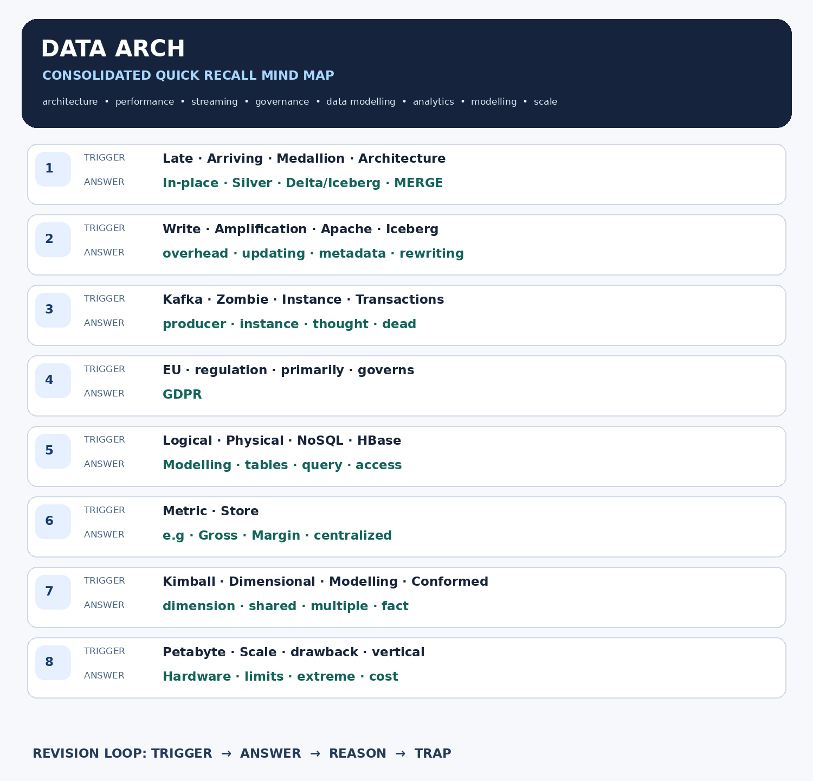

# 🚀 Data Architect Interview & Architecture README



[Open the answer PDF](Data_Arch_answers.pdf)


## Consolidated Mind Map

```text
DATA ARCH
  ├─ Question domains
  │   ├─ architecture
  │   ├─ performance
  │   ├─ streaming
  │   ├─ governance
  │   ├─ data modelling
  │   ├─ analytics
  │   ├─ modelling
  │   ├─ scale
  │   ├─ lakehouse
  │   ├─ ingestion
  │   ├─ security
  │   ├─ no sql
  │   ├─ mlops
  │   ├─ dataops
  │   └─ + 8 additional bank categories
  └─ Decision loop
      ├─ Trigger: identify the scenario constraint
      ├─ Answer: recall the source-backed technical choice
      ├─ Reason: connect choice to behavior or requirement
      └─ Trap: reject a distractor that conflicts with the requirement
```

## Four-keyword recall cards

| Question trigger (max 4) | Answer recall (max 4) | Reason — why it works | Trap — what to reject |
|---|---|---|---|
| Late · Arriving · Medallion · Architecture | In-place · Silver · Delta/Iceberg · MERGE | Modern table formats like Iceberg and Delta Lake support ACID MERGE operations, allowing late-arriving data to be integrated into existing partitions without full table rewrites. | Trap: Drop the late records |
| Write · Amplification · Apache · Iceberg | overhead · updating · metadata · rewriting | Write amplification occurs when a small data change requires rewriting a large underlying file or significant metadata updates, a common challenge in Copy-on-Write (CoW) strategies. | Trap: The speed of disk writes |
| Kafka · Zombie · Instance · Transactions | producer · instance · thought · dead | Zombie instances occur when a producer times out and is replaced, but the original producer recovers and attempts to send data. Kafka uses 'Epochs' to fence these out. | Trap: A message that cannot be deleted |
| EU · regulation · primarily · governs | GDPR | GDPR (General Data Protection Regulation) requires features like the 'Right to be Forgotten,' which necessitates efficient record-level deletion in data lakes. | Trap: HIPAA |
| Logical · Physical · NoSQL · HBase | Modelling · tables · query · access | Unlike relational databases, NoSQL physical models are 'query-first,' meaning tables are structured specifically to optimize for the exact queries the application will run. | Trap: Ensuring all tables are in 5th Normal Form |
| Metric · Store | e.g · Gross · Margin · centralized | A Metric Store (or Semantic Layer) ensures that 'Revenue' is calculated the same way across every dashboard and application in the company. | Trap: A place to buy rulers |
| Kimball · Dimensional · Modelling · Conformed | dimension · shared · multiple · fact | Conformed dimensions ensure consistency by using the same reference data across different business processes. | Trap: A dimension with no attributes |
| Petabyte · Scale · drawback · vertical | Hardware · limits · extreme · cost | Scaling up (bigger RAM/CPU) hits a physical ceiling and becomes exponentially expensive compared to horizontal scaling. | Trap: It is too fast |

## How to use this map

1. Read the trigger and identify the requirement or failure mode in the scenario.
2. Recall the answer keywords before looking at the explanation.
3. State why the answer works using the reason column.
4. Eliminate the trap because it conflicts with the scenario or source explanation.

## Source coverage

- Question bank: `questionBank_Data_Arch.js`
- Questions in source bank: **128**
- Consolidated recall cards: **8**
- Recall cards are representative study aids derived from the supplied question bank, not an official exam blueprint.

---

### 📘 Quick Reference (The Data Lifecycle)

```text
Source (OLTP/Logs) → Ingestion (Kafka/Airflow) → Processing (Spark/Flink) → Storage (Lakehouse) → Serving (BI/API)
```

---

# 🧠 0. Data Architect Mental Model (The Flow)

* **State vs. Event:** Databases represent the current state; Logs (Kafka) represent the history of how we got there.
* **The CAP Theorem:** In a distributed system, you can only guarantee two out of three: Consistency, Availability, and Partition Tolerance.
* **Storage is Cheap, Compute is Expensive:** Optimize for minimizing data movement (Data Locality) and pruning unnecessary data early (S3 Select/Pushdown).

---

# ⚙️ 1. Data Modeling & Governance

### 🔑 Schema Evolution & Management
* **Common Schema:** Enforce a "Standard Data Model" (SDM) across the enterprise to avoid "Data Silos."
* **Schema Registry:** Use a registry (like Confluent or Glue) to enforce **Backward Compatibility**. Never break downstream consumers.
* **Protobuf/Avro over JSON:** Use binary formats for high-scale systems to reduce payload size and ensure strict typing.

### 🔑 Data Governance
* **Data Cataloging:** Every dataset must be indexed with metadata (Owner, Lineage, Retention).
* **PII/GDPR:** Implement **Data Masking** and **Tokenization** at the ingestion layer. Ensure "Right to be Forgotten" is architected into the storage layer (e.g., using Delta Lake `DELETE`).

---

# 🏗️ 2. Storage Architecture (Lakehouse & Warehouse)

### 🔑 The Medallion Architecture
* **Bronze (Raw):** Literal copy of source data. No transformations.
* **Silver (Cleansed):** Deduplicated, filtered, and standardized.
* **Gold (Curated):** Business-level aggregates ready for BI/ML.

### 🔑 Storage Tiers & Partitioning
* **Partitioning:** Partition by `date` (YYYY/MM/DD) or `region` to enable **Partition Partitioning**, significantly reducing scan costs.
* **Clustering:** Use Z-Ordering or Liquid Clustering to optimize query performance on non-partition columns.

---

# ⚡ 3. Streaming & Real-Time (Kafka/ELK Integration)

### 🔑 Buffering & Backpressure
* **Kafka as a Buffer:** Use Kafka to decouple high-speed ingestion from slow downstream databases (ELK/RDS) to prevent "Thundering Herd" failures.
* **Exactly-Once Semantics (EOS):** Use idempotent producers and transactional writes to ensure data integrity during streaming.

### 🔑 Real-time Search (ELK/OpenSearch)
* **Index Lifecycle Management (ILM):** Automate the transition of indices from **Hot → Warm → Cold → Delete** based on data age to save on expensive SSD storage.

---

# 💰 4. Database Cost Optimization

* **Job Schedulers:** Use **Airflow** or **Azure Automation** to scale clusters (Spark/RDS) up for heavy batch processing and down/off during idle hours.
* **Storage Lifecycle:** Move aged data from S3 Standard to **Glacier Deep Archive** automatically.
* **Spot Instances:** Use Spot/Preemptible nodes for Spark executors or non-critical ELK "Warm" nodes to save ~80%.

---

# 🚨 5. Failure Scenarios & Troubleshooting

### 🔥 1. Schema Drift Breakdown
* **Symptom:** Downstream ETL jobs failing; BI dashboards showing nulls.
* **Root Cause:** The source system changed a column type or renamed a field without updating the registry.
* **Fix:** Implement **Dead Letter Queues (DLQ)** for failed records and automated "Circuit Breakers" in the pipeline.
* **Interview One-Liner:** "I handle schema drift by enforcing contract-first development and using DLQs to isolate incompatible records without stopping the pipeline."

### 🔥 2. Data Lag (Ingestion Delay)
* **Symptom:** Real-time dashboards are 30 minutes behind.
* **Root Cause:** Consumer lag in Kafka or "Small File Problem" in S3/HDFS causing slow reads.
* **Fix:** Scale out the consumer group or implement **Compaction** to merge small files into larger ones.
* **Interview One-Liner:** "I mitigate lag by monitoring partition-level throughput and implementing auto-compaction to solve the small-file bottleneck."

### 🔥 3. Split Brain / Duplicate Writes
* **Symptom:** Financial reports showing double the expected revenue.
* **Root Cause:** Producer retries or network partitions causing duplicate event processing.
* **Fix:** Use **Idempotent Keys** and Upsert logic (e.g., `MERGE` in Delta Lake).
* **Interview One-Liner:** "I ensure data consistency by using exactly-once semantics and enforcing primary key uniqueness at the storage layer via Upserts."

---

# 📊 6. Observability & Data Quality

* **Data Observability:** Monitor "The 5 Pillars": Freshness, Distribution, Volume, Schema, and Lineage.
* **Quality Gates:** Implement **Great Expectations** or **Deequ** to fail pipelines if null counts or value distributions exceed thresholds.
* **Alerting:** Alert on "Under-replicated Partitions" (Ingestion) or "P99 Query Latency" (Serving).

---

# 📎 Appendix: Rapid Recall Cheat Sheet

| Pattern | Best For... | Senior Insight |
| :--- | :--- | :--- |
| **Change Data Capture (CDC)** | Syncing DBs | Use **Debezium** to stream database logs directly into Kafka without hitting the DB CPU. |
| **Star Schema** | BI/Warehousing | Denormalize into Fact/Dimension tables for lightning-fast join performance. |
| **Vector DBs** | GenAI / Search | Essential for RAG (Retrieval-Augmented Generation) architectures. |
| **Data Mesh** | Scale Organizations | Treat "Data as a Product" where domain teams own their own pipelines. |

---

# 🎯 Final Architect One-Liner
> "I design resilient data ecosystems by enforcing **Schema-on-Write governance**, leveraging **Lakehouse architectures** for cost-efficient scale, and utilizing **Kafka-based buffering** to maintain system stability and exactly-once consistency across distributed workloads."
