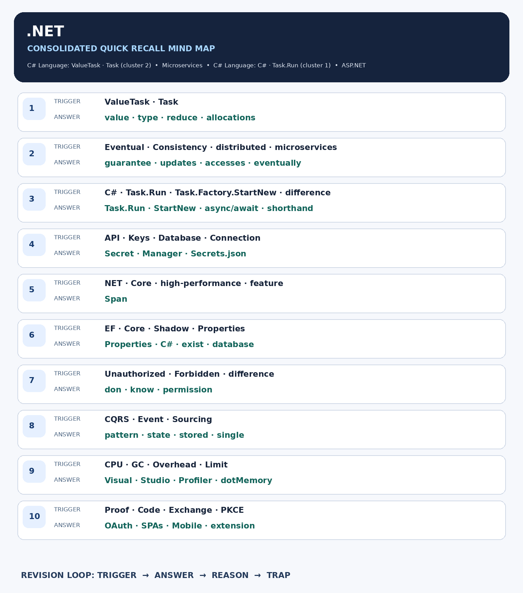

# 🟣 .NET / C# / ASP.NET Core Interview & Exam Quick Reference




[Open the answer PDF](docs/dotnet_answers.pdf)


## Consolidated Mind Map

```text
.NET
  ├─ Question domains
  │   ├─ C# Language: ValueTask · Task (cluster 2)
  │   ├─ Microservices
  │   ├─ C# Language: C# · Task.Run (cluster 1)
  │   ├─ ASP.NET Core
  │   ├─ Performance
  │   ├─ ORM (EF Core)
  │   ├─ Security
  │   ├─ Architecture
  │   ├─ Troubleshooting
  │   ├─ Security (OAuth)
  │   ├─ Security (JWT)
  │   ├─ Design Patterns
  │   ├─ Testing
  │   ├─ Swagger
  │   └─ + 24 additional bank categories
  └─ Decision loop
      ├─ Trigger: identify the scenario constraint
      ├─ Answer: recall the source-backed technical choice
      ├─ Reason: connect choice to behavior or requirement
      └─ Trap: reject a distractor that conflicts with the requirement
```

## Four-keyword recall cards

| Question trigger (max 4) | Answer recall (max 4) | Reason — why it works | Trap — what to reject |
|---|---|---|---|
| ValueTask · Task | value · type · reduce · allocations | ValueTask<T> is a struct. If an async method returns a result immediately (synchronously) most of the time, using ValueTask can prevent the allocation of a Task object on the heap. | Trap: It is used for storing data in the database |
| Eventual · Consistency · distributed · microservices | guarantee · updates · accesses · eventually | Due to network latency and distributed data, it takes time for an update in Service A to reflect in Service B. The system is 'eventually' consistent rather than 'strongly' consistent. | Trap: When the server is always in sync with the client |
| C# · Task.Run · Task.Factory.StartNew · difference | Task.Run · StartNew · async/await · shorthand | Task.Run is the modern standard for offloading work to the thread pool. StartNew is more complex and can lead to issues if not used with 'Unwrap()' when calling async methods. | Trap: Task.Run is only for console apps |
| API · Keys · Database · Connection | Secret · Manager · Secrets.json | The Secret Manager tool is used to store sensitive data during development. Unlike appsettings.json, the secrets.json file is stored outside the project folder and isn't checked into source control. | Trap: appsettings.json |
| NET · Core · high-performance · feature | Span | Span<T> is a ref struct that allows you to point to contiguous memory (on the stack or heap) without the overhead of additional allocations, significantly improving performance for slicing and buffer management. | Trap: MemoryCache |
| EF · Core · Shadow · Properties | Properties · C# · exist · database | Shadow properties are properties that are not defined in your .NET entity class but are defined for that entity type in the EF Core model. They are often used for metadata like 'LastUpdated' or 'ForeignKey' IDs. | Trap: Properties that are encrypted in the database |
| Unauthorized · Forbidden · difference | don · know · permission | 401 indicates authentication failure (missing or invalid token). 403 indicates authorization failure (the user is logged in but lacks the required role/claim). | Trap: 401 is for databases; 403 is for files |
| CQRS · Event · Sourcing | pattern · state · stored · single | Instead of storing 'Balance = 100', you store 'Deposited 50', 'Deposited 50'. This provides a perfect audit log and the ability to reconstruct state at any point in time. | Trap: A type of database backup |
| CPU · GC · Overhead · Limit | Visual · Studio · Profiler · dotMemory | dotMemory and the Visual Studio Memory Profiler allow you to take snapshots of the heap to identify objects that are staying alive unexpectedly and roots preventing Garbage Collection. | Trap: Ping |
| Proof · Code · Exchange · PKCE | OAuth · SPAs · Mobile · extension | PKCE adds a dynamically created secret (code_verifier) to the exchange process, ensuring the client that requested the code is the same one that swaps it for a token. | Trap: A physical security key (YubiKey) |

## How to use this map

1. Read the trigger and identify the requirement or failure mode in the scenario.
2. Recall the answer keywords before looking at the explanation.
3. State why the answer works using the reason column.
4. Eliminate the trap because it conflicts with the scenario or source explanation.

## Source coverage

- Question bank: `questionBank_dotnet.js`
- Questions in source bank: **357**
- Consolidated recall cards: **10**
- Recall cards are representative study aids derived from the supplied question bank, not an official exam blueprint.

---

### 📘 C# Language • Runtime • ASP.NET Core • Data • Architecture

---

# 1. C# Language

* **LINQ**: declarative queries over `IEnumerable`/`IQueryable`; **deferred execution** (runs on enumeration, e.g., `ToList()`); `IQueryable` translates to SQL (EF) — don't call `.ToList()` before filtering.
* **Delegate**: type-safe function pointer (`Func`, `Action`, `Predicate`); events build on delegates.
* **Generics**: type-safe reusable code with constraints (`where T : class, new()`).
* **Record**: reference type (or `record struct`) with value-based equality, `with` expressions, immutability by default.
* **Span<T>**: stack-only view over contiguous memory, zero-allocation slicing (can't be used across `await`).
* **Nullable** reference types (`string?`) give compile-time null-safety warnings; `Nullable<T>` (`int?`) for value types.
* **Async / Task**: `async/await` frees threads during I/O; return `Task`/`Task<T>`/`ValueTask`; avoid `async void` (except event handlers) and avoid `.Result`/`.Wait()` (deadlocks); pass `CancellationToken`.
* **IDisposable**: deterministic release of unmanaged resources — `using` statements/declarations; `IAsyncDisposable` for async.

---

# 2. Runtime

* **CLR** executes IL; **JIT** compiles IL to native at runtime (tiered compilation, ReadyToRun/AOT options).
* **Garbage Collection**: generational (Gen 0/1/2 + Large Object Heap), compacting, non-deterministic; finalizers are costly — implement the dispose pattern.

---

# 3. ASP.NET Core

* **Kestrel**: cross-platform web server (usually behind a reverse proxy).
* **Middleware** pipeline: ordered `app.Use...`; each component may short-circuit (auth → routing → endpoints; exception handling first).
* **Dependency Injection** built in: lifetimes **Transient** (per resolve), **Scoped** (per request), **Singleton** (app lifetime). Never inject Scoped into Singleton (captive dependency).
* **Minimal API**: `app.MapGet("/x", () => ...)` low-ceremony endpoints vs controllers.
* **Blazor** (C# UI: Server/WebAssembly), **Razor** (pages/views), **SignalR** (real-time over WebSockets/SSE/long polling), **gRPC** (HTTP/2 + protobuf, fast service-to-service).
* **Health Checks**: `/health` liveness/readiness for orchestrators.
* **Docker**: multi-stage builds (SDK → runtime image), non-root user, small images.
* **JWT** bearer auth + **Identity** (users, roles, password hashing, claims) → authN vs authZ policies.

```csharp
var app = WebApplication.CreateBuilder(args).Build();
app.UseAuthentication(); app.UseAuthorization();
app.MapGet("/orders/{id}", async (int id, IOrderService s) => await s.GetAsync(id));
app.Run();
```

---

# 4. Data & Architecture

* **Entity Framework (Core)**: ORM with change tracking; `AsNoTracking()` for read-only; avoid N+1 (`Include`); **Migration**s version the schema; `DbContext` is Scoped.
* **Dapper**: micro-ORM, raw SQL → fastest mapping, more manual.
* **Transaction**: `SaveChanges` is transactional; `BeginTransaction` for multi-step units; `TransactionScope` for ambient.
* **Microservices**: independent deployable services; **Polly** adds retry, circuit breaker, timeout, bulkhead, fallback for resilient HTTP calls.
* **SOLID**: SRP, OCP, LSP, ISP, DIP. **CQRS**: separate command (write) and query (read) models. **Clean Architecture**: dependencies point inward (Domain ← Application ← Infrastructure/UI).

---

# 🚨 Problem → Fix

| Symptom | Fix |
| ------- | --- |
| Deadlock calling `.Result` | `await` all the way |
| Slow list endpoint with many queries | Fix N+1 with `Include`/projection |
| Flaky downstream API | Polly retry + circuit breaker |
| Stale singleton data | Lifetime mismatch → correct DI scope |
| High allocations parsing text | `Span<T>` / pooling |

> “I build ASP.NET Core services on Kestrel with a deliberate middleware pipeline and DI lifetimes, use async end-to-end, EF Core with Dapper for hot paths, Polly for resilience, and keep boundaries clean with SOLID, CQRS and Clean Architecture.”
