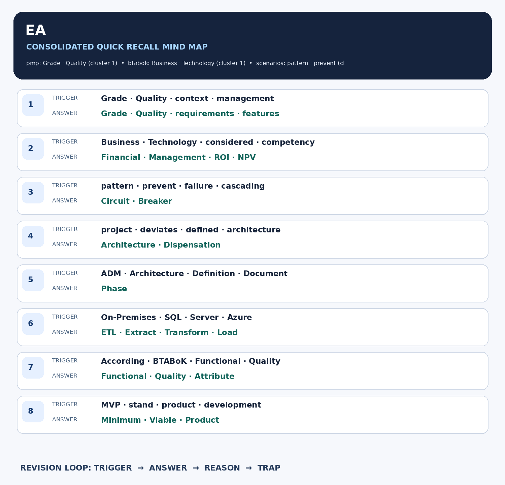

# 🏛️ Enterprise Architecture (EA) Strategy README



[Open the answer PDF](EA_answers.pdf)


## Consolidated Mind Map

```text
EA
  ├─ Question domains
  │   ├─ pmp: Grade · Quality (cluster 1)
  │   ├─ btabok: Business · Technology (cluster 1)
  │   ├─ scenarios: pattern · prevent (cluster 2)
  │   ├─ togaf: project · deviates (cluster 1)
  │   ├─ togaf: ADM · Architecture (cluster 2)
  │   ├─ scenarios: On Premises · SQL (cluster 1)
  │   ├─ btabok: According · BTABoK (cluster 2)
  │   ├─ pmp: MVP · stand (cluster 2)
  └─ Decision loop
      ├─ Trigger: identify the scenario constraint
      ├─ Answer: recall the source-backed technical choice
      ├─ Reason: connect choice to behavior or requirement
      └─ Trap: reject a distractor that conflicts with the requirement
```

## Four-keyword recall cards

| Question trigger (max 4) | Answer recall (max 4) | Reason — why it works | Trap — what to reject |
|---|---|---|---|
| Grade · Quality · context · management | Grade · Quality · requirements · features | High Quality means meeting requirements. High Grade means having many fancy features. | Trap: Quality is about features; Grade is about fulfilling requirements. |
| Business · Technology · considered · competency | Financial · Management · ROI · NPV | Architects must understand financial metrics like Return on Investment (ROI) and Total Cost of Ownership (TCO) to justify solutions. | Trap: Photoshop design |
| pattern · prevent · failure · cascading | Circuit · Breaker | The Circuit Breaker pattern detects failures and encapsulates the logic of preventing a failure from constantly recurring during maintenance or temporary external system failure. | Trap: Sidecar Pattern |
| project · deviates · defined · architecture | Architecture · Dispensation | An Architecture Dispensation is the formal mechanism to grant a project a 'pass' or waiver from complying with specific architecture standards. | Trap: Architecture Contract |
| ADM · Architecture · Definition · Document | Phase | The Architecture Definition Document is the companion to the Architecture Requirements Specification and is built incrementally during Phases B, C, and D. | Trap: Phase A |
| On-Premises · SQL · Server · Azure | ETL · Extract · Transform · Load | ETL is preferred when the data needs to be cleansed or transformed *before* it reaches the destination, often to save on storage processing or to meet target schema requirements. | Trap: ELT (Extract, Load, Transform) |
| According · BTABoK · Functional · Quality | Functional · Quality · Attribute | Functional requirements define behavior (e.g., 'process payment'), while Quality Attributes define characteristics (e.g., 'securely', 'quickly'). | Trap: Functional is for business; Quality Attribute is for IT. |
| MVP · stand · product · development | Minimum · Viable · Product | An MVP is the version of a new product that allows a team to collect the maximum amount of validated learning about customers with the least effort. | Trap: Most Valuable Player |

## How to use this map

1. Read the trigger and identify the requirement or failure mode in the scenario.
2. Recall the answer keywords before looking at the explanation.
3. State why the answer works using the reason column.
4. Eliminate the trap because it conflicts with the scenario or source explanation.

## Source coverage

- Question bank: `questionBank_EA.js`
- Questions in source bank: **553**
- Consolidated recall cards: **8**
- Recall cards are representative study aids derived from the supplied question bank, not an official exam blueprint.

---

### 📘 Quick Reference (TOGAF + Cloud-Native + Governance + Interoperability)

EA bridges the gap between business strategy and technical implementation by ensuring alignment across four domains: **Business, Data, Application, and Technology (BDAT).**


---

# 🧠 0. The TOGAF ADM (Architecture Development Method)

The ADM is the "Operating System" for an EA.

* **Preliminary Phase:** Defining "Where, what, why, who, and how" we do architecture.
* **Phase A (Vision):** High-level aspirational view of the project; obtaining stakeholder buy-in.
* **Phases B, C, D (BDAT):**
    * **Business:** Processes and organizational structure.
    * **Data:** Data models and management.
    * **Application:** Software services and interactions.
    * **Technology:** Cloud/On-prem infrastructure.
* **Phase E & F (Opportunities & Migration):** Transitioning from the **Baseline** (current state) to the **Target** (future state) via "Gaps."

---

# ⚙️ 1. Platform & Framework Strategy

## 🔑 Cloud-Native Strategy
* **Buy vs. Build:** Prioritize SaaS/PaaS over custom IaaS builds to reduce **Technical Debt**.
* **Abstraction Layers:** Use Containers (K8s) or Serverless to avoid **Cloud Vendor Lock-in**.
* **Microservices:** Transition from Monoliths to modular services to improve **Velocity** and **Scalability**.

## 🔑 Standards & Interoperability
* **API-First Approach:** Ensuring different systems can talk to each other regardless of language (Java, C#, Node).
* **Event-Driven Architecture (EDA):** Utilizing Kafka/Azure Service Bus for decoupled, asynchronous communication.
* **Common Data Model (CDM):** Standardizing data formats across the enterprise to ensure "One Version of the Truth."

---

# 🔐 2. Security & Compliance (Zero Trust)

## 🔑 Governance & Security
* **Defense in Depth:** Implementing security at the Network, Identity, and Application layers.
* **Zero Trust Architecture:** "Never trust, always verify." Every request must be authenticated, authorized, and encrypted.
* **Shift Left Security:** Integrating automated security scanning (SAST/DAST) into the CI/CD pipeline.

## 🔑 Compliance
* **Regulatory Guardrails:** Ensuring the platform meets GDPR, HIPAA, or SOC2 requirements through **Policy as Code** (e.g., Azure Policy or AWS SCPs).

---

# 💰 3. Financial & Operational Excellence

## 🔑 Cost-Effective Architecture (FinOps)
* **Unit Economics:** Measuring the cloud cost per transaction or per user.
* **Right-sizing:** Utilizing Auto-scaling and Spot instances to optimize spend.
* **Rationalization:** Eliminating redundant applications (e.g., why have 3 different CRM tools?).

---

# 🚨 4. Enterprise Failure Patterns (The "Architect's Nightmare")

## 🔥 The "Accidental Architecture"
* **Symptom:** "Spaghetti" integrations where every system is hard-linked to every other system.
* **Fix:** Implement an **Integration Layer** (API Gateway / ESB) and enforce Standards.

## 🔥 Technical Debt Accumulation
* **Symptom:** Development slows down to a crawl because the team is busy patching legacy systems.
* **Fix:** Allocate "Architectural Runway"—20% of every sprint dedicated to modernization/refactoring.

## 🔥 Data Silos
* **Symptom:** Marketing has different customer data than Sales.
* **Fix:** Centralized Data Lakehouse (Databricks/Snowflake) with strong **Data Governance**.

---

# 📎 Appendix: Clipboard Recall Sections

#### **Strategy & Frameworks**
```markdown
- TOGAF ADM → Standardized cycle for developing enterprise architecture
- Baseline vs. Target → Identifying "Gaps" to create a migration roadmap
- BDAT → Business, Data, Application, and Technology architecture domains
- Interoperability → Ensuring cross-platform communication via standard APIs and EDA
```

#### **Governance & Cost**
```markdown
- FinOps → Cloud financial management to ensure cost-effective scaling
- Policy as Code → Automating compliance and security guardrails in the cloud
- Buy vs. Build → Choosing SaaS/PaaS to minimize long-term maintenance costs
- Rationalization → Streamlining the app portfolio to reduce complexity and spend
```

#### **Technical Design**
```markdown
- Zero Trust → Identity-centric security; assume the network is compromised
- Cloud-Native → Leveraging K8s, Serverless, and Managed Services for elasticity
- Event-Driven → Decoupling systems via message brokers (Kafka) for resilience
- API-First → Treating APIs as products to ensure ecosystem consistency
```

---

# 🎯 Final Architect One-Liner

> "As an Enterprise Architect, I apply the TOGAF ADM to align technical platforms with business goals, ensuring a secure, cloud-native, and interoperable ecosystem that maximizes cost-efficiency through FinOps and robust governance."
