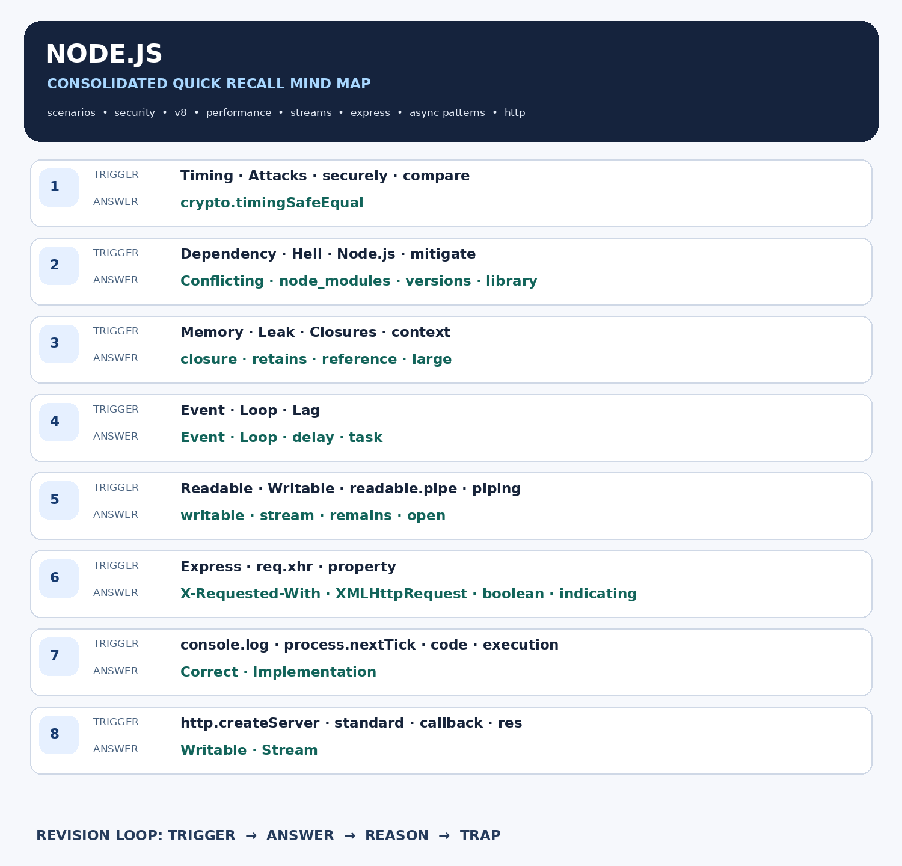

# 🟢 Node.js Interview & Exam Quick Reference



[Open the answer PDF](nodeJS_answers.pdf)

---

## Consolidated Mind Map

```text
NODE.JS
  ├─ Question domains
  │   ├─ scenarios
  │   ├─ security
  │   ├─ v8
  │   ├─ performance
  │   ├─ streams
  │   ├─ express
  │   ├─ async patterns
  │   ├─ http
  │   ├─ npm
  │   ├─ event loop
  │   ├─ process
  │   ├─ child process
  │   ├─ modules
  │   ├─ fs
  │   └─ + 15 additional bank categories
  └─ Decision loop
      ├─ Trigger: identify the scenario constraint
      ├─ Answer: recall the source-backed technical choice
      ├─ Reason: connect choice to behavior or requirement
      └─ Trap: reject a distractor that conflicts with the requirement
```

## Four-keyword recall cards

| Question trigger (max 4) | Answer recall (max 4) | Reason — why it works | Trap — what to reject |
|---|---|---|---|
| Timing · Attacks · securely · compare | crypto.timingSafeEqual | timingSafeEqual() ensures the comparison takes the same amount of time regardless of how many characters match, preventing attackers from guessing content based on time. | Trap: crypto.compare() |
| Dependency · Hell · Node.js · mitigate | Conflicting · node_modules · versions · library | Node.js allows multiple versions of the same package to exist in the dependency tree, avoiding the version conflicts common in other languages. | Trap: A bug in the OS |
| Memory · Leak · Closures · context | closure · retains · reference · large | Because closures keep their environment alive, they can prevent large objects from being garbage collected if not managed properly. | Trap: When a closure is too small |
| Event · Loop · Lag | Event · Loop · delay · task | High lag indicates the main thread is blocked by heavy synchronous tasks, preventing the loop from processing the next tick timely. | Trap: The time it takes to download a file |
| Readable · Writable · readable.pipe · piping | writable · stream · remains · open | By default, pipe() does not forward errors. You must attach error listeners to both streams manually to prevent memory leaks or crashes. | Trap: The writable stream is automatically destroyed |
| Express · req.xhr · property | X-Requested-With · XMLHttpRequest · boolean · indicating | This is a convenient way to detect if a request was made via AJAX (like fetch or axios) in some older patterns. | Trap: To check if the request is a POST |
| console.log · process.nextTick · code · execution | Correct · Implementation | process.nextTick fires immediately after the current operation. Timers (0ms) usually fire before setImmediate (Check phase) depending on the loop entry point. | Trap: A, B, C |
| http.createServer · standard · callback · res | Writable · Stream | The response (res) object is an instance of 'http.ServerResponse', which implements the Writable Stream interface. | Trap: A Readable Stream |

## How to use this map

1. Read the trigger and identify the requirement or failure mode in the scenario.
2. Recall the answer keywords before looking at the explanation.
3. State why the answer works using the reason column.
4. Eliminate the trap because it conflicts with the scenario or source explanation.

## Source coverage

- Question bank: `questionBank_nodeJS.js`
- Questions in source bank: **206**
- Consolidated recall cards: **8**
- Recall cards are representative study aids derived from the supplied question bank, not an official exam blueprint.

---

### 📘 Event Loop • Async • Streams • Scaling • Express • Security

---

# 1. Runtime Internals

* **V8** compiles JavaScript; **libuv** provides the event loop, thread pool (default 4 threads: fs, dns.lookup, crypto, zlib) and async I/O.
* **Event Loop phases:** timers → pending callbacks → idle/prepare → **poll** (I/O) → **check** (`setImmediate`) → close callbacks.
* **Microtask** queue (Promise `.then`, `queueMicrotask`) drains after each callback; **`process.nextTick`** runs even before promise microtasks. Starving the loop with endless `nextTick`/microtasks blocks I/O.
* Never block the loop with CPU-heavy sync work (big JSON parse, crypto sync, regex backtracking) → offload.
* **Garbage Collection**: generational (young/old, Scavenge + Mark-Sweep/Compact). **Memory Leak** causes: unbounded caches/maps, forgotten listeners/timers, closures holding large objects, global state. Diagnose with `--inspect`, heap snapshots, `process.memoryUsage()`. **Profiling**: `--prof`, `clinic`, Chrome DevTools flame graphs.

```js
setTimeout(() => console.log('timeout'));
setImmediate(() => console.log('immediate'));
process.nextTick(() => console.log('nextTick'));
Promise.resolve().then(() => console.log('promise'));
// nextTick, promise, then timeout/immediate (order of the last two depends on context)
```

---

# 2. Async Patterns

* **Callback** (error-first `(err, data)`) → **Promise** → **async/await** (sugar over promises). Always `try/catch` awaited calls; handle `unhandledRejection`.
* `Promise.all` (fail fast), `allSettled` (collect all outcomes), `race`, `any`.
* **EventEmitter**: `on/once/emit`; an unhandled `'error'` event throws; watch listener leaks (`MaxListenersExceededWarning`).
* **Streams** (Readable, Writable, Duplex, Transform): process data in chunks. **Backpressure**: `write()` returns `false` → pause until `'drain'`; `pipe()`/`pipeline()` handles it and propagates errors.
* **Buffer**: fixed-size raw binary memory; `Buffer.from`, `alloc`, encodings.

---

# 3. Scaling & Concurrency

| Tool | Use |
| ---- | --- |
| **Worker Threads** | CPU-bound JS in parallel threads (shared memory possible) |
| **Cluster** | Multiple processes sharing a port to use all cores |
| **Child Process** | Spawn other programs/scripts (`spawn`, `exec`, `fork`) |
| Load balancer / containers | Horizontal scaling across machines |

**Graceful Shutdown:** on `SIGTERM` stop accepting connections (`server.close()`), finish in-flight requests, close DB pools, then `process.exit`.

---

# 4. Web Layer

* **Express** routing + **Middleware** chain `(req, res, next)`; order matters; error middleware has 4 args `(err, req, res, next)`.
* **REST**: resources + verbs, proper status codes, idempotent PUT/DELETE, pagination, versioning.
* **WebSocket**: persistent bidirectional channel (chat, live feeds).
* **CORS**: browser-enforced cross-origin policy; configure allowed origins/methods/headers (don't use `*` with credentials).
* **Rate Limiting**: protect against abuse/brute force (token bucket, `express-rate-limit`, Redis-backed in clusters).
* **JWT**: signed (not encrypted) token — validate signature, `exp`, `aud/iss`; short-lived access + refresh tokens; never store secrets in payload.
* **Helmet**: sets secure HTTP headers (CSP, HSTS, X-Content-Type-Options).
* **npm**: `package-lock.json` for reproducible installs, `npm ci` in CI, `npm audit` for vulnerabilities, semver ranges (`^`, `~`).

---

# 🚨 Problem → Fix

| Symptom | Fix |
| ------- | --- |
| API freezes under CPU task | Worker Threads / offload |
| Memory grows until OOM | Heap snapshot; remove leaks (listeners, caches) |
| Large file upload crashes memory | Streams + backpressure |
| Only 1 core used | Cluster / multiple instances |
| Browser blocks API call | Configure CORS |
| Deploy drops requests | Graceful shutdown on SIGTERM |

> “Node is single-threaded for JS but non-blocking via libuv; I keep the event loop free, use streams with backpressure, scale with cluster or workers, and harden Express with Helmet, CORS, rate limiting and short-lived JWTs.”
