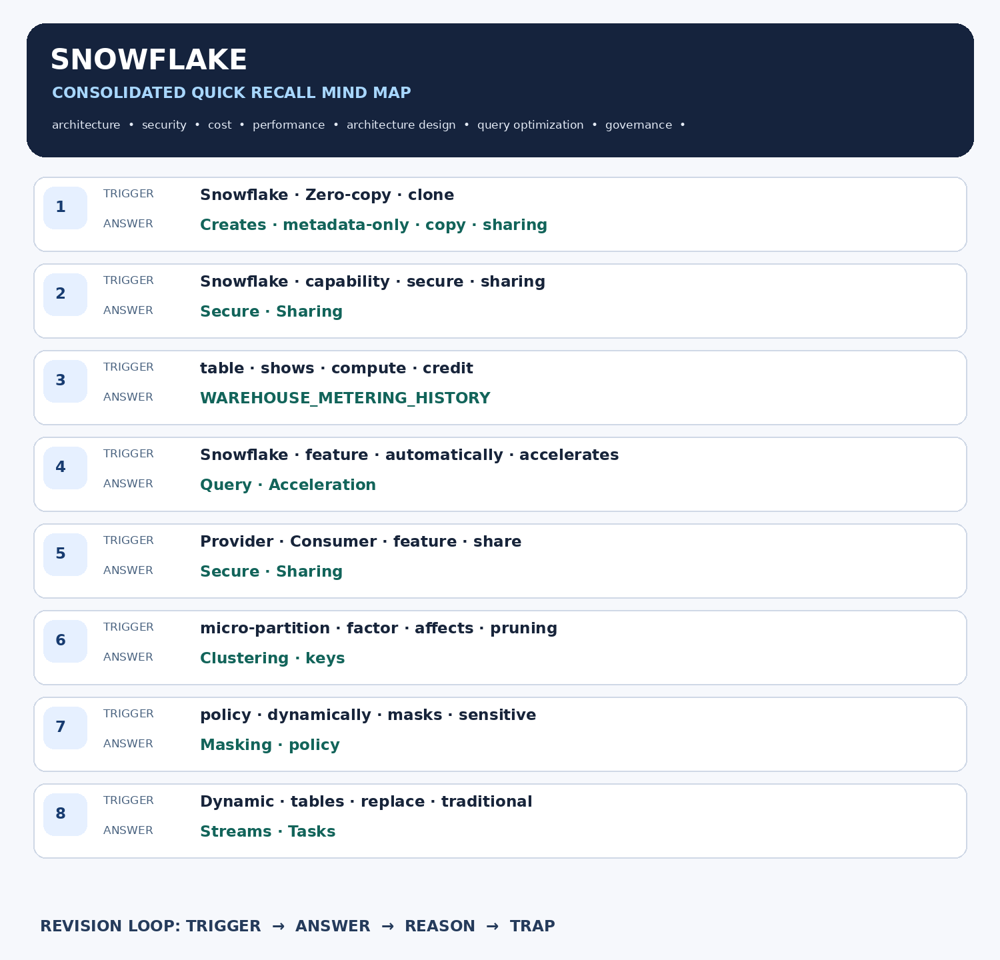

# ❄️ Snowflake Interview & Architecture README



[Open the answer PDF](snowflake_answers.pdf)


## Consolidated Mind Map

```text
SNOWFLAKE
  ├─ Question domains
  │   ├─ architecture
  │   ├─ security
  │   ├─ cost
  │   ├─ performance
  │   ├─ architecture design
  │   ├─ query optimization
  │   ├─ governance
  │   ├─ dynamic tables
  │   ├─ snowpark
  │   ├─ iceberg
  │   ├─ tasks
  │   ├─ streams
  │   ├─ security architecture
  │   ├─ cost optimization
  │   └─ + 25 additional bank categories
  └─ Decision loop
      ├─ Trigger: identify the scenario constraint
      ├─ Answer: recall the source-backed technical choice
      ├─ Reason: connect choice to behavior or requirement
      └─ Trap: reject a distractor that conflicts with the requirement
```

## Four-keyword recall cards

| Question trigger (max 4) | Answer recall (max 4) | Reason — why it works | Trap — what to reject |
|---|---|---|---|
| Snowflake · Zero-copy · clone | Creates · metadata-only · copy · sharing | Zero-copy cloning: instant clone of tables, schemas or databases; only changed micro-partitions use extra storage. | Trap: Exports to S3 |
| Snowflake · capability · secure · sharing | Secure · Sharing | Secure Data Sharing allows live data access without replication. | Trap: Streams |
| table · shows · compute · credit | WAREHOUSE_METERING_HISTORY | Warehouse metering history shows compute credit usage. | Trap: ACCOUNT_HISTORY |
| Snowflake · feature · automatically · accelerates | Query · Acceleration | Query Acceleration Service allocates additional compute resources for large scan queries. | Trap: Materialized views |
| Provider · Consumer · feature · share | Secure · Sharing | Secure Data Sharing uses Snowflake's unique multi-cluster shared data architecture to give consumers access to the provider's metadata/storage directly. | Trap: Data Mirroring |
| micro-partition · factor · affects · pruning | Clustering · keys | Clustering keys improve pruning by organizing micro-partition metadata. | Trap: User roles |
| policy · dynamically · masks · sensitive | Masking · policy | Masking policies dynamically mask column values depending on user roles. | Trap: Task policy |
| Dynamic · tables · replace · traditional | Streams · Tasks | Dynamic tables simplify pipelines by replacing streams and tasks. | Trap: Materialized views |

## How to use this map

1. Read the trigger and identify the requirement or failure mode in the scenario.
2. Recall the answer keywords before looking at the explanation.
3. State why the answer works using the reason column.
4. Eliminate the trap because it conflicts with the scenario or source explanation.

## Source coverage

- Question bank: `questionBank_snowflake.js`
- Questions in source bank: **285**
- Consolidated recall cards: **8**
- Recall cards are representative study aids derived from the supplied question bank, not an official exam blueprint.

---

### 📘 Quick Reference (Cloud Data Warehouse + Elastic Scaling + Separation of Compute/Storage)

Snowflake is a **Software-as-a-Service (SaaS)** data platform that scales storage and compute independently.

```text
Cloud Services (Optimizer/Security) ↔ Query Processing (Virtual Warehouses) ↔ Database Storage (S3/Azure Blob/GCS)
```

---

# 🧠 0. Snowflake Mental Model (The 3 Layers)

1.  **Storage Layer:** Data is stored in proprietary **Micro-partitions** (compressed, columnar, and immutable).
2.  **Compute Layer (Virtual Warehouses):** Clusters of compute resources. They are **stateless** and can be scaled up or down instantly without affecting storage.
3.  **Cloud Services Layer:** The "Brain." Handles DDL/DML compilation, authentication, metadata management, and query optimization.

---

# ⚙️ 1. Infrastructure & Scaling

## 🔑 Virtual Warehouses (Compute)
* **T-Shirt Sizing:** XS, S, M, L, XL... each step doubles the compute power (and cost).
* **Scaling Up:** Changing size (e.g., Small to Large) to handle **complex queries** (faster execution).
* **Scaling Out:** Adding more clusters to a **Multi-cluster Warehouse** to handle **high concurrency** (more users).
* **Auto-suspend/Resume:** The primary cost-saving feature. Set it to 1 minute for most BI workloads.

💡 **Interview Insight:**
Warehouses are **stateless**. They cache data locally on SSDs (the "Warm Cache"), but the source of truth is always the Storage Layer.

---

# 🧩 2. Data Distribution & Storage

## 🔑 Micro-partitions & Clustering
Snowflake does not use traditional indexes. It uses **Micro-partitions**.
* **Metadata:** Snowflake stores the Min/Max values for every column in every micro-partition.
* **Data Skipping:** The optimizer uses metadata to "prune" partitions, reading only what is necessary.
* **Clustering Key:** If queries are slow on large tables (TB+), define a Clustering Key to physically co-locate related data.

## 🔑 Data Ingestion Patterns
* **COPY INTO:** Bulk loading from internal/external stages (S3/Azure/GCS).
* **Snowpipe:** Serverless, automated, incremental ingestion for near real-time data.

---

# 🚨 3. Chaos & Failure Patterns (High Signal)

## 🔥 The "Queueing" Problem
```text
Symptom: Queries are "Queued" in the warehouse and not executing.
Cause: The warehouse is at 100% load; no available threads for new queries.
```
✅ **Solution:** Increase the **Max Cluster Count** (Scale-out) to handle concurrency.

## 🔥 Exploding Metadata (Small File Problem)
```text
Symptom: Ingesting thousands of tiny files into a table makes queries slow.
Cause: Too many micro-partitions; the Cloud Services layer spends too long pruning.
```
✅ **Solution:** Batch your loads (100-250MB size) or use `Automatic Clustering`.

## 🔥 "Spilling" to Remote Storage
```text
Symptom: Query is significantly slower than usual; profile shows "Spilling to Remote Storage."
Cause: The data being processed is too large for the Warehouse RAM/Local SSD.
```
✅ **Solution:** Scale Up (increase warehouse size) to get more memory.

---

# ⚡ 4. Performance & Tuning

## 🔑 Query Profile Analysis
In an interview, if asked how to fix a slow query, say you check the **Query Profile**:
* **Partitions Scanned vs. Total:** If scanning too many, you need a Clustering Key.
* **Exploding Joins:** Check for Cartesian products (Join keys causing massive row expansion).
* **Result Cache:** Snowflake caches query results for 24 hours. If the query and data haven't changed, it returns instantly with $0$ compute cost.

---

# 🔄 5. Data Protection & Recovery

| Feature | Function |
| :--- | :--- |
| **Time Travel** | Query data at any point in the past (up to 90 days). `SELECT * FROM table AT(OFFSET => -3600)`. |
| **Fail-safe** | 7-day non-configurable period after Time Travel for disaster recovery (managed by Snowflake). |
| **Zero-Copy Cloning** | Create a metadata-only copy of a table/DB instantly without duplicating storage costs. |

---

# 🚨 Snowflake Failure Debugging Scenarios

### 🔥 1. "Warehouse is Resuming" Latency
* **Cause:** Frequent auto-suspending on a warehouse with a cold cache.
* **Fix:** Adjust `AUTO_SUSPEND` to a higher value (e.g., 5-10 mins) if the warehouse is used every few minutes to keep the SSD cache "warm."

### 🔥 2. High Cloud Services Costs
* **Cause:** Frequent small `INSERT` statements or metadata-heavy operations on tiny tables.
* **Fix:** Move to bulk `COPY INTO` or Snowpipe; Cloud Services are only free up to 10% of daily compute usage.

---

# 🧠 Ultimate Debug Strategy (Architect's View)

```text
1. Check Warehouse Load (Queued vs. Running).
2. Review Query Profile (Check for Spilling or Partition Pruning efficiency).
3. Validate Clustering Depth (Is the table fragmented?).
4. Check for Data Skew (One node doing all the work).
```

---

# 📎 Appendix: Clipboard Recall Sections

#### **Architecture Concepts**
```markdown
- Multi-cluster Shared Data → Independent scaling of storage and compute
- Micro-partitions → Immutable, columnar storage with automatic metadata tracking
- Virtual Warehouse → Stateless compute clusters (Scale-up for speed, Scale-out for concurrency)
- Zero-Copy Cloning → Instant environment staging without data duplication
```

#### **Performance & Ingestion**
```markdown
- Snowpipe → Serverless incremental ingestion for streaming-like data
- Data Skipping → Metadata-driven pruning; avoids full table scans
- Spilling to Remote → Sign of memory pressure; fix by Scaling Up the warehouse
- Clustering Key → Physical data ordering to improve pruning on TB-scale tables
```

#### **Failure & Governance**
```markdown
- Time Travel → SQL-based recovery/querying of historical data (up to 90 days)
- Resource Monitors → Guardrails to auto-suspend warehouses and prevent cost overruns
- Role-Based Access Control (RBAC) → Primary security model (AccountAdmin -> SysAdmin -> SecurityAdmin)
- Result Cache → 24-hour global cache for identical queries
```

---

# 🎯 Final Architect One-Liner

> "Snowflake is a cloud-native data platform where I optimize performance by ensuring efficient partition pruning via clustering keys, manage concurrency through multi-cluster auto-scaling, and leverage zero-copy cloning for cost-effective CI/CD and data recovery."
